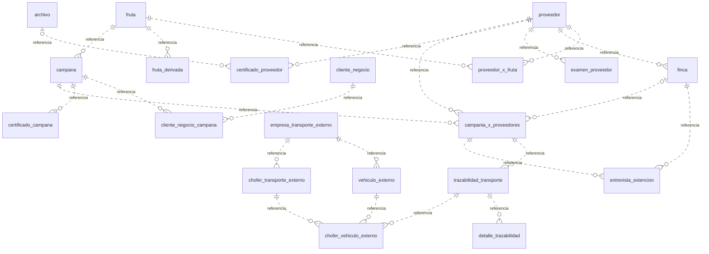
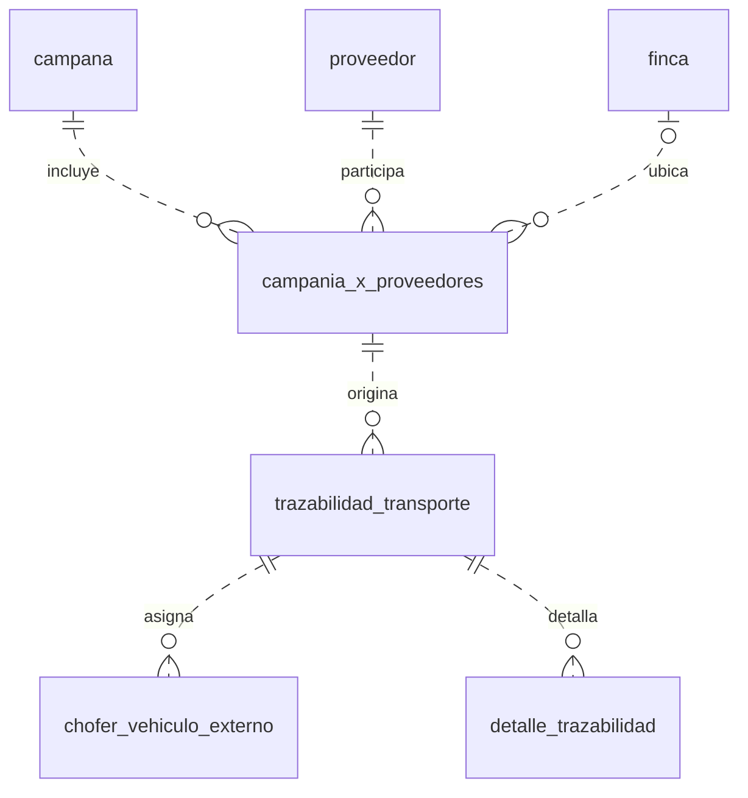
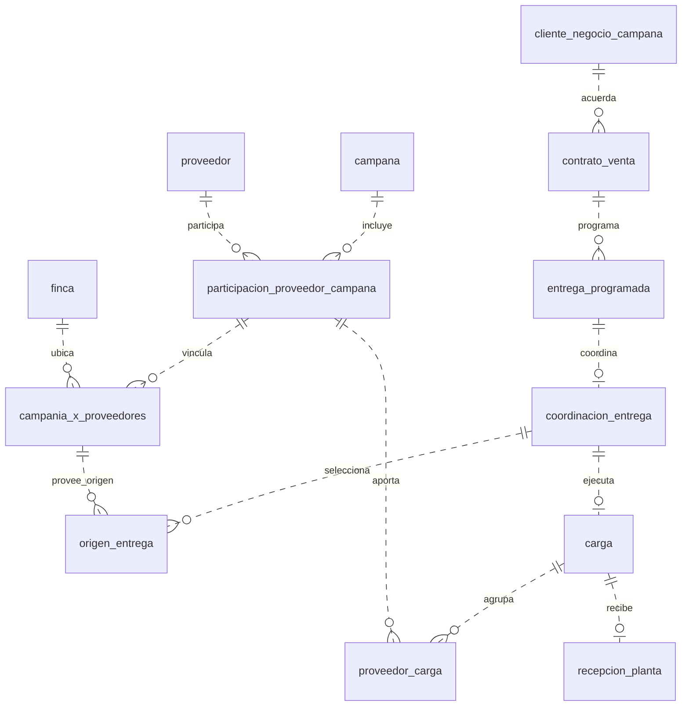

# Auditoría de la base programada frente al esquema planificado

## Estado vigente: schema actualizado por cumplimiento

**27/10/2026.** Se aplican al SQL de revisión los ajustes funcionales FC01–FC13; FC14 sigue diferido por acuerdo. Los [diccionarios por vista](01_reporte_especifico.md), [diagramas](02_tablas_y_relaciones.md) y [SQL total](03_schema_total.sql) se regeneran desde el mismo modelo. El [resumen actual](01_reporte_especifico.md#schema-actualizado-tras-la-auditoría-de-cumplimiento) detalla el contrato JSONB, columnas modificadas y trabajo restante.

Se mantienen 66 tablas (19 actuales ampliadas y 47 propuestas), 137 FK y seis vistas. Se conservan 173 nombres de columnas legacy incluidas, pero 35 definiciones actuales cambian y se agregan 73 columnas a tablas actuales. No se presenta esto como una migración compatible sin backfill/revisión de datos.

**Incorporado:** maestros con texto/decimales y datos pendientes; precio de participación; examen y contrato por etapas; transporte BORRADOR/CONFIRMADO; reservas con hora; flete por entrega; Calidad/cosecha/Industria y logística en JSONB; recepción reconocida por proveedor; identidad histórica de liquidación principal/vinculada; factura con ajustes; varios requerimientos y facturas según respuestas explícitas. La FK que obligaba a liquidar mediante `proveedor_x_persona` se sustituye por persona directa y validación de titular/vínculo. Los diagramas reflejan esa relación y las cardinalidades nuevas.

**Verificación ejecutada:** instalación del SQL en PGlite con btree_gist y **44 comprobaciones correctas**, incluidas altas por etapas, JSON recuperable, reconocidos, principales, múltiples documentos, descuentos, sobrepagos/cobros, adelantos y viajes consecutivos/solapados. Resultado/hash: `.validation/resultado_revision.json`. Se repitió también el inventario estático y el contraste de 10 ajustes con las fuentes del prototipo.

**Límites:** no se cambian entidades/DTO, migraciones TypeORM, web, prototipo ni una base desplegada. Los permisos, validación completa del contenido JSON, emisión documental, sumas restantes y cierre completo deben implementarse en servicios; no se verificó concurrencia de varias conexiones ni UI de extremo a extremo. Las diferencias del prototipo frente a respuestas explícitas pasan a ser trabajo de alineación de aplicación, no un bloqueo para preparar el SQL.

Los apartados siguientes conservan las auditorías anteriores y su estado en ese momento; este apartado y los diccionarios regenerados prevalecen sobre sus afirmaciones anteriores de que el SQL no se había modificado.

## Auditoría anterior: cumplimiento de la aplicación

**27/10/2026.** Nueva pasada solicitada con prioridad explícita en permitir los flujos del prototipo, sin condicionar el avance a calidad arquitectónica, normalización o refactorización. El detalle vigente está en [auditoría funcional, matriz y cambios mínimos FC01–FC14](01_reporte_especifico.md#auditoría-de-cumplimiento-de-la-aplicación). Los apartados históricos siguientes no convierten mejoras de diseño en requisitos.

**Resultado: cumplimiento parcial.** Se aprovechan las tablas y relaciones del recorrido principal, pero el SQL todavía rechaza datos válidos de los formularios (documentos/códigos como texto, hectáreas decimales, transportista privado sin RUC, examen sin resultado y contrato con precio pendiente); no representa fielmente la vinculación de transporte previa al acuerdo, los avances de cosecha y la recepción por proveedor; y no permite la factura con descuentos/cargos que sí calcula el prototipo.

También quedan incompletos los datos de preparación/inspección de Calidad, logística/checklist, contenido completo de guías y documentos de liquidación. Son faltantes de persistencia de funciones existentes, no recomendaciones para ampliar el negocio. Guardar los objetos mediante JSONB en tablas actuales es una alternativa válida si permite recuperarlos y continuar el flujo. No se exige consolidar las tablas duplicadas mientras la aplicación mantenga una correspondencia coherente.

**Lo que ya sirve:** maestros y catálogos de base, relaciones de campaña, contratos/entregas, programación semanal, coordinación y orígenes, carga por proveedor, distribución de guías, pagos/cobros, aplicaciones de adelantos y consultas de saldos. Esto acredita estructura aprovechable, no implementación en el backend ni prueba de toda la aplicación. No se crean tablas para KPI, resúmenes o estados calculables.

**Diferencias de negocio separadas:** varios requerimientos cliente/campaña, kilos reconocidos frente a cargados y varias facturas por viaje conservan los conflictos ya comunicados. No frenan la entrega de esta auditoría ni autorizan nuevos flujos. Archivos continúa diferido; roles extra, multempresa, tarifarios y adelantos a proveedores quedan fuera del alcance.

**Evidencia nueva:** se ejecutó otra vez el verificador estático del inventario (66 tablas, 137 FK, 6 vistas, sin referencias a columnas inexistentes) y `auditar_cumplimiento_app.mjs` (10 contrastes de fuente/SQL y 3 comprobaciones auxiliares de ausencias). `resultado_cumplimiento_app.json` conserva sus fuentes/hash. No se ejecutaron PostgreSQL/PGlite, migraciones o pruebas de navegador. No se modificó SQL ni código funcional; no se afirma estado de una base desplegada. El resultado no es un porcentaje de aplicación terminada.

---

**Revisión adicional:** consulta la validación de negocio al final de este documento y el cuestionario P01–P30 del [reporte específico](01_reporte_especifico.md#validación-de-negocio-y-cuestionario-pendiente).

**Estado posterior a las respuestas del usuario:** el prototipo es la referencia para trasladar funcionalidad a la web. Las [respuestas contrastadas y exclusiones de alcance](01_reporte_especifico.md#respuestas-y-alcance-limitado-al-prototipo) prevalecen sobre las preguntas abiertas de la revisión anterior. Se confirma una agroexportadora, una campaña activa por fruta, un viaje por entrega, coordinación como fuente del viaje, varios viajes diarios por chofer, vinculación de transportista previa al acuerdo y compra/transporte en PEN. La compra solicitada sobre kilos reconocidos contradice el pago actual sobre cargados; varios requerimientos cliente/campaña y varias facturas por carga también contradicen los editores/validadores del prototipo. Se reportan sin modificar SQL, entidades, migraciones ni aplicaciones. Las posibilidades de negocio no cubiertas se excluyen por instrucción del usuario; las validaciones técnicas para implementar los flujos existentes siguen siendo necesarias.

**Modelo documentado actualizado para revisión manual — 27/10/2026:** el [reporte específico](01_reporte_especifico.md), el [modelo general Mermaid](02_tablas_y_relaciones.md) y el [SQL de revisión](03_schema_total.sql) incorporan el retiro de `campania_x_proveedores.finca_id` y la exclusión temporal de `archivo`. Se incluyen **19 tablas actuales y 173 columnas actuales**, con **63 atributos adicionales** y **47 tablas propuestas**: **66 tablas, 137 FK y seis vistas**. Cuatro tablas propuestas de origen/calidad identifican directamente la finca. Las 28 referencias documentales quedan opcionales, sin FK y pendientes de integración. No se modificaron entidades, migraciones ni la base desplegada.

Las referencias de esta auditoría al **plan anterior de 64 tablas**, sus claves genéricas o sus omisiones describen el antecedente auditado. Las **19 comprobaciones** del SQL revisado se documentan al final del reporte específico; las pruebas antiguas se conservan como historial. El inventario de 20 tablas, 184 columnas y 23 FK sigue describiendo el código auditado; el objetivo incorpora las exclusiones aprobadas.

## Revisión de navegación y decisiones (Mockup > Administrador y Chofer > Esquemas por vista)

El 27/10/2026 se recorrieron los ocho módulos del administrador y los flujos de Miguel Torres y Elena Ruiz en el [mockup](https://campaign-management-system-umber.vercel.app/). Se actualizaron los dos documentos existentes con entrada/acciones/salida de cada ficha, relaciones recortadas desde el esquema general y función esperada de cada tabla. El reporte específico distingue Escritura esperada, Consulta, Por discutir y Compatibilidad actual. No se crearon versiones ni documentos adicionales; no se repitió una auditoría del backend desplegado.

**Confirmado por el usuario durante esta revisión:**

- `campania_x_proveedores` se conserva para agrupar las entrevistas de un proveedor por campaña; no se retira esa tabla.
- Las fincas mostradas en esa participación son las entrevistadas mediante `entrevista_extencion`. Los orígenes de entrega/carga seleccionan las fincas físicas donde se recoge fruta, sin restablecer la FK directa finca–participación.
- Una variedad por finca por ahora: `finca.fruta_derivada_id` permite obtener su fruta a través de `fruta_derivada`. No se incorpora una tabla de múltiples cultivos por finca. El vínculo sigue opcional para completar históricos sin inventar datos.
- `analisis_calidad` puede registrarse antes de cosecha. El SQL revisado hace `cosecha_id` opcional; la campaña se obtiene de `cxp_id`, y `finca_id` identifica la muestra. Se probó la inserción de un análisis sin operación de cosecha.

**Propuestas que siguen en discusión, sin añadir o retirar tablas automáticamente:** duplicidad de `participacion_proveedor_campana` frente a la participación actual y sus dependencias; autoridad entre transporte actual y coordinación multiproveedor; vínculo transportista/campaña antes de completar un acuerdo; persistencia de Agregar campaña en Calidad; catálogo de destinos; editor de acuerdos de compra; uno o varios certificados; estrategia de sesiones; filas repetidas de requerimientos cliente/campaña. Las referencias D01–D15 del reporte específico indican el estado y las vistas afectadas.

La tabla de solicitudes de transporte estaba vacía: las respuestas de cotización siguen propuestas y no se afirma haber validado su editor. El formulario del chofer solicita peso de planta; resultado, reporte y cierres administrativos requieren definir acción y responsable fuera de ese modal. Las diferencias de pesos/estados y duplicados del demo se documentan como inconsistencias, sin cambiar reglas del esquema para reproducirlas. Al abrir Preparar guía se mostró un borrador automático y sincronización; no se guardó ni emitió una guía mediante sus formularios.

## Gestión documental pendiente (Decisiones de negocio > Archivos > Relaciones pendientes)

Por decisión del usuario, `archivo` no forma parte del SQL ni de los diagramas del modelo objetivo por ahora. Se retiran sus FK entrantes y salientes. Sus 28 referencias en otras tablas quedan como columnas reservadas opcionales, sin FK; no deben utilizarse hasta definir la relación documental. El inventario está en el reporte específico. Las URL ya existentes se conservan. El backend actual mantiene su entidad de archivo y almacenamiento sin cambios.

Se difieren las comprobaciones que exigían identificadores documentales para comprobantes, MTD, guía de salida, evidencia de descarte o factura. Se conservan las reglas locales de importes, pesos y datos de emisión. Al retomar la gestión documental se decidirán tabla, almacenamiento, relaciones, evidencias obligatorias y migración de referencias existentes.

## Participación sin finca (Decisiones de negocio > Campañas > Proveedores)

La decisión del usuario elimina la selección de finca en la participación de campaña. Se mantienen `proveedor` → `finca`, y `entrevista_extencion` conserva sus vínculos a participación y finca. Los triggers propuestos siguen exigiendo productor y finca del mismo proveedor; ya no comparan contra una finca de la participación. El SQL propone `UNIQUE (campania_id, proveedor_id)` en lugar de los índices parciales por finca/sin finca. Antes de migrar, revisar los registros existentes repetidos por campaña/proveedor y sus cantidades, entrevistas y transportes: no se consolidan automáticamente.

`origen_entrega`, `origen_carga`, `analisis_calidad` y `medicion_mtd` incorporan `finca_id` explícito en el modelo propuesto. Los orígenes distinguen varias fincas del mismo proveedor; el servicio deberá comprobar la pertenencia de la finca al proveedor de la participación. El código de entidades, DTO, servicios y migraciones actuales todavía debe adaptarse en una etapa de implementación.

El mapa general incorpora las entidades amarillas de las imágenes: frutas, variedades, proveedor/fruta, certificados de proveedor, exámenes y certificados de campaña con su cobertura por proveedor. Los rótulos históricos de certificados se explican como equivalencias de función; no se crean duplicados por diferencias de nombre. La anotación pendiente sobre trasladar `proveedor_x_fruta` a finca no se ejecuta como decisión confirmada.

## Qué se incorporó al modelo documentado (Plan > Atributos adicionales > Revisión manual)

| Hallazgo de auditoría | Tratamiento en la documentación y SQL revisados | Qué sigue pendiente |
|---|---|---|
| A02–A03: participación y transporte actual | Se conserva campania_x_proveedores, retirando su finca por decisión del 27/10/2026. Se mantienen las tres tablas actuales de transporte. | Resolver duplicados por campaña/proveedor antes de migrar; revisar la cabecera adicional y la equivalencia con viajes/cargas. |
| A09–A11: unicidades distintas | Se conserva una campaña activa por fruta, un vínculo cliente/campaña y certificados múltiples por campaña. | Revisar estas reglas contra las vistas antes de cambiarlas. |
| A12: datos/reglas omitidos por el plan anterior | Se conservan dimensiones, pesos, SCTR, auditoría y exclusión de chofer. Gestión documental queda pendiente; se adaptan los triggers propuestos de entrevistas a participación sin finca. | Adaptar servicios y retomar relaciones documentales en otra etapa. |
| A15: PK genéricas bigint del plan anterior | Las 19 tablas actuales incluidas conservan sus PK int/SERIAL y nombres reales. Las tablas nuevas usan claves enteras descriptivas y FK compatibles. | Diseñar las migraciones y DTO cuando se decida implementar. |
| A16: año frente a cantidad de aplicaciones | entrevista_extencion conserva anio_aplicacion y codigo FVV; aplicaciones_al_ano es un atributo adicional independiente. | Confirmar qué valores captura cada formulario. |
| A01, A07: datos que requerirían conversión o permitir nulos | No se convierten documentos/teléfonos/hectáreas ni se vuelve opcional el resultado actual del examen. | Revisar datos y contratos antes de esos cambios; agregar estado_examen no habilita por sí solo una muestra sin resultado. |
| A04–A08, A14, A17–A18: flujos nuevos o integración | Se documentan entidades/atributos para contratos, entregas, calidad, recepción y finanzas. Se añade trampa_referencia en el modelo MTD. | Aprobar los flujos contra las vistas; la incorporación manual a Calidad, sus API y el filtro de campaña 1 siguen sin modificar. |

Fecha: **2026-10-25 (America/Lima)**. **Reauditoría solicitada tras actualizar los repositorios.** Alcance: código local de `epe-backend`, sus entidades TypeORM, 9 migraciones y servicios relevantes. Revisión de código: `49feefdaf5b077d64f4c6493392d9f20fa214469`. Se utilizó también el esquema propuesto a partir del prototipo, con nomenclatura actualizada.

**Conclusión:** el backend actual cubre la base de campañas, proveedores, fincas, catálogos, clientes, certificados y un modelo inicial de transporte. No equivale al flujo completo del prototipo. La diferencia no es solo de nombres: cambian granularidad, obligatoriedad, estados, documentos y procesos financieros. La prioridad es reutilizar lo implementado y ampliarlo con migraciones, evitando crear tablas duplicadas para conceptos que ya existen.

**Entregables actualizados:** [reporte específico](01_reporte_especifico.md), [tablas y relaciones Mermaid](02_tablas_y_relaciones.md) y [SQL objetivo](03_schema_total.sql). El reporte compara aquí el **código actual** con el **objetivo**; el DBML original es una referencia histórica distinta.

**Límite de verificación:** no se leyó `.env`, no se inspeccionaron filas de la base del usuario y no se conectó a una instancia desplegada. “Actual” significa programado en estas fuentes y reproducido en una base temporal; no significa que las migraciones estén aplicadas en producción. No se renombró ninguna tabla real, entidad, DTO o endpoint. El SQL entregado sigue siendo una instalación nueva en `agro`, no un script de upgrade sobre las tablas existentes.

## Reauditoría de las actualizaciones (Backend y frontend > Actualizaciones > Comparación)

**Resultado de esta nueva pasada:** se recalcularon los hashes SHA-256 de los 151 archivos TypeScript del backend y se reconstruyeron sus metadatos TypeORM. No se encontraron archivos nuevos, modificados ni eliminados respecto de la auditoría anterior. Los metadatos y las sentencias `up` de las nueve migraciones también coinciden. La rama local `master` y la referencia local `origin/master` apuntan a `49feefd`; no se ejecutó un fetch ni se afirma que esa referencia local refleje cambios todavía no descargados del servidor remoto.

La auditoría anterior **ya había incorporado `entrevista_extencion` y la novena migración** en su comprobación final. Por eso el inventario sigue siendo 20 tablas, 184 columnas y 23 FK, y se mantienen los 17 nombres compartidos con las 64 tablas objetivo. No hay nuevos renombrados de tablas que aplicar en esta pasada.

**Cambio visible en el frontend:** su HEAD es `7589cef` (`feat: nuevo módulo de cosecha y control de calidad`). Se revisaron los modelos y almacenes locales de ese módulo para distinguir funcionalidad visual de persistencia relacional. El catálogo del modal consulta `GET /campanas`; agregar campañas al módulo usa memoria y las acciones Análisis/Carga/Guías muestran avisos de preparación. Esto no añade tablas o endpoints de calidad al backend. Se documentan dos hallazgos adicionales A17–A18 y un contraste detallado de estos datos con el plan más abajo.

**Procedencia de las pruebas:** las 16 comprobaciones PGlite del esquema actual y las 29 del SQL objetivo son evidencia de la pasada anterior sobre las mismas fuentes. En esta pasada no se repitieron instalaciones ni se afirma una nueva ejecución de esas pruebas; se verificó que sus fuentes, sentencias de migración y metadatos no cambiaron. No se modificó código funcional.

## Inventario y método (Backend > Esquema actual > Verificación)

| Elemento | Resultado verificado |
|---|---|
| Entidades de dominio | 20 tablas |
| Columnas, incluidas auditoría y FK | 184 |
| Claves foráneas de las entidades | 23 |
| Migraciones `up` reproducidas | 9 |
| Modelo documentado revisado | 66 tablas, 137 FK y 6 vistas SQL; archivo excluida y retiro de finca_id en participación |
| Tablas actuales incluidas en el modelo revisado | 19; archivo queda pendiente |
| Tablas objetivo sin tabla homónima actual | 47; no es porcentaje de trabajo restante |
| Tablas de transporte conservadas para una transición por revisar | 3; ya incluidas entre las 20 actuales |
| Tablas técnicas de TypeORM | `typeorm_migrations` configurada, excluida del inventario de dominio |

**Fuentes de verdad:** [registro de entidades y migraciones](D:/upeu/proyecto-carrera/app/epe-backend/src/config/typeorm.datasource.ts:66), [configuración de runtime](D:/upeu/proyecto-carrera/app/epe-backend/src/config/database.config.ts:22) y [convención del repositorio](D:/upeu/proyecto-carrera/app/epe-backend/AGENTS.md:5). Se construyeron los metadatos de TypeORM sin inicializar una conexión. Se ejecutaron las 9 migraciones en PGlite (PostgreSQL WASM, con `btree_gist`), y se contrastaron nombres y nulabilidad de sus 184 columnas: no hubo diferencias con las entidades en ese contraste. No se afirma equivalencia exhaustiva de defaults, precisión, nombres de constraints, planes de consulta o configuración del servidor.

El runtime utiliza `autoLoadEntities` y recibe `DB_SYNCHRONIZE` de configuración; su valor por defecto es false. La CLI tiene `synchronize: false` y registra las migraciones. Debe conservarse el uso de migraciones sin habilitar sincronización automática para desplegar este plan. No se verificó el valor efectivo de una instancia.

| Tabla física actual | PK actual | Columnas | Equivalencia con el plan | Fuente |
|---|---|---:|---|---|
| `archivo` | `archivo_id` | 10 | Existe; se conserva este nombre y se evalúan las ampliaciones necesarias. | [archivo](D:/upeu/proyecto-carrera/app/epe-backend/src/archivo/entities/archivo.ts:12) |
| `campana` | `campania_id` | 9 | Existe; se conserva este nombre y se evalúan las ampliaciones necesarias. | [campana](D:/upeu/proyecto-carrera/app/epe-backend/src/campana/entities/campana.ts:24) |
| `campania_x_proveedores` | `cxp_id` | 11 | Existe; se conserva este nombre y se evalúan las ampliaciones necesarias. | [campania_x_proveedores](D:/upeu/proyecto-carrera/app/epe-backend/src/campana-proveedor/entities/campania-proveedor.ts:30) |
| `certificado_campana` | `certificado_id` | 10 | Existe; se conserva este nombre y se evalúan las ampliaciones necesarias. | [certificado_campana](D:/upeu/proyecto-carrera/app/epe-backend/src/certificado-campana/entities/certificado-campana.ts:23) |
| `certificado_proveedor` | `certificado_proveedor_id` | 7 | Existe; se conserva este nombre y se evalúan las ampliaciones necesarias. | [certificado_proveedor](D:/upeu/proyecto-carrera/app/epe-backend/src/certificado-proveedor/entities/certificado-proveedor.ts:16) |
| `chofer_transporte_externo` | `id_chofer_transporte_externo` | 7 | Existe; se conserva este nombre y se evalúan las ampliaciones necesarias. | [chofer_transporte_externo](D:/upeu/proyecto-carrera/app/epe-backend/src/transporte/entities/chofer-transporte-externo.ts:16) |
| `chofer_vehiculo_externo` | `id_chofer_vehiculo_externo` | 8 | Reutilizar datos en coordinación; conservar historial/restricciones de asignación. | [chofer_vehiculo_externo](D:/upeu/proyecto-carrera/app/epe-backend/src/transporte/entities/chofer-vehiculo-externo.ts:19) |
| `cliente_negocio` | `cliente_negocio_id` | 10 | Existe; se conserva este nombre y se evalúan las ampliaciones necesarias. | [cliente_negocio](D:/upeu/proyecto-carrera/app/epe-backend/src/cliente-negocio/entities/cliente-negocio.ts:9) |
| `cliente_negocio_campana` | `cliente_negocio_campana_id` | 10 | Existe; se conserva este nombre y se evalúan las ampliaciones necesarias. | [cliente_negocio_campana](D:/upeu/proyecto-carrera/app/epe-backend/src/cliente-negocio-campana/entities/cliente-negocio-campana.ts:19) |
| `detalle_trazabilidad` | `id_detalle_trazabilidad` | 10 | Separar guía, flete, gastos y SCTR; no registrar pagos por inferencia. | [detalle_trazabilidad](D:/upeu/proyecto-carrera/app/epe-backend/src/transporte/entities/detalle-trazabilidad.ts:16) |
| `empresa_transporte_externo` | `id_empresa_transporte_externo` | 7 | Existe; se conserva este nombre y se evalúan las ampliaciones necesarias. | [empresa_transporte_externo](D:/upeu/proyecto-carrera/app/epe-backend/src/transporte/entities/empresa-transporte-externo.ts:13) |
| `entrevista_extencion` | `entrevista_id` | 11 | Existe; se conserva este nombre y se evalúan las ampliaciones necesarias. | [entrevista_extencion](D:/upeu/proyecto-carrera/app/epe-backend/src/entrevista-extencion/entities/entrevista-extencion.ts:17) |
| `examen_proveedor` | `examen_proveedor_id` | 10 | Existe; se conserva este nombre y se evalúan las ampliaciones necesarias. | [examen_proveedor](D:/upeu/proyecto-carrera/app/epe-backend/src/proveedor/entities/examen-proveedor.ts:19) |
| `finca` | `finca_id` | 12 | Existe; se conserva este nombre y se evalúan las ampliaciones necesarias. | [finca](D:/upeu/proyecto-carrera/app/epe-backend/src/finca/entities/finca.ts:18) |
| `fruta` | `fruta_id` | 4 | Existe; se conserva este nombre y se evalúan las ampliaciones necesarias. | [fruta](D:/upeu/proyecto-carrera/app/epe-backend/src/fruta/entities/fruta.ts:7) |
| `fruta_derivada` | `fruta_derivada_id` | 5 | Existe; se conserva este nombre y se evalúan las ampliaciones necesarias. | [fruta_derivada](D:/upeu/proyecto-carrera/app/epe-backend/src/fruta/entities/fruta-derivada.ts:13) |
| `proveedor` | `proveedor_id` | 19 | Existe; se conserva este nombre y se evalúan las ampliaciones necesarias. | [proveedor](D:/upeu/proyecto-carrera/app/epe-backend/src/proveedor/entities/proveedor.ts:13) |
| `proveedor_x_fruta` | `pxf_id` | 5 | Existe; se conserva este nombre y se evalúan las ampliaciones necesarias. | [proveedor_x_fruta](D:/upeu/proyecto-carrera/app/epe-backend/src/proveedor-fruta/entities/proveedor-fruta.ts:14) |
| `trazabilidad_transporte` | `id_trazabilidad_transporte` | 8 | Descomponer en coordinación, carga, detalles de proveedor, recepción y eventos. | [trazabilidad_transporte](D:/upeu/proyecto-carrera/app/epe-backend/src/transporte/entities/trazabilidad-transporte.ts:26) |
| `vehiculo_externo` | `id_vehiculo_externo` | 11 | Existe; se conserva este nombre y se evalúan las ampliaciones necesarias. | [vehiculo_externo](D:/upeu/proyecto-carrera/app/epe-backend/src/transporte/entities/vehiculo-externo.ts:18) |

**Auditoría transversal existente:** todas las entidades heredan `created_at` y `updated_at` desde [AuditableEntity](D:/upeu/proyecto-carrera/app/epe-backend/src/common/entities/auditable.entity.ts:3). El plan anterior no las incluía de forma uniforme. Deben conservarse al diseñar migraciones; una fecha de subida o emisión no reemplaza la auditoría de cambios.

## Relaciones implementadas (Backend > Esquema actual > Relaciones Mermaid)

Diagrama derivado de las FK reales de las entidades. Las cajas son tablas actuales. `||` = uno; `o|` = cero o uno; `o{` = cero o muchos. No muestra atributos ni confunde relaciones del plan con relaciones implementadas.

## Nombres de las tablas que ya tienes (Backend > Esquema actual > Nombres oficiales)

Estos son los **nombres exactos de tus entidades TypeORM**. Se usan así en esta auditoría y en los reportes cuando se habla de tablas existentes. No se están renombrando tablas de tu base.

| Tabla que ya tienes | Cómo se considera en el plan |
|---|---|
| `archivo` | Conservar y ampliar según lo que necesite la vista. |
| `campana` | Conservar y ampliar según lo que necesite la vista. |
| `campania_x_proveedores` | Conservar y ampliar según lo que necesite la vista. |
| `certificado_campana` | Conservar y ampliar según lo que necesite la vista. |
| `certificado_proveedor` | Conservar y ampliar según lo que necesite la vista. |
| `chofer_transporte_externo` | Conservar y ampliar según lo que necesite la vista. |
| `chofer_vehiculo_externo` | Conservar mientras se define cómo cubrir su información en el flujo completo de transporte. |
| `cliente_negocio` | Conservar y ampliar según lo que necesite la vista. |
| `cliente_negocio_campana` | Conservar y ampliar según lo que necesite la vista. |
| `detalle_trazabilidad` | Conservar mientras se define cómo cubrir su información en el flujo completo de transporte. |
| `empresa_transporte_externo` | Conservar y ampliar según lo que necesite la vista. |
| `entrevista_extencion` | Conservar y ampliar según lo que necesite la vista. |
| `examen_proveedor` | Conservar y ampliar según lo que necesite la vista. |
| `finca` | Conservar y ampliar según lo que necesite la vista. |
| `fruta` | Conservar y ampliar según lo que necesite la vista. |
| `fruta_derivada` | Conservar y ampliar según lo que necesite la vista. |
| `proveedor` | Conservar y ampliar según lo que necesite la vista. |
| `proveedor_x_fruta` | Conservar y ampliar según lo que necesite la vista. |
| `trazabilidad_transporte` | Conservar mientras se define cómo cubrir su información en el flujo completo de transporte. |
| `vehiculo_externo` | Conservar y ampliar según lo que necesite la vista. |

**Tablas propuestas** significa que todavía no aparecen en las entidades revisadas. Por ejemplo, `contrato_venta` y `factura_venta` son propuestas; `cliente_negocio_campana` sí existe. No son nombres alternativos de una misma tabla.

**Tres nombres que también se conservan:** `trazabilidad_transporte`, `chofer_vehiculo_externo` y `detalle_trazabilidad`. Sus datos se reparten de otra forma en el plan; eso requiere diseño y una migración futura, no cambiarles el nombre para que parezcan tablas nuevas.

## Diferencias prioritarias del plan anterior (Plan > Auditoría > Hallazgos)

Prioridad **Alta**: puede perder identidad, trazabilidad, historial o compatibilidad. **Media**: impide completar el flujo o cambia reglas que deben reconciliarse. **Decisión**: diferencia entre reglas válidas que necesita definirse antes de migrar; se documenta sin resolverla arbitrariamente.

| ID | Prioridad | Diferencia comprobada | Efecto y acción requerida |
|---|---|---|
| A01 | Alta | Proveedor mezcla persona y perfil agronómico global; documento/teléfono/código son enteros. | Separar identidad y agronomía por finca/campaña; convertir identificadores a texto, depurar duplicados y preservar equivalencias. |
| A02 | Alta | `campania_x_proveedores` admite varias fincas y fila sin finca, distinto de la cabecera del plan. | Crear cabecera, migrar hijos sin inventar fincas y no sumar oferta repetida sin validar. |
| A03 | Alta | `trazabilidad_transporte` depende de un solo `cxp_id`; una carga objetivo puede incluir muchos proveedores. | Identificar viajes reales y crear coordinación/carga/detalle; no agrupar por similitud de fechas. |
| A04 | Alta | Endpoints llamados contratos devuelven vínculos cliente/campaña. | Crear contratos independientes y entregas 1:N; conservar referencias de los vínculos existentes. |
| A05 | Alta | Campos documentales y financieros están unidos en detalle de trazabilidad y recibos. | Separar documento, obligación y movimiento de dinero; no fabricar pagos/cobros con una URL. |
| A06 | Alta | Varias FK actuales usan CASCADE sobre certificados, cliente/campaña, exámenes y detalles. | Revisar política de bajas al añadir documentos financieros; el objetivo propone RESTRICT y protección del historial. |
| A07 | Media | Exámenes son generales del proveedor y solo aceptan positivo/negativo. | Añadir muestra, campaña/finca y pendiente; no reinterpretar resultados ni asignar campaña por suposición. |
| A08 | Media | MTD actual es un único valor en la participación y no tiene historial/captura. | Añadir medicion_mtd y mantener procedencia de valores anteriores. |
| A09 | Decisión | Una campaña activa por fruta en código; el objetivo permite más de una. | Mantener la regla actual hasta decidir; retirarla requiere migración explícita y revisión del servicio. |
| A10 | Decisión | Cliente/campaña único en código; el plan permite múltiples requerimientos. | Elegir vínculo único con contratos múltiples, o requerimiento identificable múltiple. No retirar el índice por accidente. |
| A11 | Decisión | Certificados de campaña múltiples en código; objetivo/UI de referencia pide uno. | Revisar datos y alcance por norma antes de poner UNIQUE(campania_id). |
| A12 | Alta | El objetivo omite restricciones y datos que ya existen: exclusión de chofer, dimensiones, SCTR, auditoría y estado/bucket de archivo. | Incorporarlos al diseño de migración; el plan anterior no sustituye el backend sin regresiones. |
| A13 | Media | Longitudes, nulabilidad, escala y enums difieren aun en tablas con mismo nombre. | Ejecutar prevalidaciones; no truncar cadenas, rellenar NULL con datos ficticios ni castear enums a ciegas. |
| A14 | Alta | No hay entidades de facturas, cobros, liquidaciones, adelantos ni checklist/cierre completo. | Implementar esos procesos con transacciones y permisos; las reglas del SQL nuevo aún no son parte del backend. |
| A15 | Media | El objetivo cambia toda PK a bigint y un nombre genérico. | Decidir si conservar PK actuales es preferible; revisar contratos API y serialización antes de ampliar rango. |
| A16 | Alta | entrevista_extencion ya existe; su anio_aplicacion es un año y no la cantidad de aplicaciones del plan. | Reutilizar la entidad y conservar códigos FVV; reconciliar semántica de año, frecuencia y distanciamiento. No crear una tabla de entrevistas duplicada. |
| A17 | Decisión | El frontend incorpora campañas manualmente a Calidad y guarda alcances Exportador/Industria en un array local. | Decidir si esa incorporación es un estado propio persistente o una consulta derivada; no duplicar campana ni asumir que el contrato ya representa esta selección. |
| A18 | Alta | El almacén de análisis usa nombres de productor/finca y permite leer todos los registros al consultar campaña 1. | Mantener IDs reales al persistir y corregir el filtro antes de integrar; el problema está en el almacén local, no en una FK de la base actual. |

**Evidencias de servicios:** [consulta denominada contratos](D:/upeu/proyecto-carrera/app/epe-backend/src/cliente-negocio-campana/services/cliente-negocio-campana.service.ts:87); [coherencia finca/proveedor en servicio](D:/upeu/proyecto-carrera/app/epe-backend/src/campana-proveedor/services/campania-proveedor.service.ts:252); [asignación transaccional con bloqueo del chofer](D:/upeu/proyecto-carrera/app/epe-backend/src/transporte/services/chofer-vehiculo-externo.service.ts:100); [una campaña activa por fruta](D:/upeu/proyecto-carrera/app/epe-backend/src/campana/services/campana.service.ts:100).

**Cómo leer las secciones que siguen:** son la explicación de los hallazgos anteriores. En cada tabla verás **qué tienes hoy**, **qué le falta para cubrir las vistas** y **qué haríamos después**. Son recomendaciones; no cambios ya ejecutados. Los campos y restricciones técnicos quedan en bloques desplegables opcionales.

## archivo (Infraestructura > Archivos)

**Tabla ya mapeada:** `archivo`. **Fuente:** [archivo](D:/upeu/proyecto-carrera/app/epe-backend/src/archivo/entities/archivo.ts:12).

**Qué tienes hoy:** Guarda los documentos y su ubicación en almacenamiento. Ya controla si el archivo está pendiente o disponible.

**Qué falta para las vistas:** Que los demás módulos reutilicen este mecanismo cuando adjunten documentos.

**Qué haríamos:** Aprovechar la tabla y el servicio que ya existen. No crear otra tabla de archivos para cada módulo.

Ver campos, restricciones y explicación técnica

Se mantiene el nombre archivo. La propuesta anterior tenía ruta_storage, nombre/tipo_mime/bytes, subido_por y fecha_subida; no modelaba bucket ni ciclo de vida. Conservar bucket + object_key y estados PENDIENTE/DISPONIBLE/ELIMINACION_PENDIENTE/ELIMINADO/ERROR. Extender el uploader existente a los demás módulos, en vez de construir otro almacenamiento paralelo. Una URL no se convierte en FK sin resolver y verificar su objeto.

**Diccionario comprobado de la entidad actual:**

| Columna actual | Tipo en TypeORM | Nulabilidad / clave |
|---|---|---|
| `created_at` | timestamptz | NOT NULL |
| `updated_at` | timestamptz | NOT NULL |
| `archivo_id` | int | PK autogenerada |
| `bucket` | varchar(63) | NOT NULL |
| `object_key` | varchar(1024) | NOT NULL |
| `nombre_original` | varchar(255) | NOT NULL |
| `mime_type` | varchar(100) | NOT NULL |
| `tamano_bytes` | int | NOT NULL |
| `checksum_sha256` | varchar(64) | NULL permitido |
| `estado` | enum: PENDIENTE, DISPONIBLE, ELIMINACION_PENDIENTE, ELIMINADO, ERROR | NOT NULL |

**Restricciones observadas:** UNIQUE `object_key`; CHECK `"tamano_bytes" > 0`.

## campana (Administrador > Gestión de Campaña > Campaña)

**Tabla ya mapeada:** `campana`. **Fuente:** [campana](D:/upeu/proyecto-carrera/app/epe-backend/src/campana/entities/campana.ts:24).

**Qué tienes hoy:** Guarda una campaña, su fruta, fechas y estado.

**Qué falta para las vistas:** Responsable, variedades elegidas, lineamientos y una forma de verificar todos los pendientes antes de cerrarla.

**Qué haríamos:** Ampliar campana. Antes hay que decidir si se mantiene tu regla de una sola campaña activa por fruta.

Ver campos, restricciones y explicación técnica

Mantener campana y agregar esos campos/relaciones por migración. El plan separa requerimiento original y agregados derivados; no sustituir requerimiento_comercial hasta determinar su significado y reconciliar sus valores. Estado actual planificacion/en proceso/terminado difiere de PLANIFICADO/EN_PROCESO/FINALIZADO. La unicidad parcial UQ_campana_fruta_activa permite solo una campaña no terminada por fruta: el SQL objetivo no la conserva y su retirada requiere decisión de negocio.

**Diccionario comprobado de la entidad actual:**

| Columna actual | Tipo en TypeORM | Nulabilidad / clave |
|---|---|---|
| `created_at` | timestamptz | NOT NULL |
| `updated_at` | timestamptz | NOT NULL |
| `campania_id` | int | PK autogenerada |
| `nombre` | varchar | NOT NULL |
| `fecha_inicio` | date | NOT NULL |
| `fecha_fin` | date | NOT NULL |
| `estado` | enum: planificacion, en proceso, terminado | NOT NULL |
| `requerimiento_comercial` | decimal(12,3) | NOT NULL |
| `fruta_id` | int | NOT NULL; FK a `fruta` (`fruta_id`); ON DELETE RESTRICT |

**Restricciones observadas:** UNIQUE `fruta_id` WHERE `"estado" <> 'terminado'`.

## campania_x_proveedores (Administrador > Gestión de Campaña > Campaña > Proveedores)

**Tabla ya mapeada:** `campania_x_proveedores`. **Fuente:** [campania_x_proveedores](D:/upeu/proyecto-carrera/app/epe-backend/src/campana-proveedor/entities/campania-proveedor.ts:30).

**Qué tienes hoy:** Relaciona una campaña con un proveedor y, cuando se conoce, una finca. Un mismo proveedor puede aparecer varias veces con fincas diferentes.

**Qué falta para las vistas:** Distinguir los datos de todo el proveedor en la campaña de los datos de cada finca.

**Qué haríamos:** Conservar este nombre. Si se aprueba separar ambos niveles, agregar una cabecera común y vincular sus fincas. No sumar las cantidades de esas filas sin verificar qué representa cada una.

Ver campos, restricciones y explicación técnica

Se reserva campania_x_proveedores para el nivel de finca del objetivo, que antes se llamaba fincas_campania. La nueva participacion_proveedor_campana agrupa campaña/proveedor, rol, oferta y evaluación. No renombrar esta tabla como si ya fuera esa cabecera. Elegir qué hacer con filas sin finca: conservarlas como cabeceras sin detalle, no inventar una finca. Reconciliar cantidades antes de agregarlas porque no está demostrado que cada cantidad sea aditiva por finca. Guardar una equivalencia cxp_id antiguo → participación nueva/detalle nuevo para migrar trazabilidades y entrevistas. El estado actual sin validar/validado no equivale por sí solo a los estados pendientes de examen/entrevista y aprobado/rechazado del objetivo.

**Diccionario comprobado de la entidad actual:**

| Columna actual | Tipo en TypeORM | Nulabilidad / clave |
|---|---|---|
| `created_at` | timestamptz | NOT NULL |
| `updated_at` | timestamptz | NOT NULL |
| `cxp_id` | int | PK autogenerada |
| `cantidad_proveedor` | decimal(12,3) | NOT NULL |
| `mtd_ceratitis` | decimal(12,3) | NOT NULL |
| `fruta_convencional_estimado` | int | NULL permitido |
| `tipo_proveedor` | enum: acopio, productor | NOT NULL |
| `estado` | enum: sin validar, validado | NOT NULL |
| `campania_id` | int | NOT NULL; FK a `campana` (`campania_id`); ON DELETE RESTRICT |
| `proveedor_id` | int | NOT NULL; FK a `proveedor` (`proveedor_id`); ON DELETE RESTRICT |
| `finca_id` | int | NULL permitido; FK a `finca` (`finca_id`); ON DELETE RESTRICT |

**Restricciones observadas:** UNIQUE `campania_id, proveedor_id` WHERE `"finca_id" IS NULL`; UNIQUE `campania_id, finca_id` WHERE `"finca_id" IS NOT NULL`; CHECK `"tipo_proveedor" = 'productor' OR "fruta_convencional_estimado" IS NULL`.

## certificado_campana (Administrador > Gestión de Campaña > Campaña > Certificaciones)

**Tabla ya mapeada:** `certificado_campana`. **Fuente:** [certificado_campana](D:/upeu/proyecto-carrera/app/epe-backend/src/certificado-campana/entities/certificado-campana.ts:23).

**Qué tienes hoy:** Guarda el certificado, costo, vencimiento y documentos. Permite varios certificados por campaña.

**Qué falta para las vistas:** Productores cubiertos, kilos certificados, ampliaciones y varios pagos con su historial.

**Qué haríamos:** Ampliar la tabla y agregar los registros de ampliaciones y pagos. Primero decidir si una campaña tendrá uno o varios certificados.

Ver campos, restricciones y explicación técnica

Mantener nombre, pero ampliar organismo, norma, emisión, moneda y productores cubiertos. Crear pago_certificado_campana y ampliacion_certificado_campana. La UI de referencia y el plan dicen uno por campaña; el backend admite varios: revisar datos antes de imponer UNIQUE(campania_id). recibo_url no acredita monto, fecha o pago total. No inferir un movimiento financiero por la sola presencia del recibo.

**Diccionario comprobado de la entidad actual:**

| Columna actual | Tipo en TypeORM | Nulabilidad / clave |
|---|---|---|
| `created_at` | timestamptz | NOT NULL |
| `updated_at` | timestamptz | NOT NULL |
| `certificado_id` | int | PK autogenerada |
| `nombre` | varchar(255) | NOT NULL |
| `document_url` | text | NOT NULL |
| `costo` | decimal(12,2) | NOT NULL |
| `recibo_url` | text | NOT NULL |
| `fecha_vencimiento` | date | NOT NULL |
| `estado` | enum: vigente, por vencer, vencida | NOT NULL |
| `campania_id` | int | NOT NULL; FK a `campana` (`campania_id`); ON DELETE CASCADE |

**Restricciones observadas:** sin UNIQUE, CHECK o EXCLUDE adicionales declarados; conserva PK y las FK descritas..

## certificado_proveedor (Administrador > Gestión de Proveedores > Proveedor > Certificados)

**Tabla ya mapeada:** `certificado_proveedor`. **Fuente:** [certificado_proveedor](D:/upeu/proyecto-carrera/app/epe-backend/src/certificado-proveedor/entities/certificado-proveedor.ts:16).

**Qué tienes hoy:** Guarda los certificados propios de un proveedor y puede enlazarlos con archivo.

**Qué falta para las vistas:** Completar los documentos que aún no tengan archivo y mantener clara la diferencia con el certificado de una campaña.

**Qué haríamos:** Conservar certificado_proveedor para certificados propios. La cobertura de productores de un certificado de campaña sería otra relación propuesta.

Ver campos, restricciones y explicación técnica

Conservar certificado_proveedor; este es el equivalente de certificados_propios, no el de la tabla puente del DBML certificacion_proveedor. La cobertura del certificado de campaña se llama certificado_campana_x_proveedor. El objetivo pide archivo obligatorio y permite fecha opcional: revisar esta inversión de nulabilidad. Completar documentos pendientes sin eliminar certificados históricos.

**Diccionario comprobado de la entidad actual:**

| Columna actual | Tipo en TypeORM | Nulabilidad / clave |
|---|---|---|
| `created_at` | timestamptz | NOT NULL |
| `updated_at` | timestamptz | NOT NULL |
| `certificado_proveedor_id` | int | PK autogenerada |
| `fecha_revision_senasa` | date | NOT NULL |
| `nombre` | varchar(255) | NOT NULL |
| `proveedor_id` | int | NOT NULL; FK a `proveedor` (`proveedor_id`); ON DELETE CASCADE |
| `documento_archivo_id` | int | NULL permitido; FK a `archivo` (`archivo_id`); ON DELETE RESTRICT |

**Restricciones observadas:** sin UNIQUE, CHECK o EXCLUDE adicionales declarados; conserva PK y las FK descritas..

## chofer_transporte_externo (Administrador > Gestión de Transporte > Transportista > Choferes)

**Tabla ya mapeada:** `chofer_transporte_externo`. **Fuente:** [chofer_transporte_externo](D:/upeu/proyecto-carrera/app/epe-backend/src/transporte/entities/chofer-transporte-externo.ts:16).

**Qué tienes hoy:** Guarda al conductor, su empresa, nombre, teléfono y correo.

**Qué falta para las vistas:** Documento de identidad, licencia y vínculo con una cuenta si va a ingresar como chofer.

**Qué haríamos:** Completar esa información y relacionarla con la identidad del usuario. No crear una persona distinta por cada viaje.

Ver campos, restricciones y explicación técnica

Conservar nombre y crear identidad compartida en persona y cuenta en usuario cuando corresponda. No partir un nombre completo automáticamente en nombres/apellidos sin validar. Completar documento y licencia como datos pendientes, sin fabricar identificadores. La FK compuesta del objetivo comprueba empresa común; preservar también las validaciones de asignación actuales.

**Diccionario comprobado de la entidad actual:**

| Columna actual | Tipo en TypeORM | Nulabilidad / clave |
|---|---|---|
| `created_at` | timestamptz | NOT NULL |
| `updated_at` | timestamptz | NOT NULL |
| `id_chofer_transporte_externo` | int | PK autogenerada |
| `nombre` | varchar(255) | NOT NULL |
| `telefono` | varchar(20) | NOT NULL |
| `correo` | varchar(320) | NOT NULL |
| `id_empresa_transporte_externo` | int | NOT NULL; FK a `empresa_transporte_externo` (`id_empresa_transporte_externo`); ON DELETE RESTRICT |

**Restricciones observadas:** sin UNIQUE, CHECK o EXCLUDE adicionales declarados; conserva PK y las FK descritas..

## chofer_vehiculo_externo (Administrador > Gestión de Transporte > Asignaciones)

**Tabla ya mapeada:** `chofer_vehiculo_externo`. **Fuente:** [chofer_vehiculo_externo](D:/upeu/proyecto-carrera/app/epe-backend/src/transporte/entities/chofer-vehiculo-externo.ts:19).

**Qué tienes hoy:** Asigna chofer y vehículo a una trazabilidad durante un periodo. Ya impide que el chofer tenga fechas superpuestas.

**Qué falta para las vistas:** Relacionar esa asignación con la entrega comercial que atenderá.

**Qué haríamos:** Reutilizar las asignaciones existentes y conservar la protección contra cruces de fechas. No descartar esta tabla sin haber trasladado también su historial.

Ver campos, restricciones y explicación técnica

No hay equivalencia 1:1. Su información alimenta coordinacion_entrega; primero hace falta identificar una entrega y su acuerdo. El objetivo anterior no conserva una tabla de historial de reasignaciones ni la exclusión de solapamientos. Preservar esa protección y decidir si las asignaciones históricas seguirán en esta tabla o en una tabla hija nueva. No asumir que llegada significa CIERRE del nuevo checklist.

**Diccionario comprobado de la entidad actual:**

| Columna actual | Tipo en TypeORM | Nulabilidad / clave |
|---|---|---|
| `created_at` | timestamptz | NOT NULL |
| `updated_at` | timestamptz | NOT NULL |
| `id_chofer_vehiculo_externo` | int | PK autogenerada |
| `fecha_asignacion_inicio` | date | NOT NULL |
| `fecha_asignacion_final` | date | NOT NULL |
| `id_vehiculo_externo` | int | NOT NULL; FK a `vehiculo_externo` (`id_vehiculo_externo`); ON DELETE RESTRICT |
| `id_chofer_transporte_externo` | int | NOT NULL; FK a `chofer_transporte_externo` (`id_chofer_transporte_externo`); ON DELETE RESTRICT |
| `id_trazabilidad_transporte` | int | NOT NULL; FK a `trazabilidad_transporte` (`id_trazabilidad_transporte`); ON DELETE CASCADE |

**Restricciones observadas:** CHECK `"fecha_asignacion_final" >= "fecha_asignacion_inicio"`; EXCLUDE `"id_chofer_transporte_externo" WITH =, daterange("fecha_asignacion_inicio", "fecha_asignacion_final", '[]') WITH &&`.

## cliente_negocio (Administrador > Gestión Comercial > Clientes)

**Tabla ya mapeada:** `cliente_negocio`. **Fuente:** [cliente_negocio](D:/upeu/proyecto-carrera/app/epe-backend/src/cliente-negocio/entities/cliente-negocio.ts:9).

**Qué tienes hoy:** Guarda al cliente, contacto, RUC, correo, ubicación y tipo.

**Qué falta para las vistas:** Pocos cambios de identidad; principalmente conectarlo con los contratos y entregas del flujo completo.

**Qué haríamos:** Conservar cliente_negocio y revisar sus reglas de correo único y longitud de datos antes de cambiarlas.

Ver campos, restricciones y explicación técnica

Es la misma identidad que clientes del plan; conservar cliente_negocio y sus identificadores de origen. La propuesta anterior reducía longitudes y omitía la unicidad de correo. Antes de migrar, comprobar longitudes y decidir mantener unicidad de correo sin romper clientes que comparten una dirección corporativa.

**Diccionario comprobado de la entidad actual:**

| Columna actual | Tipo en TypeORM | Nulabilidad / clave |
|---|---|---|
| `created_at` | timestamptz | NOT NULL |
| `updated_at` | timestamptz | NOT NULL |
| `cliente_negocio_id` | int | PK autogenerada |
| `nombre_empresa` | varchar(255) | NOT NULL |
| `nombre_contacto` | varchar(255) | NOT NULL |
| `telefono` | varchar(20) | NOT NULL |
| `ruc` | varchar(11) | NOT NULL |
| `correo_corporativo` | varchar(320) | NOT NULL |
| `ubicacion` | text | NOT NULL |
| `tipo_cliente` | enum: exportador, industria | NOT NULL |

**Restricciones observadas:** UNIQUE `ruc`; UNIQUE `correo_corporativo`.

## cliente_negocio_campana (Administrador > Gestión Comercial > Campaña > Cliente > Contratos)

**Tabla ya mapeada:** `cliente_negocio_campana`. **Fuente:** [cliente_negocio_campana](D:/upeu/proyecto-carrera/app/epe-backend/src/cliente-negocio-campana/entities/cliente-negocio-campana.ts:19).

**Qué tienes hoy:** Relaciona al cliente con una campaña y guarda cantidades y documentos. Solo permite un vínculo por cliente y campaña.

**Qué falta para las vistas:** Que ese mismo vínculo tenga varios contratos y que cada contrato tenga varias entregas.

**Qué haríamos:** Conservar cliente_negocio_campana y agregar contrato_venta como tabla hija propuesta. Tener dos contratos del mismo cliente no debería obligar a duplicar al cliente.

Ver campos, restricciones y explicación técnica

Conservar cliente_negocio_campana como vínculo/requerimiento comercial (antes requerimientos_comerciales). Crear contrato_venta 1:N, y después entrega_programada. Reubicar documento_url y kilos_acordados en el contrato cuando sean datos contractuales; cantidad_kg y ficha técnica siguen en la necesidad original. El plan permite varios requerimientos por cliente/campaña y no conserva la unicidad actual: decidir si se mantiene un vínculo único o se agrega identidad explícita de requerimiento. No crear un contrato vigente a partir de un documento vacío o ambiguo.

**Diccionario comprobado de la entidad actual:**

| Columna actual | Tipo en TypeORM | Nulabilidad / clave |
|---|---|---|
| `created_at` | timestamptz | NOT NULL |
| `updated_at` | timestamptz | NOT NULL |
| `cliente_negocio_campana_id` | int | PK autogenerada |
| `documento_url` | text | NOT NULL |
| `fecha_registro` | date | NOT NULL |
| `ficha_tecnica_url` | text | NOT NULL |
| `cantidad_kg` | decimal(14,3) | NOT NULL |
| `kilos_acordados` | decimal(14,3) | NOT NULL |
| `cliente_negocio_id` | int | NOT NULL; FK a `cliente_negocio` (`cliente_negocio_id`); ON DELETE CASCADE |
| `campania_id` | int | NOT NULL; FK a `campana` (`campania_id`); ON DELETE CASCADE |

**Restricciones observadas:** UNIQUE `cliente_negocio_id, campania_id`.

## detalle_trazabilidad (Administrador > Gestión de Transporte > Trazabilidad > Detalle)

**Tabla ya mapeada:** `detalle_trazabilidad`. **Fuente:** [detalle_trazabilidad](D:/upeu/proyecto-carrera/app/epe-backend/src/transporte/entities/detalle-trazabilidad.ts:16).

**Qué tienes hoy:** Guarda guía, flete, SCTR y gastos de transporte.

**Qué falta para las vistas:** Distinguir el documento de traslado, el monto que debes pagar y el pago que realmente hiciste.

**Qué haríamos:** Conservar sus datos y separarlos según su finalidad cuando se implemente el flujo nuevo. Un flete de S/ 800 registrado todavía no significa que esos S/ 800 se pagaron.

Ver campos, restricciones y explicación técnica

No es solo gasto_transporte. Separar documento de guía, liquidacion_transporte y gastos por concepto, conservando SCTR. El objetivo anterior no guardaba SCTR y limita una liquidación por carga; agrupar detalles solo después de identificar si representan viajes, versiones o gastos distintos. Un flete registrado no implica que exista pago. Una guía URL tampoco equivale a guía de remisión con campos estructurados.

**Diccionario comprobado de la entidad actual:**

| Columna actual | Tipo en TypeORM | Nulabilidad / clave |
|---|---|---|
| `created_at` | timestamptz | NOT NULL |
| `updated_at` | timestamptz | NOT NULL |
| `id_detalle_trazabilidad` | int | PK autogenerada |
| `guia_url` | text | NOT NULL |
| `flete` | decimal(12,2) | NOT NULL |
| `sctr` | varchar(255) | NOT NULL |
| `estibas` | decimal(12,2) | NOT NULL |
| `pasajes` | decimal(12,2) | NOT NULL |
| `comida` | decimal(12,2) | NOT NULL |
| `id_trazabilidad_transporte` | int | NOT NULL; FK a `trazabilidad_transporte` (`id_trazabilidad_transporte`); ON DELETE CASCADE |

**Restricciones observadas:** CHECK `"flete" >= 0 AND "estibas" >= 0 AND "pasajes" >= 0 AND "comida" >= 0`.

## empresa_transporte_externo (Administrador > Gestión de Transporte > Transportistas)

**Tabla ya mapeada:** `empresa_transporte_externo`. **Fuente:** [empresa_transporte_externo](D:/upeu/proyecto-carrera/app/epe-backend/src/transporte/entities/empresa-transporte-externo.ts:13).

**Qué tienes hoy:** Guarda a la empresa transportista y su contacto.

**Qué falta para las vistas:** Diferenciar empresa e independiente y registrar la información adicional del transporte.

**Qué haríamos:** Mantener el nombre y ampliar los datos. Los registros actuales no se eliminan ni se clasifican solo por cómo se llama el transportista.

Ver campos, restricciones y explicación técnica

Conservar nombre. Agregar tipo/documento genérico y persona_id para independientes, además de ubicación/MTC si el flujo los necesita. El objetivo sustituye ruc por tipo_documento/numero_documento; planificar backfill de RUC existentes y conservar su unicidad para empresas. No clasificar personas jurídicas o independientes solo por el texto del nombre.

**Diccionario comprobado de la entidad actual:**

| Columna actual | Tipo en TypeORM | Nulabilidad / clave |
|---|---|---|
| `created_at` | timestamptz | NOT NULL |
| `updated_at` | timestamptz | NOT NULL |
| `id_empresa_transporte_externo` | int | PK autogenerada |
| `nombre_completo` | varchar(255) | NOT NULL |
| `ruc` | varchar(11) | NOT NULL |
| `correo` | varchar(320) | NOT NULL |
| `numero` | varchar(20) | NOT NULL |

**Restricciones observadas:** UNIQUE `correo`; UNIQUE `ruc`.

## entrevista_extencion (Administrador > Gestión de Campaña > Proveedor > Entrevistas)

**Tabla ya mapeada:** `entrevista_extencion`. **Fuente:** [entrevista_extencion](D:/upeu/proyecto-carrera/app/epe-backend/src/entrevista-extencion/entities/entrevista-extencion.ts:17).

**Qué tienes hoy:** Ya guarda entrevistas de productores por finca, con datos agronómicos y un código único generado por el backend.

**Qué falta para las vistas:** Alinear el significado de sus datos con el formulario de referencia.

**Qué haríamos:** Reutilizar entrevista_extencion. Por ejemplo, anio_aplicacion indica un año como 2026; no equivale a decir que hubo cuatro aplicaciones durante el año. Son datos distintos.

Ver campos, restricciones y explicación técnica

Conservar el nombre físico exacto entrevista_extencion, incluida su escritura actual, en lugar de crear entrevista_finca_campana paralela. El plan usa codigo_fyv, fecha explícita de registro, densidad_plantacion, distanciamiento_m textual, frecuencia_riego textual y aplicaciones_anio. anio_aplicacion es año calendario y no número de aplicaciones al año: no convertir 2026 en 2026 aplicaciones. Un valor escalar de distanciamiento no equivale automáticamente a una separación 5 x 4. El código FVV actual y FYV del prototipo difieren; preservar los códigos históricos y definir la nueva convención antes de migrar. Si se conserva la separación cabecera/fincas, reubicar sus FK con equivalencia de IDs; el vínculo actual permite una asignación sin finca que tenga entrevistas a distintas fincas del proveedor.

**Diccionario comprobado de la entidad actual:**

| Columna actual | Tipo en TypeORM | Nulabilidad / clave |
|---|---|---|
| `created_at` | timestamptz | NOT NULL |
| `updated_at` | timestamptz | NOT NULL |
| `entrevista_id` | int | PK autogenerada |
| `densidad` | decimal(12,3) | NOT NULL |
| `distanciamiento` | decimal(12,3) | NOT NULL |
| `frecuencia` | decimal(12,3) | NOT NULL |
| `nombre_aplicacion` | varchar(255) | NOT NULL |
| `anio_aplicacion` | int | NOT NULL |
| `codigo` | varchar(255) | NOT NULL |
| `cam_x_prov_id` | int | NOT NULL; FK a `campania_x_proveedores` (`cxp_id`); ON DELETE RESTRICT |
| `finca_id` | int | NOT NULL; FK a `finca` (`finca_id`); ON DELETE RESTRICT |

**Restricciones observadas:** UNIQUE `codigo`; CHECK `"densidad" >= 0 AND "distanciamiento" >= 0 AND "frecuencia" >= 0 AND "anio_aplicacion" BETWEEN 1900 AND 9999`; CHECK `"codigo" ~ '^FVV-[A-Z0-9-]+-[0-9]+$'`.

## examen_proveedor (Administrador > Gestión de Campaña > Proveedor > Exámenes)

**Tabla ya mapeada:** `examen_proveedor`. **Fuente:** [examen_proveedor](D:/upeu/proyecto-carrera/app/epe-backend/src/proveedor/entities/examen-proveedor.ts:19).

**Qué tienes hoy:** Guarda exámenes generales de un proveedor, con resultado positivo o negativo.

**Qué falta para las vistas:** Identificar la campaña/finca o muestra y permitir que el examen esté pendiente de resultado.

**Qué haríamos:** Ampliar examen_proveedor. No asignar los exámenes antiguos a una campaña que no esté confirmada.

Ver campos, restricciones y explicación técnica

Conservar nombre, pero ampliar alcance con participación y finca opcional, código de muestra, fecha de envío, pendiente de resultado y archivo. No asignar retrospectivamente todos los exámenes a una campaña arbitraria; mantener registros generales o una cola de revisión. positivo/negativo no se mapea automáticamente a aprobado/rechazado: depende del tipo de análisis.

**Diccionario comprobado de la entidad actual:**

| Columna actual | Tipo en TypeORM | Nulabilidad / clave |
|---|---|---|
| `created_at` | timestamptz | NOT NULL |
| `updated_at` | timestamptz | NOT NULL |
| `examen_proveedor_id` | int | PK autogenerada |
| `fecha` | date | NOT NULL |
| `tipo_examen` | varchar(150) | NOT NULL |
| `resultado` | enum: positivo, negativo | NOT NULL |
| `origen` | varchar(255) | NOT NULL |
| `observacion` | text | NOT NULL |
| `documento_url` | text | NOT NULL |
| `proveedor_id` | int | NOT NULL; FK a `proveedor` (`proveedor_id`); ON DELETE CASCADE |

**Restricciones observadas:** sin UNIQUE, CHECK o EXCLUDE adicionales declarados; conserva PK y las FK descritas..

## finca (Administrador > Gestión de Proveedores > Proveedor > Fincas)

**Tabla ya mapeada:** `finca`. **Fuente:** [finca](D:/upeu/proyecto-carrera/app/epe-backend/src/finca/entities/finca.ts:18).

**Qué tienes hoy:** Guarda la finca de un proveedor, su ubicación, coordenadas y hectáreas.

**Qué falta para las vistas:** Códigos y datos adicionales que piden las vistas, además de soportar hectáreas con decimales.

**Qué haríamos:** Conservar finca como padrón físico. Los cambios agronómicos de una campaña se registran en la entrevista, sin reescribir la historia de las campañas anteriores.

Ver campos, restricciones y explicación técnica

Conservar finca. El objetivo usa hectáreas decimales, códigos SENASA/catastro/establecimiento, ubigeo, dirección, variedad y edad, además de coordenadas opcionales. Permitir decimales es ampliación de precisión, pero el objetivo exige hectáreas totales > 0 donde hoy se acepta cero. Separar padrón físico de entrevista_extencion; no copiar un perfil agronómico global como si fuera medición histórica de cada finca.

**Diccionario comprobado de la entidad actual:**

| Columna actual | Tipo en TypeORM | Nulabilidad / clave |
|---|---|---|
| `created_at` | timestamptz | NOT NULL |
| `updated_at` | timestamptz | NOT NULL |
| `finca_id` | int | PK autogenerada |
| `nombre_finca` | varchar(255) | NOT NULL |
| `departamento` | varchar(100) | NOT NULL |
| `provincia` | varchar(100) | NOT NULL |
| `distrito` | varchar(100) | NOT NULL |
| `latitud` | decimal(10,7) | NOT NULL |
| `longitud` | decimal(10,7) | NOT NULL |
| `ha_total_finca` | int | NOT NULL |
| `ha_cultivo` | int | NOT NULL |
| `proveedor_id` | int | NOT NULL; FK a `proveedor` (`proveedor_id`); ON DELETE RESTRICT |

**Restricciones observadas:** CHECK `"ha_total_finca" >= 0 AND "ha_cultivo" >= 0 AND "ha_cultivo" <= "ha_total_finca"`.

## fruta (Administrador > Gestión de Campaña > Catálogos > Frutas)

**Tabla ya mapeada:** `fruta`. **Fuente:** [fruta](D:/upeu/proyecto-carrera/app/epe-backend/src/fruta/entities/fruta.ts:7).

**Qué tienes hoy:** Es el catálogo de frutas.

**Qué falta para las vistas:** Revisar nombres repetidos antes de aplicar la unicidad que propone el plan.

**Qué haríamos:** Conservar fruta y sus identificadores. No crear otro catálogo llamado frutas.

Ver campos, restricciones y explicación técnica

Conservar fruta y mapear name → nombre si se adopta el diccionario del objetivo. El plan agrega unicidad y reduce longitud 150 → 80: detectar duplicados, mayúsculas/espacios y textos largos antes de aplicarlo. No deduplicar IDs sin actualizar las FK y los consumidores.

**Diccionario comprobado de la entidad actual:**

| Columna actual | Tipo en TypeORM | Nulabilidad / clave |
|---|---|---|
| `created_at` | timestamptz | NOT NULL |
| `updated_at` | timestamptz | NOT NULL |
| `fruta_id` | int | PK autogenerada |
| `name` | varchar(150) | NOT NULL |

**Restricciones observadas:** sin UNIQUE, CHECK o EXCLUDE adicionales declarados; conserva PK y las FK descritas..

## fruta_derivada (Administrador > Gestión de Campaña > Catálogos > Variedades)

**Tabla ya mapeada:** `fruta_derivada`. **Fuente:** [fruta_derivada](D:/upeu/proyecto-carrera/app/epe-backend/src/fruta/entities/fruta-derivada.ts:13).

**Qué tienes hoy:** Representa las variedades de una fruta.

**Qué falta para las vistas:** Relacionar las variedades que seleccionas para proveedores, campañas y entregas.

**Qué haríamos:** Usar fruta_derivada como nombre de esa tabla. No crear otra tabla variedades para el mismo catálogo.

Ver campos, restricciones y explicación técnica

Conservar fruta_derivada como nombre físico para el concepto de variedad del plan. Agregar selección de campaña/proveedor y controles de fruta compatible. La compatibilidad de nombre no significa que variedad_id del objetivo sea ya la PK del backend: se requiere una correspondencia explícita de columnas.

**Diccionario comprobado de la entidad actual:**

| Columna actual | Tipo en TypeORM | Nulabilidad / clave |
|---|---|---|
| `created_at` | timestamptz | NOT NULL |
| `updated_at` | timestamptz | NOT NULL |
| `fruta_derivada_id` | int | PK autogenerada |
| `name` | varchar(150) | NOT NULL |
| `fruta_id` | int | NOT NULL; FK a `fruta` (`fruta_id`); ON DELETE RESTRICT |

**Restricciones observadas:** sin UNIQUE, CHECK o EXCLUDE adicionales declarados; conserva PK y las FK descritas..

## proveedor (Administrador > Gestión de Proveedores > Proveedor)

**Tabla ya mapeada:** `proveedor`. **Fuente:** [proveedor](D:/upeu/proyecto-carrera/app/epe-backend/src/proveedor/entities/proveedor.ts:13).

**Qué tienes hoy:** Guarda identidad, contacto, sanidad y un perfil agronómico general del proveedor.

**Qué falta para las vistas:** Compartir la identidad con otros roles cuando corresponda y conservar los datos agronómicos por finca y campaña.

**Qué haríamos:** Conservar proveedor. Revisar documentos repetidos y pasar documentos/teléfonos a texto si se necesitan ceros iniciales o letras. No eliminar el perfil actual antes de reconciliar sus datos con las entrevistas.

Ver campos, restricciones y explicación técnica

Conservar proveedor como identidad comercial, extraer persona sin duplicar al mismo individuo y mantener una tabla de equivalencias. Convertir documento/teléfono/códigos a texto para soportar ceros iniciales, prefijos y letras. Agregar unicidad documental en persona tras depurar duplicados; el SQL actual acepta proveedores con documento/email repetidos. Crear proveedor_x_persona y reutilizar entrevista_extencion para la agronomía histórica, reconciliando sus campos con el perfil global. No eliminar los campos globales antes de verificar el traslado y sus consumidores.

**Diccionario comprobado de la entidad actual:**

| Columna actual | Tipo en TypeORM | Nulabilidad / clave |
|---|---|---|
| `created_at` | timestamptz | NOT NULL |
| `updated_at` | timestamptz | NOT NULL |
| `proveedor_id` | int | PK autogenerada |
| `nombres` | varchar(150) | NOT NULL |
| `apellido` | varchar(150) | NOT NULL |
| `tipo_documento` | enum: DNI, Pasaporte, Carnet de extranjeria | NOT NULL |
| `nmr_documento` | int | NOT NULL |
| `identidad_doc_url` | text | NOT NULL |
| `zona` | text | NOT NULL |
| `telefono` | int | NOT NULL |
| `email` | varchar(320) | NOT NULL |
| `codigo_lugar_produccion` | int | NOT NULL |
| `nombre_agronomico` | varchar(255) | NULL permitido |
| `densidad_plantacion` | decimal(12,3) | NULL permitido |
| `distanciamiento` | decimal(12,3) | NULL permitido |
| `frecuencia_riego` | int | NULL permitido |
| `nombre_aplicacion` | varchar(255) | NULL permitido |
| `aplicaciones_al_ano` | int | NULL permitido |
| `estado_examen_sanidad_agraria` | varchar(100) | NULL permitido |

**Restricciones observadas:** sin UNIQUE, CHECK o EXCLUDE adicionales declarados; conserva PK y las FK descritas..

## proveedor_x_fruta (Administrador > Gestión de Proveedores > Proveedor > Frutas)

**Tabla ya mapeada:** `proveedor_x_fruta`. **Fuente:** [proveedor_x_fruta](D:/upeu/proyecto-carrera/app/epe-backend/src/proveedor-fruta/entities/proveedor-fruta.ts:14).

**Qué tienes hoy:** Indica qué frutas tiene asociadas cada proveedor y evita repetir la misma relación.

**Qué falta para las vistas:** La selección de variedades cuando la vista la necesite.

**Qué haríamos:** Conservar proveedor_x_fruta. Agregar la asociación con fruta_derivada solo para cubrir esa selección adicional.

Ver campos, restricciones y explicación técnica

Conservar nombre y relación. El objetivo cambia las bajas a RESTRICT y añade vínculo a variedades en proveedor_x_fruta_derivada. Mantener la unicidad existente. La eliminación de asociaciones del catálogo no debe borrar compras, guías o documentos financieros.

**Diccionario comprobado de la entidad actual:**

| Columna actual | Tipo en TypeORM | Nulabilidad / clave |
|---|---|---|
| `created_at` | timestamptz | NOT NULL |
| `updated_at` | timestamptz | NOT NULL |
| `pxf_id` | int | PK autogenerada |
| `proveedor_id` | int | NOT NULL; FK a `proveedor` (`proveedor_id`); ON DELETE CASCADE |
| `fruta_id` | int | NOT NULL; FK a `fruta` (`fruta_id`); ON DELETE CASCADE |

**Restricciones observadas:** UNIQUE `proveedor_id, fruta_id`.

## trazabilidad_transporte (Administrador > Gestión de Transporte > Trazabilidad)

**Tabla ya mapeada:** `trazabilidad_transporte`. **Fuente:** [trazabilidad_transporte](D:/upeu/proyecto-carrera/app/epe-backend/src/transporte/entities/trazabilidad-transporte.ts:26).

**Qué tienes hoy:** Guarda transporte y pesos vinculados a una relación de campaña/proveedor. Una fila parte de un solo proveedor.

**Qué falta para las vistas:** Representar un mismo viaje que recoge fruta de varios proveedores y termina en una entrega a un cliente.

**Qué haríamos:** Conservar los datos actuales y definir cómo identificar el viaje común. No cambiar simplemente el nombre a carga: antes hay que resolver cómo reunir varios proveedores sin duplicar kilos.

Ver campos, restricciones y explicación técnica

Descomponer entre coordinacion_entrega, carga, proveedor_carga, recepcion_planta e historial_chofer, vinculando al contrato/cliente correcto. No renombrarla directamente como carga: su grano es una relación de proveedor/campaña/finca, mientras que una carga del prototipo reúne proveedores. No agrupar registros solo por fecha/placa/chofer; se necesita una clave de viaje aprobada. kg_planta puede ser un dato histórico de recepción, pero no prueba resultado, reporte, descarte o cierre.

**Diccionario comprobado de la entidad actual:**

| Columna actual | Tipo en TypeORM | Nulabilidad / clave |
|---|---|---|
| `created_at` | timestamptz | NOT NULL |
| `updated_at` | timestamptz | NOT NULL |
| `id_trazabilidad_transporte` | int | PK autogenerada |
| `contrato_url` | text | NOT NULL |
| `kg_comprados` | decimal(14,3) | NOT NULL |
| `kg_planta` | decimal(14,3) | NOT NULL |
| `estado` | enum: planificado, en recojo, despachado, llegada | NOT NULL |
| `cxp_id` | int | NOT NULL; FK a `campania_x_proveedores` (`cxp_id`); ON DELETE RESTRICT |

**Restricciones observadas:** CHECK `"kg_comprados" >= 0 AND "kg_planta" >= 0`.

## vehiculo_externo (Administrador > Gestión de Transporte > Transportista > Vehículos)

**Tabla ya mapeada:** `vehiculo_externo`. **Fuente:** [vehiculo_externo](D:/upeu/proyecto-carrera/app/epe-backend/src/transporte/entities/vehiculo-externo.ts:18).

**Qué tienes hoy:** Guarda placa, dimensiones, volumen y pesos del vehículo.

**Qué falta para las vistas:** Aclarar qué significa peso neto y si hace falta registrar aparte la capacidad útil.

**Qué haríamos:** Conservar vehiculo_externo y sus dimensiones. No reemplazar el peso neto por capacidad sin verificar que significan lo mismo.

Ver campos, restricciones y explicación técnica

Conservar nombre. El plan anterior guardaba volumen_m3, capacidad_kg y peso_bruto_kg, omitiendo dimensiones. No convertir peso_neto en capacidad sin definir si es tara, carga útil u otro dato. Conservar dimensiones y pesos originales; añadir capacidad_kg como dato independiente cuando se confirme. Las conversiones de t/kg se deben documentar y comprobar.

**Diccionario comprobado de la entidad actual:**

| Columna actual | Tipo en TypeORM | Nulabilidad / clave |
|---|---|---|
| `created_at` | timestamptz | NOT NULL |
| `updated_at` | timestamptz | NOT NULL |
| `id_vehiculo_externo` | int | PK autogenerada |
| `placa` | varchar(15) | NOT NULL |
| `volumen` | decimal(12,3) | NOT NULL |
| `ancho` | decimal(10,3) | NOT NULL |
| `altura` | decimal(10,3) | NOT NULL |
| `profundidad` | decimal(10,3) | NOT NULL |
| `peso_neto` | decimal(14,3) | NOT NULL |
| `peso_bruto` | decimal(14,3) | NOT NULL |
| `id_empresa_transporte_externo` | int | NOT NULL; FK a `empresa_transporte_externo` (`id_empresa_transporte_externo`); ON DELETE RESTRICT |

**Restricciones observadas:** UNIQUE `placa`; CHECK `"peso_neto" >= 0 AND "peso_bruto" >= "peso_neto"`; CHECK `"volumen" > 0 AND "ancho" > 0 AND "altura" > 0 AND "profundidad" > 0`.

## Cómo cambiarían las relaciones (Plan > Proveedores y transporte > Ejemplo)

Esta sección responde a **cómo conectaríamos lo que ya tienes para atender una vista más completa**. Hoy una trazabilidad parte de un proveedor; el objetivo permite que un viaje reúna varios. Los diagramas comparan esas dos formas. Las tablas nuevas del diagrama objetivo siguen siendo propuestas.

**Actual: participación de finca como origen único de trazabilidad.**

**Objetivo: cabecera de participación, varias fincas y carga multiproveedor.**

## Qué significa la actualización de Calidad (Administrador > Cosecha y Control de Calidad > Persistencia)

**La pantalla avanzó, pero esos registros todavía no se guardan en tu base.** Selecciona campañas del backend, pero incorpora campañas a Calidad y conserva análisis en memoria del navegador. Por eso una recarga puede perderlos.

Antes de conectarlo hay que definir qué datos se guardan y a qué campaña, proveedor y finca pertenecen. También se detectó un filtro que, para campaña 1, incluye registros de otras campañas; debe revisarse antes de usar ese almacén con datos reales.

Ver contraste de Calidad y evidencias del código

Esta sección contrasta el código local nuevo con el esquema objetivo y conserva la separación respecto del recorrido previo del prototipo publicado. No se vuelve a presentar como implementación local completa cada vista que existía en aquel prototipo.

| Dato o acción del frontend actual | Estado observado en código | Diferencia frente al plan y acción de diseño |
|---|---|---|
| Listado e incorporación de campañas | QualityPage consume quality.store.ts; el modal lee GET /campanas y agrega una fila en memoria. | campana ya existe; falta decidir cómo conservar la incorporación al módulo. No crear otro padrón de campañas. |
| Alcances Exportador/Industria | QualityCampaign.scope es un array; puede incorporar la misma campaña a ambos. | El plan usa canal de contrato/operación; eso no prueba que represente una incorporación manual independiente al módulo. Resolver antes de crear asociación nueva o derivarlo. |
| Identidad de la campaña incorporada | quality.store.ts identifica coincidencia por campaniaId o por nombre. | El nombre no debe sustituir al ID al persistir, porque dos campañas distintas podrían compartirlo. |
| Muestreos y resultados | QualityAnalysisRecord contiene campaña, productorNombre, fincaNombre, fecha, tipo, resultado/unidad, estado y observaciones. | analisis_calidad y medicion_mtd siguen siendo propuestas. Resolver finca y productor mediante IDs; no guardar solo el nombre como relación. |
| MTD y trampa | mtd numérico y mtdTrampa opcional en el modelo local. | El plan conserva valor/fecha/límite/evidencia en medicion_mtd, pero no representa explícitamente mtdTrampa. Definir si es referencia textual o entidad de trampa; no inventar catálogo. |
| Archivo de análisis | File en memoria y documentoNombre opcional. | Para persistir hace falta el objeto confirmado en archivo y la FK; un File o su nombre no es un identificador de almacenamiento. |
| Análisis/Carga/Guías de la tabla | Los handlers de QualityPage muestran avisos de próximamente disponible. | No contabilizar esas acciones como CRUD o tablas de backend ya implementados. |
| Aislamiento por campaña | useQualityAnalysis y getQualityAnalysis filtran con r.campaniaId === campaniaId || campaniaId === 1. | Para campaniaId=1 el filtro acepta todas las campañas. Ejemplo estático: registros de campañas 1 y 2 se incluyen ambos al consultar 1. Resolver antes de usarlo con datos reales. |

**Evidencia:** [incorporación y deduplicación local](D:/upeu/proyecto-carrera/app/epe-web/src/modules/quality/quality.store.ts:45), [almacén/filtro de análisis](D:/upeu/proyecto-carrera/app/epe-web/src/modules/quality/qualityAnalysis.store.ts:33), [contrato local de análisis](D:/upeu/proyecto-carrera/app/epe-web/src/modules/quality/qualityAnalysis.utils.ts:5), [acciones todavía informativas](D:/upeu/proyecto-carrera/app/epe-web/src/modules/quality/pages/QualityPage.tsx:70) y [lectura del catálogo de campañas](D:/upeu/proyecto-carrera/app/epe-web/src/modules/quality/components/QualityAddCampaignModal.tsx:107).

**Alcance de la observación:** es una inspección estática. No se abrió la app local ni se enviaron datos. Los almacenes declaran TODO(api) y sus demos se habilitan solo en desarrollo; no se atribuye al backend una fuga de datos que no está persistiendo. Los estados de conexión se registran únicamente en [reporte de conexión de vistas](D:/upeu/proyecto-carrera/app/epe-web/docs/reporte-conexion-vistas.md:1), conservando su historial.

## Funciones que todavía necesitan guardarse en la base (Plan > Cobertura funcional > Pendientes)

**Esta lista dice qué funcionalidades todavía no tienen todas sus tablas y operaciones de guardado.** Que exista un formulario o un archivo de ejemplo no significa que sus registros ya estén guardados en PostgreSQL.

| Área | Capacidad existente | Persistencia adicional requerida por el plan |
|---|---|---|
| Acceso administrativo/chofer | No hay entidad de usuario/rol/sesión en el registro auditado. | persona, usuario, rol, sesion_usuario y autorización real. |
| Proveedores por campaña | Vínculo a proveedor/finca, perfil global y entrevista_extencion persistida con validación de productor/finca. | Cabecera de participación, variedades e historia MTD; ampliar semántica/campos de la entrevista existente. |
| Comercial | Cliente y vínculo único con campaña. | contrato_venta, destinos, variedades requeridas, entrega_programada y distribución por variedad. |
| Certificaciones | Certificado de campaña con costo/recibo y certificado propio con archivo. | Cobertura por productor, norma/organismo/moneda, ampliaciones y pagos parciales. |
| Transporte | Empresas, choferes, vehículos, trazabilidad, asignaciones y detalle. | Solicitudes/invitaciones/cotizaciones, acuerdo, coordinación multiorigen y flete separado de pagos. |
| Calidad y carga | MTD y kg comprados/planta en una trazabilidad. | Cosecha/operación, muestreos, detalle real por proveedor/variedad, bultos y costos de carga. |
| Logística y despacho | Estado resumido de trazabilidad. | Eventos ordenados, guías estructuradas, recepción documentada, descarte, checklist y cierre. |
| Facturación/cobros | No hay factura/cobro persistidos en entidades. | factura_venta, cobro_venta y reglas de saldo/moneda. |
| Liquidación de compra | Flete/costos en detalle de trazabilidad; no documentos de liquidación ni pagos. | liquidacion_proveedor/transporte, pago_proveedor/transporte, adelantos, aplicaciones y control anual por persona. |

## Lo que ya funciona y debemos conservar (Plan > Compatibilidad > Protección de datos)

**El modelo nuevo no debe hacerte perder reglas ni datos que ya tienes.** Por ejemplo: impedir que un chofer atienda dos viajes al mismo tiempo, conservar dimensiones del vehículo, SCTR, documentos y fechas de creación/modificación. Esta sección marca lo que el plan anterior omitía o representaba de otra forma.

Ver comparación de las reglas actuales con el plan

| Regla o dato actual | Estado en el SQL objetivo anterior, mantenido salvo nombres | Recomendación para implementación |
|---|---|---|
| Auditoría created_at/updated_at de todas las entidades | No está de forma transversal. | Heredar AuditableEntity en nuevas entidades; preservar fechas actuales. |
| EXCLUDE de solapamiento de chofer | No está en coordinacion_entrega. | Mantener restricción equivalente; decidir fechas inclusivas frente a horarios. El control del servicio por sí solo no sustituye exclusión concurrente. |
| Bloqueo transaccional del chofer y viaje previo terminado | No queda resuelto por el estado de carga solamente. | Conservar bloqueo; definir nuevo final CIERRE frente al actual llegada. |
| Una campaña activa por fruta | No está en el objetivo. | Decidir expresamente si se conserva o elimina; modificar índice y servicio conjuntamente. |
| Cliente/campaña único | No está en el objetivo. | Conservar vínculo único con contratos múltiples, o definir identidad de requerimiento múltiple. |
| Correo de cliente y transportista únicos | El objetivo no conserva ambas unicidades. | Revisar la regla, no retirarla accidentalmente. |
| Dimensiones vehiculares y pesos originales | Ancho/altura/profundidad y semántica de peso neto no se conservan. | Mantener los datos originales y agregar capacidad separada. |
| SCTR en detalle_trazabilidad | No tiene destino explícito en las 64 tablas. | Incorporar respaldo o dato SCTR al servicio/viaje antes de retirar la tabla legacy. |
| Bucket y estados del archivo | Faltan en el objetivo simplificado. | Extender el servicio S3 actual y mantener estados, confirmación y política de borrado. |
| Registro sin finca permitido en código | El detalle objetivo exige finca. | Cabecera sin detalles hasta completar entrevista; no endurecer el detalle sin separar antes la cabecera. |
| Código de entrevista FVV único y generación con advisory lock | El objetivo usa codigo_fyv sin unicidad/generación equivalente. | Conservar unicidad y generación atómica, preservando códigos históricos. |
| Triggers de productor/finca y protección de asignación con entrevistas | El objetivo no tiene todas esas reglas de entrevista. | Preservar coherencia de finca y rol de productor al reubicar las FK. |

**Estas observaciones no se aplicaron como cambios de esquema en esta tarea.** El SQL objetivo se actualizó en nomenclatura, no se reescribió para resolver decisiones nuevas de producto. Los puntos de esta tabla son condiciones de aceptación para la migración futura.

## Cómo cambiar la estructura sin perder registros (Backend > Migraciones > Datos existentes)

**Una migración es un cambio controlado de la estructura de la base.** Puede agregar una tabla, cambiar un campo o trasladar registros. La lista técnica describe los cambios que ya programaste; no son nueve tareas nuevas que tengas que repetir.

La recomendación es verificar dónde quedará cada dato antes de cambiar la estructura. Por ejemplo, si separas contratos de cliente_negocio_campana, cada contrato debe seguir apuntando al cliente y a la campaña correctos. Los valores que hoy no existen no se pueden reconstruir inventándolos.

Ver migraciones existentes, riesgos y pruebas anteriores

| Orden | Migración | Alcance que afecta la comparación |
|---:|---|---|
| 1 | [InitialSchema1789745103871](D:/upeu/proyecto-carrera/app/epe-backend/src/database/migrations/1789745103871-InitialSchema.ts:6) | Crea el núcleo de campañas, proveedor, cliente, certificados, catálogos y exámenes. |
| 2 | [AddTransportTables1790352000000](D:/upeu/proyecto-carrera/app/epe-backend/src/database/migrations/1790352000000-AddTransportTables.ts:6) | Crea seis tablas de transporte, costos y asignaciones; agrega btree_gist y exclusión por chofer. |
| 3 | [AddEstadoExamenSanidadAgrariaToProveedor1790792329457](D:/upeu/proyecto-carrera/app/epe-backend/src/database/migrations/1790792329457-AddEstadoExamenSanidadAgrariaToProveedor.ts:6) | Agrega estado_examen_sanidad_agraria al proveedor. |
| 4 | [AddArchivoStorage1791128261336](D:/upeu/proyecto-carrera/app/epe-backend/src/database/migrations/1791128261336-AddArchivoStorage.ts:6) | Crea archivo y migra certificado_proveedor desde documento_url a documento_archivo_id. |
| 5 | [MoveAgronomicFieldsToProveedor1791561600000](D:/upeu/proyecto-carrera/app/epe-backend/src/database/migrations/1791561600000-MoveAgronomicFieldsToProveedor.ts:6) | Mueve agronomía desde campaña/proveedor al proveedor usando DISTINCT ON por proveedor, tomando el registro más recientemente actualizado. |
| 6 | [CreateFincaAndMoveLocationFields1791561601000](D:/upeu/proyecto-carrera/app/epe-backend/src/database/migrations/1791561601000-CreateFincaAndMoveLocationFields.ts:6) | Crea finca a partir de ubicaciones de campaña/proveedor y agrega finca_id; cambia unicidades a campaña/finca y vínculo sin finca. |
| 7 | [CleanupLegacyCampaniaProveedorFields1791561602000](D:/upeu/proyecto-carrera/app/epe-backend/src/database/migrations/1791561602000-CleanupLegacyCampaniaProveedorFields.ts:6) | Elimina campos legacy agronómicos y de ubicación de campaña/proveedor. |
| 8 | [OptionalCampaignProviderFarm1792029000000](D:/upeu/proyecto-carrera/app/epe-backend/src/database/migrations/1792029000000-OptionalCampaignProviderFarm.ts:8) | Elimina la exigencia de finca para productor; down revisa previamente productores sin finca y falla si existen. |
| 9 | [CreateEntrevistaExtencion1792371600000](D:/upeu/proyecto-carrera/app/epe-backend/src/database/migrations/1792371600000-CreateEntrevistaExtencion.ts:8) | Agrega estado sin validar/validado al vínculo de campaña y crea entrevista_extencion, sus índices y triggers de productor/finca y protección de la asignación. |

**Riesgos de datos al migrar:** la migración que toma el último perfil agronómico por proveedor no conserva por sí sola todas las diferencias de campañas anteriores. El código permite identificar ese riesgo, pero no demuestra que se hayan perdido datos de una instancia real. Revisar respaldos antes de reconstruir un historial. La creación de finca genera una finca por fila CXP que tenía ubicación completa; filas históricas de distintas campañas podrían corresponder al mismo lugar físico: no deduplicarlas sin validar identidad de finca. El paso a archivo elimina documento_url del certificado propio sin un backfill de archivos en ese script; revisar certificados cuyo documento_archivo_id siga nulo y rescatar URLs de respaldos si fuera necesario.

**Pruebas realizadas en la reproducción temporal:**

| Caso | Comportamiento observado |
|---|---|
| Varias fincas y vínculo sin finca del mismo proveedor/campaña | aceptado |
| Documento y email repetidos en proveedores por SQL directo | aceptado; sin unicidad en BD |
| Segunda campaña activa de la misma fruta | rechazado |
| Segunda vinculación del cliente a la misma campaña | rechazado |
| Finca repetida en campaña | rechazado |
| Segundo vínculo sin finca | rechazado |
| Solapamiento de chofer en fecha inclusiva | rechazado |
| Examen con resultado pendiente | rechazado |
| Finca de otro proveedor por SQL directo | aceptado por BD; el servicio sí lo rechaza |
| Eliminar campaña sin otros bloqueos elimina certificado por CASCADE | confirmado en base temporal |
| Entrevista de productor en su finca con código FVV | aceptado |
| Entrevista de acopiador | rechazado |
| Entrevista con finca de otro proveedor | rechazado |
| Entrevista con finca distinta de la asignada | rechazado |
| Código FVV duplicado | rechazado |
| Cambiar a acopio una asignación con entrevistas | rechazado |

El caso de finca ajena fue aceptado por SQL directo porque las FK actuales comprueban cada padre por separado. El servicio CampaniaProveedorService sí valida pertenencia: no se presenta como un fallo de ese servicio. La FK compuesta del objetivo traslada esa coherencia a la base. Los casos de duplicidad de documento y borrado CASCADE se ejecutaron solamente sobre filas sintéticas de la base temporal.

En la pasada anterior, el SQL objetivo con nombres actualizados se instaló y pasó **29 pruebas funcionales locales**. Esta reauditoría mantiene esa evidencia porque el esquema no cambió; no presenta las pruebas como recién ejecutadas. La comprobación de renombrado no convierte las estructuras actuales en las nuevas ni prueba una migración real. No se ejecutaron migraciones sobre la base del usuario ni una prueba de carga/concurrencia contra PostgreSQL desplegado.

## Por dónde empezar (Plan > Implementación > Orden sugerido)

**Es una propuesta de orden de trabajo, no una implementación ya realizada.**

1. **Acordar las reglas que cambian:** campaña activa por fruta, certificados por campaña y cantidades por proveedor/finca.
2. **Completar proveedores y campañas:** reutilizar proveedor, finca, campania_x_proveedores y entrevista_extencion.
3. **Completar la parte comercial:** conservar cliente_negocio_campana y agregar contratos y entregas cuando se implemente ese flujo.
4. **Conectar transporte y calidad:** identificar cada viaje, sus proveedores, sus pesos, sus documentos y su recepción.
5. **Agregar liquidaciones, facturas y movimientos de dinero:** distinguir lo acordado, lo que se debe y lo que efectivamente se pagó o cobró.
6. **Permitir el cierre de campaña al completar los pendientes:** conservar siempre la historia de los registros.

**Decisión inmediata:** elegir el primer módulo a completar. Este documento explica qué adaptar; no obliga a reconstruir toda tu base ni indica que debas crear de golpe las 64 tablas del plan.
## Validación adicional de negocio — 27/10/2026

Se preservaron los avances locales antes de revisar: backend `e03a2a0`, web `b76f8e3` y documentación/prototipo `3d8b5ac`. Esta pasada contrasta el SQL objetivo con los documentos y tipos/reglas locales del prototipo; no repite la auditoría completa de metadatos ni verifica una base desplegada.

El [reporte específico](01_reporte_especifico.md#validación-de-negocio-y-cuestionario-pendiente) contiene H01–H10 y P01–P30. Destacan la doble participación del proveedor, la autoridad de los dos modelos de transporte, la diferencia entre compra sobre recepción documentada y compra sobre kilos cargados del código más reciente, las monedas ausentes en acuerdos/liquidaciones, los ajustes de facturación no representables y el detalle faltante de avances/recepción. Las decisiones previas aprobadas se conservan; no se convirtió ninguna pregunta en un cambio de esquema.

La verificación estática nueva (`.validation/validar_inventario_negocio.mjs`) confirma 66 tablas, 137 FK y 6 vistas, sin referencias a columnas inexistentes. El resultado incluye el hash del SQL. No se logró repetir PGlite: falta su dependencia local y falló la resolución de `registry.npmjs.org`. Las pruebas anteriores mencionadas debajo siguen siendo evidencia histórica. No se modificaron SQL, entidades, DTO, migraciones ni bases.
