# Modelo de datos de Agro Exportaciones — reporte específico

Fecha de inspección: **25/10/2026, America/Lima**. Fuente funcional: [aplicación de demostración](https://campaign-management-system-umber.vercel.app/). Fuente de comparación: [AGRO_SIMPLIFICADO.dbml](../referencias/AGRO_SIMPLIFICADO.dbml). Entregables del mismo corte: [modelo general](baseline-02_tablas_y_relaciones.md) y [SQL completo](baseline-03_schema_total.sql).

**Resultado: el DBML cumple parcialmente; no cubre todas las vistas del prototipo.** Sus 42 tablas son una base útil, pero faltan entidades y hay granularidades incompatibles con los formularios. El esquema propuesto reúne 64 tablas, 151 claves foráneas y seis vistas SQL derivadas. No se leyó el esquema interno del servidor desplegado: los nombres, tipos y reglas del SQL son una propuesta de implementación, no una afirmación de cómo está construido actualmente.

**Criterio de lectura.** Cada subtítulo corresponde a una pantalla, pestaña, panel o formulario funcional, con breadcrumb lógico. No se propone una base física por pantalla: cada vista tiene su conjunto de tablas y comparte identidades con las demás. Los formularios/modalidades de una entidad reutilizan sus tablas. El inicio del administrador se documenta como navegación, sin tabla propia.

**Cobertura y límites de la inspección.** Se recorrieron los ocho módulos, campañas planificadas/en proceso/finalizadas y sesiones de Miguel Torres y Elena Ruiz; se abrieron detalles y formularios representativos. Se inspeccionaron las variantes Exportador e Industria y etapas pendientes/en camino/llegada. No se enumeró cada registro ni cada combinación de filtros ni se enviaron pagos, cobros, cierres o solicitudes. Cotizaciones de respuesta no tenían registros; sus campos se marcan como propuestos. No se descargaron los adjuntos ni se hizo revisión de su contenido. Los marcadores H/R visibles son anotaciones del prototipo y no evidencia de que su backend implemente lo que describen. No se consideran instrucciones de esos textos ni del DBML como órdenes del usuario.

**Convenciones del diccionario.** PK interna `bigint` identity en todas las tablas; FK explícitas; `numeric` para dinero y kg; documentos/ubigeos/placas como texto; fechas operativas `date` y eventos `timestamptz`. Los atributos marcados como opcionales admiten NULL; cero y NULL no significan lo mismo. Archivos referencian almacenamiento estable, no una URL temporal. Los CHECK de SQL aparecen junto a la tabla; tipos y obligatoriedad son decisiones propuestas y pueden ser más estrictos que los datos demo.

**Ejecución del SQL.** Instalar en una base PostgreSQL de desarrollo vacía con `psql -v ON_ERROR_STOP=1 -f 03_schema_total.sql`. Crea el esquema `agro` en una transacción; si ya existe, falla sin reemplazarlo. No contiene DROP, credenciales ni inserciones demo. No es una migración del sistema publicado ni modifica la aplicación o las carpetas de código. No precarga parámetros tributarios. El script debe ejecutarlo el propietario de la base y luego conceder al servicio solo los permisos necesarios.

**Qué falta integrar en el backend.** Autenticación, restauración de sesión, autorización por rol/chofer, almacenamiento/validación de archivos, generación de números documentales, estados programados y transacciones de servicio no aparecen por arte de crear el esquema. El SQL no instala RLS; debe accederse mediante un backend que aplique permisos. Para cerrar campaña se necesita bloquear/revalidar todas sus operaciones concurrentes y prohibir nuevas escrituras en descendientes finalizados; el trigger entregado verifica pendientes y protege la cabecera, pero no congela universalmente cada tabla hija. Validar totales de guías/bultos, capacidad del vehículo, vigencia de certificados, límites MTD, precio por finca y coberturas superpuestas en las operaciones correspondientes. Las FK y CHECK no reemplazan esos servicios. La opción de anular/revertir documentos debe diseñarse antes de necesitar correcciones: los movimientos entregados son inmutables.

**Importación del demo.** No usar el SQL para importar a ciegas: hay choferes sin documento/licencia, recepciones sin respaldo con factura existente, estados de tablero distintos del historial y una entrega repetida en cargas de calidad. Depurar, preservar evidencia y aprobar excepciones de migración; no inventar identidades, kilos ni reportes. La regla de una carga por entrega se conserva por el texto explícito de la interfaz.

**Cómo leer los diagramas Mermaid:** cada caja es una tabla, sin atributos. En el extremo de una línea, `||` significa exactamente uno; `o|`, cero o uno; `o{`, cero o muchos. Por ejemplo, `clientes ||..o{ destinos_cliente` indica que un cliente puede tener varios destinos y cada destino pertenece a un cliente. La línea discontinua representa una relación no identificadora: cada tabla tiene su propia PK. Las relaciones N:M se representan mediante tablas intermedias. Una tabla sin línea en una vista participa mediante consultas o reglas del servicio, sin FK directa. Los diagramas por vista incluyen sus tablas padre externas para conservar el contexto; las tablas compartidas se reutilizan entre módulos y roles. Las FK compuestas de coherencia entre el mismo par se agrupan en una sola línea; el SQL conserva todas las restricciones.


**Mapa general de integración.** Resume las entidades centrales; los diagramas por vista amplían las relaciones de identidad, catálogos, calidad, certificados, documentos y adelantos.

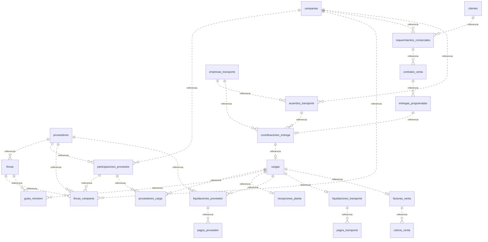

## Bienvenido (Acceso > Selección de perfil)

**Cobertura:** Inspeccionada en la aplicación. **Referencia de inventario:** V01.

**Observado:** Selector Administrador / Chofer y acceso de demostración sin contraseña. El selector de chofer permite elegir personas con y sin asignaciones.

**Diseño y reglas:** Una persona puede actuar como proveedor y como conductor sin duplicar su identidad. Un usuario tiene un rol en este alcance. La sesión persistente es una propuesta técnica: el retorno al login al recargar no se corrige únicamente creando tablas. El backend debe emitir/verificar una cookie o token con vencimiento, y el frontend restaurar sesión antes de cargar el perfil. Nunca guardar el token en claro ni usar los nombres del demo como autenticación real.

**Tablas usadas:** `personas`, `roles`, `usuarios`, `archivos`, `sesiones_usuario`.

**Relaciones:**

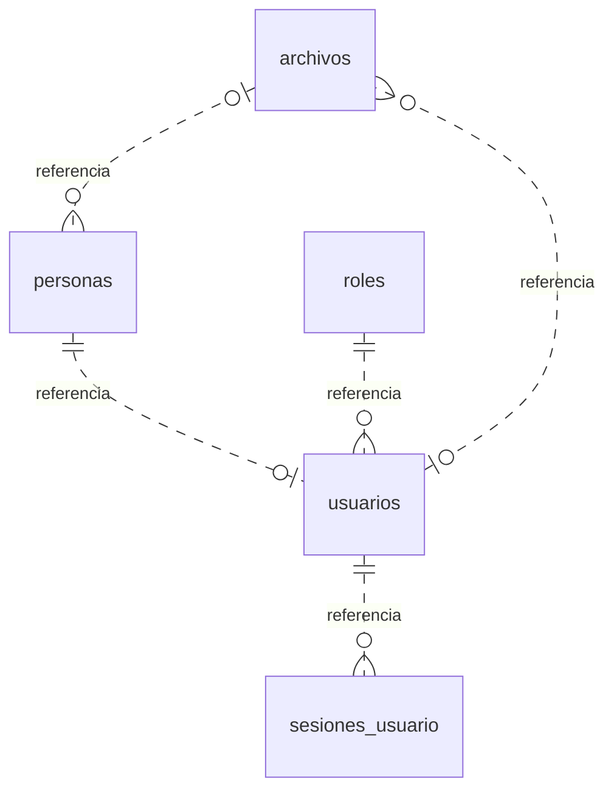


**Diccionario de `personas`.** Identidad única de productores, familiares y conductores.

| Atributo propuesto | Tipo / definición | Obligatoriedad y vínculo |
|---|---|---|
| `id` | `bigint GENERATED ALWAYS AS IDENTITY PRIMARY KEY` | PK interna automática |
| `tipo_documento` | `varchar(20) NOT NULL` | Obligatorio |
| `numero_documento` | `varchar(30) NOT NULL` | Obligatorio |
| `nombres` | `varchar(120) NOT NULL` | Obligatorio |
| `apellidos` | `varchar(120) NOT NULL` | Obligatorio |
| `telefono` | `varchar(30)` | Opcional |
| `correo` | `varchar(180)` | Opcional |
| `documento_archivo_id` | `bigint` | Opcional; FK a `archivos` |

**Unicidades:** `(tipo_documento, numero_documento)`.

**Diccionario de `roles`.** Perfiles de acceso; los permisos efectivos se aplican en el servidor.

| Atributo propuesto | Tipo / definición | Obligatoriedad y vínculo |
|---|---|---|
| `id` | `bigint GENERATED ALWAYS AS IDENTITY PRIMARY KEY` | PK interna automática |
| `nombre` | `varchar(40) NOT NULL` | Obligatorio |

**Unicidades:** `(nombre)`.

**Diccionario de `usuarios`.** Cuenta asociada a una persona; no se crea una cuenta por cada participación comercial.

| Atributo propuesto | Tipo / definición | Obligatoriedad y vínculo |
|---|---|---|
| `id` | `bigint GENERATED ALWAYS AS IDENTITY PRIMARY KEY` | PK interna automática |
| `persona_id` | `bigint NOT NULL` | Obligatorio; FK a `personas` |
| `rol_id` | `bigint NOT NULL` | Obligatorio; FK a `roles` |
| `usuario` | `varchar(80) NOT NULL` | Obligatorio |
| `password_hash` | `text NOT NULL` | Obligatorio |
| `activo` | `boolean NOT NULL DEFAULT true` | Obligatorio |

**Unicidades:** `(persona_id)`; `(usuario)`.

**Diccionario de `archivos`.** Metadatos del objeto almacenado; la base no almacena URLs firmadas ni el binario.

| Atributo propuesto | Tipo / definición | Obligatoriedad y vínculo |
|---|---|---|
| `id` | `bigint GENERATED ALWAYS AS IDENTITY PRIMARY KEY` | PK interna automática |
| `nombre` | `varchar(255) NOT NULL` | Obligatorio |
| `ruta_storage` | `text NOT NULL` | Obligatorio |
| `tipo_mime` | `varchar(100) NOT NULL` | Obligatorio |
| `bytes` | `bigint NOT NULL` | Obligatorio |
| `sha256` | `varchar(64)` | Opcional |
| `subido_por` | `bigint` | Opcional; FK a `usuarios` |
| `fecha_subida` | `timestamptz NOT NULL DEFAULT now()` | Obligatorio |

**Unicidades:** `(ruta_storage)`.

**Validaciones locales:** `bytes > 0`.

**Diccionario de `sesiones_usuario`.** Propuesta técnica para persistir sesiones; solo se conserva el hash del token.

| Atributo propuesto | Tipo / definición | Obligatoriedad y vínculo |
|---|---|---|
| `id` | `bigint GENERATED ALWAYS AS IDENTITY PRIMARY KEY` | PK interna automática |
| `usuario_id` | `bigint NOT NULL` | Obligatorio; FK a `usuarios` |
| `token_hash` | `text NOT NULL` | Obligatorio |
| `creada_at` | `timestamptz NOT NULL DEFAULT now()` | Obligatorio |
| `expira_at` | `timestamptz NOT NULL` | Obligatorio |
| `revocada_at` | `timestamptz` | Opcional |

**Unicidades:** `(token_hash)`.

**Validaciones locales:** `expira_at > creada_at`.

## Módulos del sistema (Administrador > Inicio)

**Cobertura:** Inspeccionada en la aplicación. **Referencia de inventario:** V02.

**Observado:** Ocho tarjetas: Gestión Comercial; Gestión de Campaña; Gestión de Proveedores; Gestión de Transporte; Cosecha y Control de Calidad; Logística y Despacho; Facturación y cobros; Liquidación de Compra.

**Diseño y reglas:** No representa una tabla de negocio. Es navegación y permisos sobre entidades compartidas. No se observó un módulo de sueldos. Los nombres de breadcrumb de este informe son rutas lógicas propuestas; la navegación inspeccionada mantiene la URL raíz, no URLs técnicas distintas.

**Entidades:** ninguna tabla propia; utiliza sesión y permisos para mostrar accesos.

**Verificación de las 42 tablas del DBML original.** Las notas del archivo ya reconocen exclusiones: pagos/ampliaciones de certificados e historial operativo. Una nota no implementa restricciones.

| Tabla actual | Dictamen y ajuste |
|---|---|
| `personas` | Conservar y ampliar con referencia al documento de identidad. |
| `roles` | Conservar; un rol por cuenta es suficiente para los dos perfiles observados. |
| `usuarios` | Conservar; comprobar que la persona del chofer y de la cuenta sea la misma. Sesión persistente requiere implementación adicional. |
| `archivos` | Ampliar con tamaño y hash opcional; ruta estable, no URL firmada. |
| `frutas` | Conservar. |
| `variedades` | Conservar; validar compatibilidad con fruta de campaña. |
| `campanias` | Ampliar: fruta, variedades asociadas, lineamientos, observaciones y cierre auditable. |
| `proveedores` | Ampliar asociaciones generales de frutas/variedades y sanidad; mover rol comercial a participación. |
| `personas_proveedor` | Conservar; relación válida para persona destinataria y control anual. |
| `fincas` | Ampliar código catastral, cultivo/variedad y edad; separar historia agronómica por campaña. |
| `acuerdos_compra` | Modificar su referencia a finca_campania; no sustituye participación y entrevista. |
| `entrevistas` | Reestructurar por finca de campaña, FYV, fecha/hora y atributos agronómicos. |
| `examenes` | Reestructurar por participación y muestra; admitir resultado pendiente y fecha de envío. |
| `normas` | Conservar. |
| `certificaciones` | Separar certificados propios; ampliar organismo/costo/moneda; una por campaña en la UI. |
| `certificacion_proveedor` | Referir participación de misma campaña; kg iniciales no se sobrescriben con ampliación. |
| `clientes` | Faltan contacto, tipo, ubicación y fecha de registro. |
| `destinos_cliente` | Conservar y comprobar pertenencia al cliente del contrato. |
| `contratos_venta` | Separar requerimientos_comerciales; varios contratos por requerimiento y moneda propia. |
| `precios_venta` | Retirar en este alcance: la UI muestra precio por contrato. Si aparecen precios por variedad, usar detalle como única fuente. |
| `entregas_programadas` | Conservar; agregar distribución por variedad y coordinación previa a carga. |
| `empresas_transporte` | Modificar: admite independiente, documento genérico y datos de ubicación/contacto. |
| `vehiculos` | Ampliar volumen/pesos y unidades explícitas; verificar significado de peso neto. |
| `choferes` | Conservar; identidad/cuenta coherentes y licencia real. El demo tiene datos faltantes. |
| `acuerdos_transporte` | Conservar y relacionar opcionalmente a cotización; separar invitaciones y solicitudes. |
| `cosechas` | Reestructurar como operación de entrega; admitir múltiples fincas y análisis operativos. |
| `cargas` | Separar coordinación de carga real; incorporar anotador/calidad y gastos propios de carga. |
| `proveedores_carga` | Reestructurar por participación y variedad; el formulario real no registra cosecha por finca obligatoria. |
| `guias_remision` | Conservar snapshots; exigir un punto físico y distribución de kilos sin duplicación. |
| `proveedores_guia` | Conservar y asegurar con FK compuestas que guía y detalle sean de misma carga. |
| `normas_guia` | Conservar. |
| `historial_chofer` | Vincular a coordinación para reportes antes de completar carga; secuencia y estado derivado. |
| `recepciones_planta` | Ampliar flag de descarte, reporte, resultado, descarga y cierres; permitir etapa incompleta. |
| `liquidaciones_proveedor` | Conservar; validar suma real, persona vinculada y captura UIT. Agregar documento. |
| `pagos_proveedor` | Conservar; saldo, evidencia y no edición del historial. |
| `liquidaciones_transporte` | Conservar; flete separado de pagos, gastos y adelantos. |
| `gastos_transporte` | Conservar con concepto único; no sumar viático y gasto sustituto dos veces. |
| `adelantos_transporte` | Conservar como desembolso de acuerdo. |
| `aplicaciones_adelanto` | Conservar; consumir adelanto de mismo acuerdo, sin otro desembolso. |
| `pagos_transporte` | Conservar con control de saldo combinado con adelantos. |
| `facturas_venta` | Ampliar kg facturados, precio/moneda aplicados y condiciones de emisión; preparación no permite cobrar. |
| `cobros_venta` | Conservar; verificar factura emitida y saldo. |

**Entidades añadidas respecto de ese archivo:** `sesiones_usuario`, `parametros_uit`, `campania_variedades`, `proveedor_frutas`, `proveedor_variedades`, `certificados_propios`, `participaciones_proveedor`, `participacion_variedades`, `fincas_campania`, `ampliaciones_certificacion`, `pagos_certificacion`, `requerimientos_comerciales`, `requerimiento_variedades`, `entrega_variedades`, `solicitudes_transporte`, `invitaciones_transporte`, `cotizaciones_transporte`, `coordinaciones_entrega`, `origenes_entrega`, `analisis_calidad`, `mediciones_mtd`, `origenes_carga`, `gastos_carga`.

**Diferencias de mayor impacto:** participación comercial separada de contrato; participación proveedor separada de precio; datos de finca por campaña; coordinación antes de carga; múltiples fincas sin inventar kilos; certificados propios separados y pagos/ampliaciones; solicitud/invitación/cotización; peso/precio/moneda históricos de factura; resultado y reporte de recepción.

## Gestión Comercial — Clientes (Administrador > Gestión Comercial > Clientes)

**Cobertura:** Inspeccionada en la aplicación. **Referencia de inventario:** V03.

**Observado:** Empresa, contacto, teléfono, correo corporativo, RUC, tipo Exportador/Industria; acciones nuevo, ver, editar y vincular a campaña.

**Diseño y reglas:** El cliente es una identidad comercial persistente y sus plantas/destinos son registros hijos. Contacto no equivale a usuario. RUC único, conservado como texto. Los destinos deben pertenecer al cliente del contrato; el SQL valida esa coincidencia.

**Tablas usadas:** `clientes`, `destinos_cliente`.

**Relaciones:**

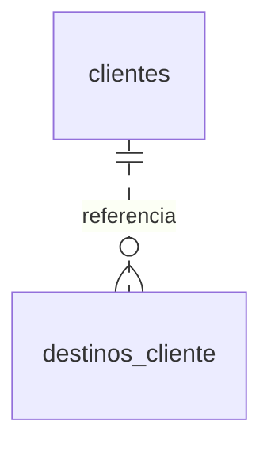


**Diccionario de `clientes`.** Padrón general del cliente y contacto.

| Atributo propuesto | Tipo / definición | Obligatoriedad y vínculo |
|---|---|---|
| `id` | `bigint GENERATED ALWAYS AS IDENTITY PRIMARY KEY` | PK interna automática |
| `razon_social` | `varchar(180) NOT NULL` | Obligatorio |
| `ruc` | `varchar(11) NOT NULL` | Obligatorio |
| `contacto` | `varchar(180) NOT NULL` | Obligatorio |
| `tipo` | `varchar(20) NOT NULL` | Obligatorio |
| `telefono` | `varchar(30)` | Opcional |
| `correo` | `varchar(180)` | Opcional |
| `ubicacion` | `varchar(180)` | Opcional |
| `fecha_registro` | `date NOT NULL DEFAULT CURRENT_DATE` | Obligatorio |

**Unicidades:** `(ruc)`.

**Validaciones locales:** `tipo IN ('EXPORTADOR','INDUSTRIA')`; `ruc ~ '^[0-9]{11}$'`.

**Diccionario de `destinos_cliente`.** Puntos de llegada de cada cliente; no asumir que todos comparten una planta.

| Atributo propuesto | Tipo / definición | Obligatoriedad y vínculo |
|---|---|---|
| `id` | `bigint GENERATED ALWAYS AS IDENTITY PRIMARY KEY` | PK interna automática |
| `cliente_id` | `bigint NOT NULL` | Obligatorio; FK a `clientes` |
| `nombre` | `varchar(150) NOT NULL` | Obligatorio |
| `ubigeo` | `varchar(6)` | Opcional |
| `direccion` | `text` | Opcional |
| `codigo_establecimiento` | `varchar(4)` | Opcional |
| `latitud` | `numeric(10,7)` | Opcional |
| `longitud` | `numeric(10,7)` | Opcional |

**Unicidades:** `(id, cliente_id)`.

**Validaciones locales:** `latitud BETWEEN -90 AND 90`; `longitud BETWEEN -180 AND 180`; `(latitud IS NULL) = (longitud IS NULL)`.

## Detalle de cliente (Administrador > Gestión Comercial > Clientes > Detalle)

**Cobertura:** Inspeccionada en la aplicación. **Referencia de inventario:** V04.

**Observado:** Ficha de SUTRIMEX con ubicación y fecha de registro; participaciones por campaña con cantidades, kilos acordados, número de contratos y ficha técnica.

**Diseño y reglas:** La ficha agrega información desde requerimientos y contratos. No crear tablas detalle_cliente ni copia de campañas. Cantidad registrada, kilos acordados y kilos entregados son métricas diferentes.

**Tablas usadas:** `clientes`, `requerimientos_comerciales`, `contratos_venta`.

**Relaciones:**

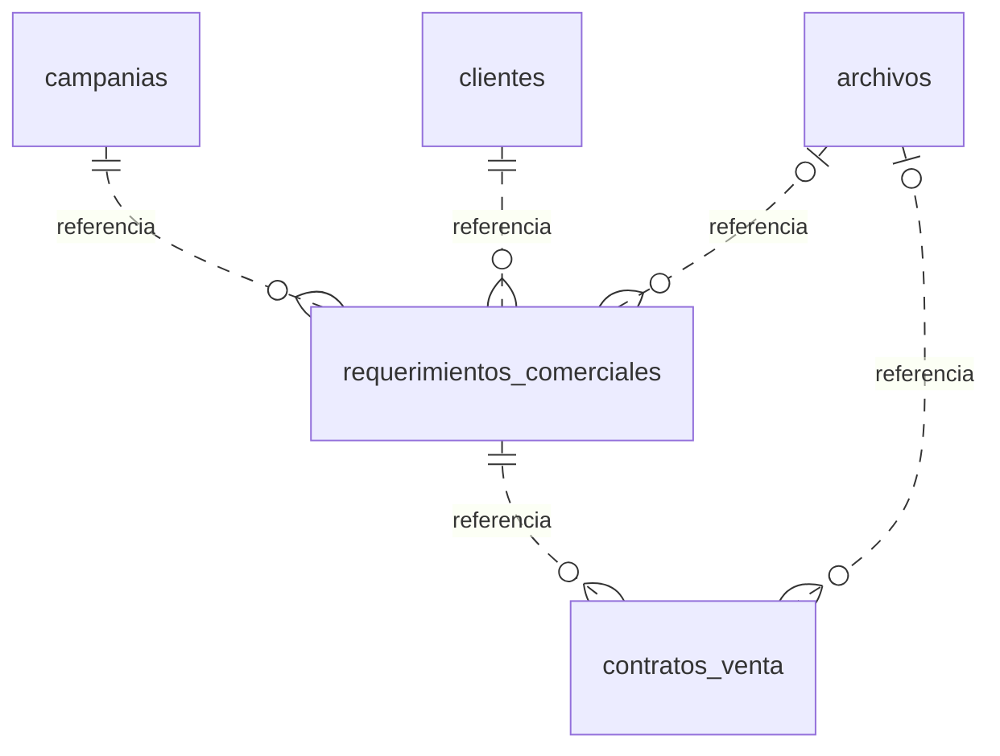


**`clientes`:** reutiliza el diccionario definido en su primera aparición; no crea otra tabla.

**Diccionario de `requerimientos_comerciales`.** Participación cliente–campaña y necesidad original, previa a sus contratos.

| Atributo propuesto | Tipo / definición | Obligatoriedad y vínculo |
|---|---|---|
| `id` | `bigint GENERATED ALWAYS AS IDENTITY PRIMARY KEY` | PK interna automática |
| `campania_id` | `bigint NOT NULL` | Obligatorio; FK a `campanias` |
| `cliente_id` | `bigint NOT NULL` | Obligatorio; FK a `clientes` |
| `cantidad_kg` | `numeric(14,3) NOT NULL` | Obligatorio |
| `fecha_registro` | `date NOT NULL` | Obligatorio |
| `ficha_tecnica_id` | `bigint` | Opcional; FK a `archivos` |
| `destino_solicitado` | `varchar(180)` | Opcional |
| `entrega_desde` | `date` | Opcional |
| `entrega_hasta` | `date` | Opcional |
| `observaciones` | `text` | Opcional |

**Validaciones locales:** `cantidad_kg > 0`; `entrega_hasta >= entrega_desde`.

**Diccionario de `contratos_venta`.** Varios contratos por requerimiento, con precio y moneda propios.

| Atributo propuesto | Tipo / definición | Obligatoriedad y vínculo |
|---|---|---|
| `id` | `bigint GENERATED ALWAYS AS IDENTITY PRIMARY KEY` | PK interna automática |
| `requerimiento_id` | `bigint NOT NULL` | Obligatorio; FK a `requerimientos_comerciales` |
| `numero` | `varchar(60) NOT NULL` | Obligatorio |
| `canal` | `varchar(20) NOT NULL` | Obligatorio |
| `fecha` | `date NOT NULL` | Obligatorio |
| `kilos_acordados` | `numeric(14,3) NOT NULL` | Obligatorio |
| `precio_kg` | `numeric(14,4) NOT NULL` | Obligatorio |
| `moneda` | `varchar(3) NOT NULL` | Obligatorio |
| `estado` | `varchar(25) NOT NULL DEFAULT 'VIGENTE'` | Obligatorio |
| `condiciones_pago` | `text` | Opcional |
| `archivo_id` | `bigint` | Opcional; FK a `archivos` |

**Unicidades:** `(numero)`.

**Validaciones locales:** `kilos_acordados > 0`; `precio_kg > 0`; `canal IN ('EXPORTACION','INDUSTRIA')`; `moneda IN ('PEN','USD','EUR')`.

## Contratos — Participaciones comerciales (Administrador > Gestión Comercial > Contratos)

**Cobertura:** Inspeccionada en la aplicación. **Referencia de inventario:** V05.

**Observado:** Listado por cliente y campaña, filtros, cantidad en kg, kilos acordados, fecha de registro y varios contratos por participación. El formulario Editar participación incluye ficha técnica, varias variedades, destino solicitado y ventana desde/hasta.

**Diseño y reglas:** Separar necesidad comercial y contrato firmado. Una campaña y un cliente pueden tener varios requerimientos: los datos compartidos muestran varias participaciones de Batimix en Mango 2026, así que no imponer UNIQUE(cliente,campaña) sin depuración. Requerimiento→contratos es 1:N. El destino solicitado puede ser una ciudad/país y no necesariamente la planta de llegada.

**Tablas usadas:** `requerimientos_comerciales`, `requerimiento_variedades`.

**Relaciones:**

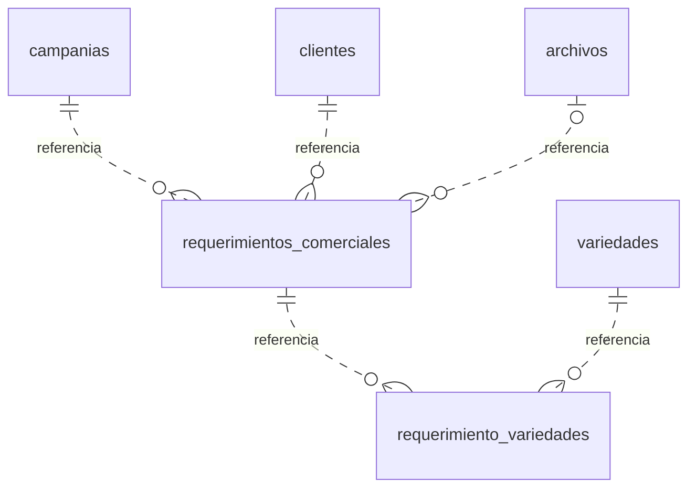


**`requerimientos_comerciales`:** reutiliza el diccionario definido en su primera aparición; no crea otra tabla.

**Diccionario de `requerimiento_variedades`.** Selección múltiple de variedades requeridas.

| Atributo propuesto | Tipo / definición | Obligatoriedad y vínculo |
|---|---|---|
| `id` | `bigint GENERATED ALWAYS AS IDENTITY PRIMARY KEY` | PK interna automática |
| `requerimiento_id` | `bigint NOT NULL` | Obligatorio; FK a `requerimientos_comerciales` |
| `variedad_id` | `bigint NOT NULL` | Obligatorio; FK a `variedades` |

**Unicidades:** `(requerimiento_id, variedad_id)`.

## Consulta cliente–campaña (Administrador > Gestión Comercial > Contratos > Participación)

**Cobertura:** Inspeccionada en la aplicación. **Referencia de inventario:** V06.

**Observado:** Consulta SUTRIMEX — Mango 2026 con ficha técnica, cuatro contratos, variedades requeridas, destino Rotterdam, ventana de entrega, resumen de entregas y entregas logísticas relacionadas.

**Diseño y reglas:** Reutiliza la participación y agrega contratos y entregas por sus claves. La suma programada no debe confundirse con lo efectivamente cargado o recibido. Los archivos se referencian por identificador de almacenamiento.

**Tablas usadas:** `requerimientos_comerciales`, `requerimiento_variedades`, `contratos_venta`, `entregas_programadas`.

**Relaciones:**

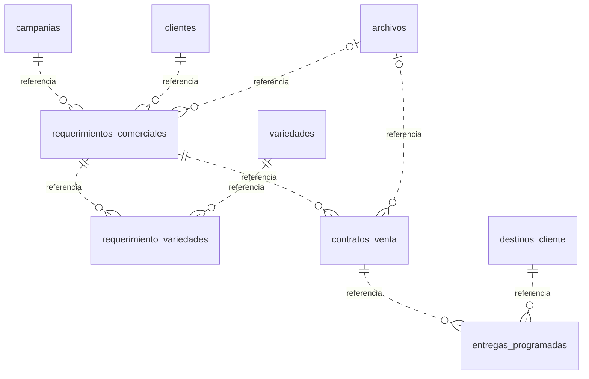


**`requerimientos_comerciales`:** reutiliza el diccionario definido en su primera aparición; no crea otra tabla.

**`requerimiento_variedades`:** reutiliza el diccionario definido en su primera aparición; no crea otra tabla.

**`contratos_venta`:** reutiliza el diccionario definido en su primera aparición; no crea otra tabla.

**Diccionario de `entregas_programadas`.** Programación comercial; puede existir antes de asignar transporte.

| Atributo propuesto | Tipo / definición | Obligatoriedad y vínculo |
|---|---|---|
| `id` | `bigint GENERATED ALWAYS AS IDENTITY PRIMARY KEY` | PK interna automática |
| `contrato_id` | `bigint NOT NULL` | Obligatorio; FK a `contratos_venta` |
| `destino_id` | `bigint NOT NULL` | Obligatorio; FK a `destinos_cliente` |
| `fecha` | `date NOT NULL` | Obligatorio |
| `kilos_programados` | `numeric(14,3) NOT NULL` | Obligatorio |
| `observaciones` | `text` | Opcional |

**Validaciones locales:** `kilos_programados > 0`.

## Contratos del cliente en campaña (Administrador > Gestión Comercial > Contratos > Participación > Contratos)

**Cobertura:** Inspeccionada en la aplicación. **Referencia de inventario:** V07.

**Observado:** Varios contratos con fecha, kilos, precio/kg, moneda, precio total, archivo y número de entregas. En una misma participación se observaron contratos USD y PEN.

**Diseño y reglas:** El contrato pertenece a un requerimiento; su cliente y campaña se obtienen desde este. Precio total=kg acordados×precio/kg. No sumar importes de monedas distintas. Se adopta un precio por contrato, como la UI; se retira precios_venta del modelo compacto para evitar dos fuentes editables. Si luego se confirma precio diferente por variedad, sustituir el precio de cabecera por líneas completas, sin duplicarlo.

**Tablas usadas:** `contratos_venta`.

**Relaciones:**

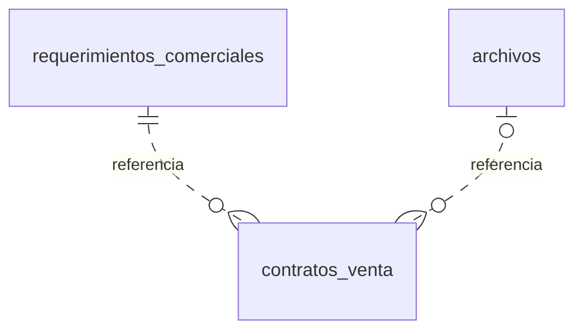


**`contratos_venta`:** reutiliza el diccionario definido en su primera aparición; no crea otra tabla.

## Entregas programadas (Administrador > Gestión Comercial > Contratos > Contrato > Entregas)

**Cobertura:** Inspeccionada en la aplicación. **Referencia de inventario:** V08.

**Observado:** Fecha programada, kilos, destino, preparación y acciones registrar, ver, editar programación o quitar. Edición deshabilitada con carga registrada.

**Diseño y reglas:** Contrato 1:N entregas. Los kilos de todas las entregas no pueden superar el contrato. La distribución por variedad alimenta el programa semanal y debe sumar exactamente la cabecera; insertar cabecera y líneas en una misma transacción porque el SQL comprueba la suma al confirmar. No crear una tabla por pestaña de estado.

**Tablas usadas:** `entregas_programadas`, `entrega_variedades`.

**Relaciones:**

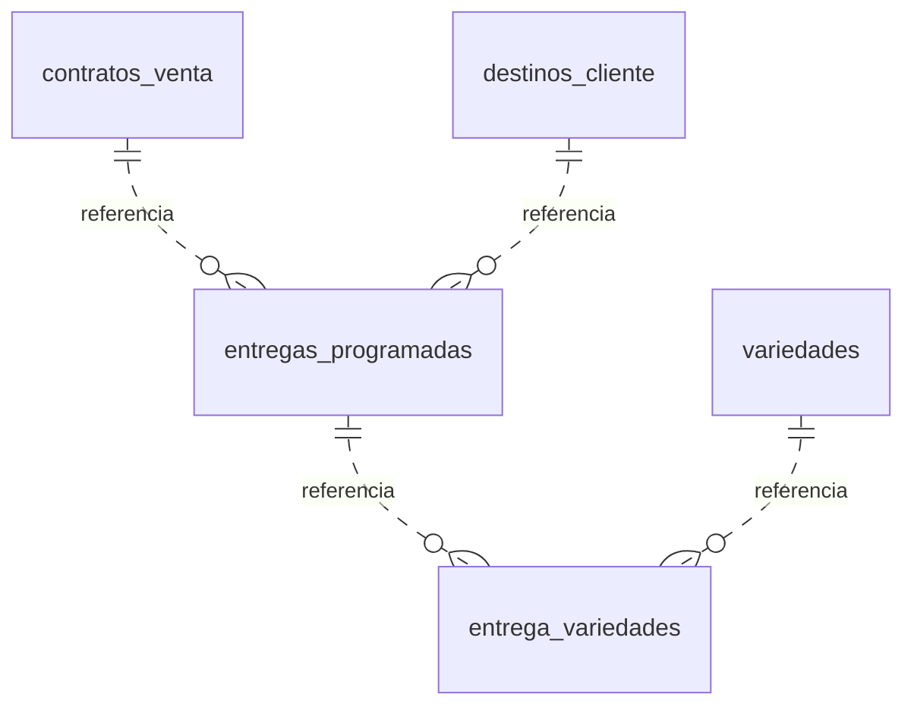


**`entregas_programadas`:** reutiliza el diccionario definido en su primera aparición; no crea otra tabla.

**Diccionario de `entrega_variedades`.** Distribución programada por variedad para el programa semanal.

| Atributo propuesto | Tipo / definición | Obligatoriedad y vínculo |
|---|---|---|
| `id` | `bigint GENERATED ALWAYS AS IDENTITY PRIMARY KEY` | PK interna automática |
| `entrega_id` | `bigint NOT NULL` | Obligatorio; FK a `entregas_programadas` |
| `variedad_id` | `bigint NOT NULL` | Obligatorio; FK a `variedades` |
| `kilos_programados` | `numeric(14,3) NOT NULL` | Obligatorio |

**Unicidades:** `(entrega_id, variedad_id)`.

**Validaciones locales:** `kilos_programados > 0`.

## Gestión de Campaña (Administrador > Gestión de Campaña > Listado)

**Cobertura:** Inspeccionada en la aplicación. **Referencia de inventario:** V09.

**Observado:** Pestañas Planificado, En Proceso y Finalizado; filtros por fruta, periodo y fechas; cantidad comercial derivada; campañas Mango, Palta, Arándano y demo.

**Diseño y reglas:** Una fruta por campaña y varias variedades de esa fruta. Un responsable es un usuario, no un nombre libre nuevo por campaña. El inicio automático depende de fecha; el cierre es manual. No almacenar como atributos los contadores y brechas del tablero. El SQL no ejecuta un programador para pasar automáticamente a EN_PROCESO; corresponde al servicio o a un job.

**Tablas usadas:** `frutas`, `variedades`, `campanias`, `campania_variedades`.

**Relaciones:**

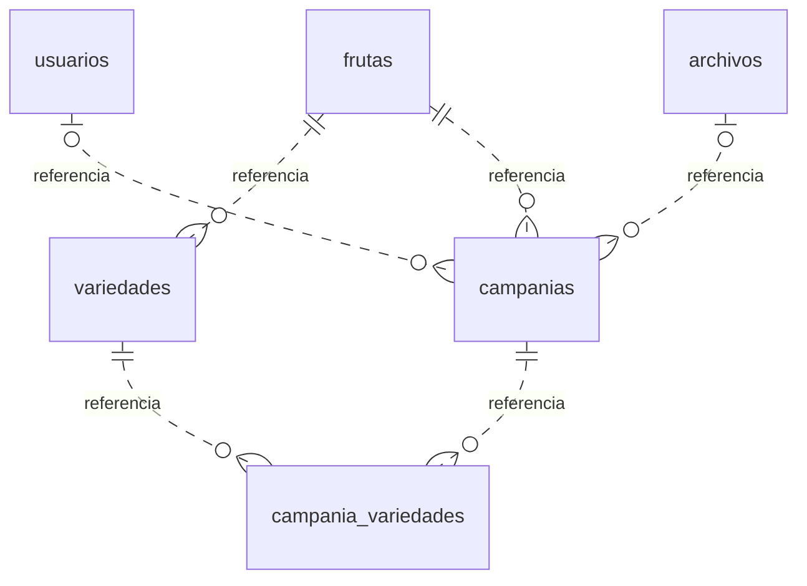


**Diccionario de `frutas`.** Catálogo de frutas.

| Atributo propuesto | Tipo / definición | Obligatoriedad y vínculo |
|---|---|---|
| `id` | `bigint GENERATED ALWAYS AS IDENTITY PRIMARY KEY` | PK interna automática |
| `nombre` | `varchar(80) NOT NULL` | Obligatorio |

**Unicidades:** `(nombre)`.

**Diccionario de `variedades`.** Variedades pertenecientes a una fruta.

| Atributo propuesto | Tipo / definición | Obligatoriedad y vínculo |
|---|---|---|
| `id` | `bigint GENERATED ALWAYS AS IDENTITY PRIMARY KEY` | PK interna automática |
| `fruta_id` | `bigint NOT NULL` | Obligatorio; FK a `frutas` |
| `nombre` | `varchar(100) NOT NULL` | Obligatorio |

**Unicidades:** `(fruta_id, nombre)`.

**Diccionario de `campanias`.** Campaña con sus fechas, responsable y cierre manual.

| Atributo propuesto | Tipo / definición | Obligatoriedad y vínculo |
|---|---|---|
| `id` | `bigint GENERATED ALWAYS AS IDENTITY PRIMARY KEY` | PK interna automática |
| `nombre` | `varchar(120) NOT NULL` | Obligatorio |
| `fruta_id` | `bigint NOT NULL` | Obligatorio; FK a `frutas` |
| `temporada` | `varchar(30) NOT NULL` | Obligatorio |
| `fecha_inicio` | `date NOT NULL` | Obligatorio |
| `fecha_fin` | `date NOT NULL` | Obligatorio |
| `estado` | `varchar(25) NOT NULL DEFAULT 'PLANIFICADO'` | Obligatorio |
| `responsable_id` | `bigint` | Opcional; FK a `usuarios` |
| `lineamientos_id` | `bigint` | Opcional; FK a `archivos` |
| `observaciones` | `text` | Opcional |
| `cerrada_at` | `timestamptz` | Opcional |
| `cerrada_por` | `bigint` | Opcional; FK a `usuarios` |
| `motivo_cierre` | `text` | Opcional |

**Validaciones locales:** `estado IN ('PLANIFICADO','EN_PROCESO','FINALIZADO')`; `fecha_fin >= fecha_inicio`; `(estado = 'FINALIZADO') = (cerrada_at IS NOT NULL AND cerrada_por IS NOT NULL AND motivo_cierre IS NOT NULL)`.

**Diccionario de `campania_variedades`.** Variedades elegidas para una campaña.

| Atributo propuesto | Tipo / definición | Obligatoriedad y vínculo |
|---|---|---|
| `id` | `bigint GENERATED ALWAYS AS IDENTITY PRIMARY KEY` | PK interna automática |
| `campania_id` | `bigint NOT NULL` | Obligatorio; FK a `campanias` |
| `variedad_id` | `bigint NOT NULL` | Obligatorio; FK a `variedades` |

**Unicidades:** `(campania_id, variedad_id)`.

## Datos generales y resumen de campaña (Administrador > Gestión de Campaña > Campaña > Detalle)

**Cobertura:** Inspeccionada en la aplicación. **Referencia de inventario:** V10.

**Observado:** Mango 2026: responsable, periodo, frutas/variedades, lineamientos, observaciones, oferta estimada, validada, kilos certificados, comprometidos y brechas; advertencias de recepción incompleta.

**Diseño y reglas:** Son consultas sobre varias entidades. Distinguir sumas por requerimiento, contrato, proveedor y certificado; agregar cada conjunto por separado antes de combinarlos para evitar multiplicar kilos por un JOIN 1:N. La advertencia de cobertura duplicada no acredita producción nueva.

**Tablas usadas:** `campanias`, `participaciones_proveedor`, `certificaciones`, `contratos_venta`, `cosechas`, `cargas`.

**Relaciones:**

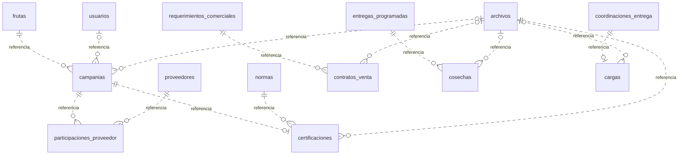


**`campanias`:** reutiliza el diccionario definido en su primera aparición; no crea otra tabla.

**Diccionario de `participaciones_proveedor`.** Vinculación proveedor–campaña; aquí pertenecen rol, oferta y evaluación.

| Atributo propuesto | Tipo / definición | Obligatoriedad y vínculo |
|---|---|---|
| `id` | `bigint GENERATED ALWAYS AS IDENTITY PRIMARY KEY` | PK interna automática |
| `campania_id` | `bigint NOT NULL` | Obligatorio; FK a `campanias` |
| `proveedor_id` | `bigint NOT NULL` | Obligatorio; FK a `proveedores` |
| `rol_comercial` | `varchar(20) NOT NULL` | Obligatorio |
| `tipo_fruta` | `varchar(20) NOT NULL` | Obligatorio |
| `kilos_estimados` | `numeric(14,3) NOT NULL` | Obligatorio |
| `estado` | `varchar(30) NOT NULL DEFAULT 'EXAMEN_PENDIENTE'` | Obligatorio |
| `entrevista_aplica` | `boolean NOT NULL DEFAULT true` | Obligatorio |
| `fecha_registro` | `timestamptz NOT NULL DEFAULT now()` | Obligatorio |
| `observaciones` | `text` | Opcional |

**Unicidades:** `(campania_id, proveedor_id)`; `(id, campania_id, proveedor_id)`.

**Validaciones locales:** `rol_comercial IN ('PRODUCTOR','ACOPIADOR')`; `tipo_fruta IN ('ORGANICA','CONVENCIONAL')`; `kilos_estimados >= 0`; `estado IN ('EXAMEN_PENDIENTE','ENTREVISTA_PENDIENTE','APROBADO','RECHAZADO')`.

**Diccionario de `certificaciones`.** Certificado de campaña, costo y organismo; un certificado por campaña según la UI.

| Atributo propuesto | Tipo / definición | Obligatoriedad y vínculo |
|---|---|---|
| `id` | `bigint GENERATED ALWAYS AS IDENTITY PRIMARY KEY` | PK interna automática |
| `campania_id` | `bigint NOT NULL` | Obligatorio; FK a `campanias` |
| `norma_id` | `bigint NOT NULL` | Obligatorio; FK a `normas` |
| `nombre` | `varchar(180) NOT NULL` | Obligatorio |
| `codigo` | `varchar(80)` | Opcional |
| `organismo` | `varchar(180) NOT NULL` | Obligatorio |
| `fecha_emision` | `date NOT NULL` | Obligatorio |
| `fecha_vencimiento` | `date NOT NULL` | Obligatorio |
| `costo` | `numeric(14,2) NOT NULL` | Obligatorio |
| `moneda` | `varchar(3) NOT NULL` | Obligatorio |
| `archivo_id` | `bigint NOT NULL` | Obligatorio; FK a `archivos` |

**Unicidades:** `(campania_id)`; `(id, campania_id)`.

**Validaciones locales:** `fecha_vencimiento >= fecha_emision`; `costo >= 0`; `moneda IN ('PEN','USD','EUR')`.

**`contratos_venta`:** reutiliza el diccionario definido en su primera aparición; no crea otra tabla.

**Diccionario de `cosechas`.** Operación de cosecha de una entrega; estado separado del despacho.

| Atributo propuesto | Tipo / definición | Obligatoriedad y vínculo |
|---|---|---|
| `id` | `bigint GENERATED ALWAYS AS IDENTITY PRIMARY KEY` | PK interna automática |
| `entrega_id` | `bigint NOT NULL` | Obligatorio; FK a `entregas_programadas` |
| `codigo_lote` | `varchar(60) NOT NULL` | Obligatorio |
| `fecha_prevista` | `date NOT NULL` | Obligatorio |
| `kilos_estimados` | `numeric(14,3) NOT NULL` | Obligatorio |
| `kilos_cosechados` | `numeric(14,3)` | Opcional |
| `kilos_aceptados` | `numeric(14,3)` | Opcional |
| `estado` | `varchar(30) NOT NULL DEFAULT 'PENDIENTE'` | Obligatorio |
| `cierre_cosecha_at` | `timestamptz` | Opcional |
| `evidencia_id` | `bigint` | Opcional; FK a `archivos` |

**Unicidades:** `(codigo_lote)`.

**Validaciones locales:** `kilos_estimados >= 0`; `kilos_cosechados >= 0`; `kilos_aceptados >= 0`.

**Diccionario de `cargas`.** Carga física real de la coordinación; no crea otra asignación de camión o chofer.

| Atributo propuesto | Tipo / definición | Obligatoriedad y vínculo |
|---|---|---|
| `id` | `bigint GENERATED ALWAYS AS IDENTITY PRIMARY KEY` | PK interna automática |
| `coordinacion_id` | `bigint NOT NULL` | Obligatorio; FK a `coordinaciones_entrega` |
| `codigo` | `varchar(80) NOT NULL` | Obligatorio |
| `fecha_carga` | `date NOT NULL` | Obligatorio |
| `anotador_nombre` | `varchar(180) NOT NULL` | Obligatorio |
| `estado_calidad` | `varchar(30) NOT NULL DEFAULT 'PENDIENTE'` | Obligatorio |
| `viaticos_movilidad` | `numeric(14,2) NOT NULL DEFAULT 0` | Obligatorio |
| `viaticos_insumos` | `numeric(14,2) NOT NULL DEFAULT 0` | Obligatorio |
| `guia_salida_id` | `bigint` | Opcional; FK a `archivos` |
| `guia_salida_registrada_at` | `timestamptz` | Opcional |
| `observaciones` | `text` | Opcional |

**Unicidades:** `(coordinacion_id)`; `(codigo)`; `(id, coordinacion_id)`.

**Validaciones locales:** `viaticos_movilidad >= 0`; `viaticos_insumos >= 0`; `(guia_salida_id IS NULL) = (guia_salida_registrada_at IS NULL)`.

## Proveedores de campaña (Administrador > Gestión de Campaña > Planificado > Campaña > Proveedores)

**Cobertura:** Inspeccionada en la aplicación. **Referencia de inventario:** V11.

**Observado:** Proveedores vinculados con rol Productor/Acopiador, cantidad estimada, estado de evaluación y si hubo entrevista. Detalle Roberto Palacios muestra varias fincas, varias variedades y fruta orgánica.

**Diseño y reglas:** La participación es la identidad del proveedor dentro de la campaña. No usar acuerdos_compra como sustituto: todavía puede no existir precio, finca entrevistada o compra. El SQL asegura que la finca pertenece al proveedor de la participación. Un proveedor puede cambiar su rol comercial entre campañas sin alterar su identidad general.

**Tablas usadas:** `participaciones_proveedor`, `participacion_variedades`, `fincas_campania`.

**Relaciones:**

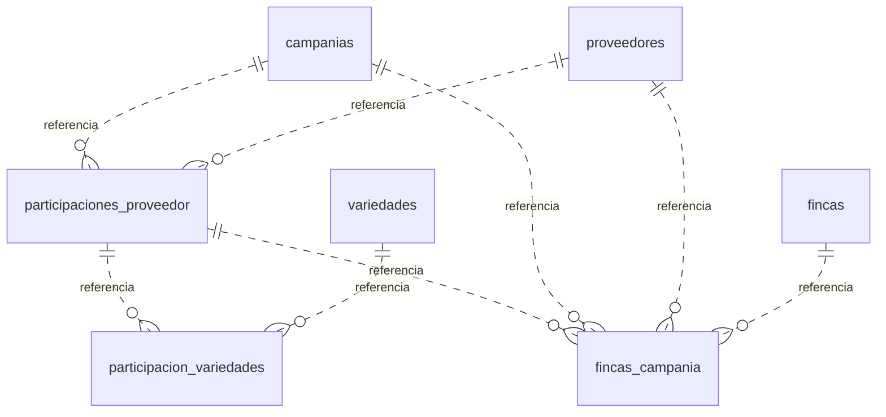


**`participaciones_proveedor`:** reutiliza el diccionario definido en su primera aparición; no crea otra tabla.

**Diccionario de `participacion_variedades`.** Variedades de la participación, sin deducirlas solo de contratos de compra.

| Atributo propuesto | Tipo / definición | Obligatoriedad y vínculo |
|---|---|---|
| `id` | `bigint GENERATED ALWAYS AS IDENTITY PRIMARY KEY` | PK interna automática |
| `participacion_id` | `bigint NOT NULL` | Obligatorio; FK a `participaciones_proveedor` |
| `variedad_id` | `bigint NOT NULL` | Obligatorio; FK a `variedades` |

**Unicidades:** `(participacion_id, variedad_id)`.

**Diccionario de `fincas_campania`.** Fincas vinculadas a una participación; permite conservar historial por campaña.

| Atributo propuesto | Tipo / definición | Obligatoriedad y vínculo |
|---|---|---|
| `id` | `bigint GENERATED ALWAYS AS IDENTITY PRIMARY KEY` | PK interna automática |
| `participacion_id` | `bigint NOT NULL` | Obligatorio; FK a `participaciones_proveedor` |
| `campania_id` | `bigint NOT NULL` | Obligatorio; FK a `campanias`, FK a `participaciones_proveedor` |
| `proveedor_id` | `bigint NOT NULL` | Obligatorio; FK a `proveedores`, FK a `participaciones_proveedor`, FK a `fincas` |
| `finca_id` | `bigint NOT NULL` | Obligatorio; FK a `fincas` |

**Unicidades:** `(campania_id, finca_id)`; `(id, participacion_id)`.

## Entrevista (Administrador > Gestión de Campaña > Planificado > Proveedores > Participación > Entrevista)

**Cobertura:** Inspeccionada en la aplicación. **Referencia de inventario:** V12.

**Observado:** Fincas entrevistadas con fecha y hora automáticas, código FYV, hectáreas y datos agronómicos. El detalle muestra densidad, distanciamiento, frecuencia de riego, aplicación y aplicaciones al año.

**Diseño y reglas:** Cada entrevista corresponde a una finca vinculada y conserva su fecha; se permiten nuevas revisiones sin sobrescribir la finca general. Las condiciones de compra son una entidad propuesta reutilizada para precios por origen y vigencia; no se observó un editor independiente de acuerdos_compra durante el recorrido. El precio aplicado se captura al liquidar y no se recalcula desde un precio vigente que haya cambiado.

**Tablas usadas:** `entrevistas`, `fincas_campania`, `acuerdos_compra`.

**Relaciones:**

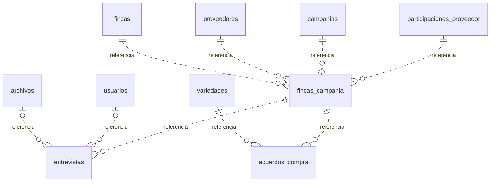


**Diccionario de `entrevistas`.** Registro agronómico de cada finca entrevistada en una campaña.

| Atributo propuesto | Tipo / definición | Obligatoriedad y vínculo |
|---|---|---|
| `id` | `bigint GENERATED ALWAYS AS IDENTITY PRIMARY KEY` | PK interna automática |
| `finca_campania_id` | `bigint NOT NULL` | Obligatorio; FK a `fincas_campania` |
| `codigo_fyv` | `varchar(60) NOT NULL` | Obligatorio |
| `registrada_at` | `timestamptz NOT NULL DEFAULT now()` | Obligatorio |
| `registrada_por` | `bigint` | Opcional; FK a `usuarios` |
| `densidad_plantacion` | `numeric(12,3)` | Opcional |
| `distanciamiento_m` | `varchar(60)` | Opcional |
| `frecuencia_riego` | `varchar(120)` | Opcional |
| `nombre_aplicacion` | `varchar(180)` | Opcional |
| `aplicaciones_anio` | `integer` | Opcional |
| `resultado` | `text` | Opcional |
| `archivo_id` | `bigint` | Opcional; FK a `archivos` |

**Validaciones locales:** `densidad_plantacion > 0`; `aplicaciones_anio >= 0`.

**`fincas_campania`:** reutiliza el diccionario definido en su primera aparición; no crea otra tabla.

**Diccionario de `acuerdos_compra`.** Condiciones versionadas por finca, variedad y vigencia; no sustituye la participación.

| Atributo propuesto | Tipo / definición | Obligatoriedad y vínculo |
|---|---|---|
| `id` | `bigint GENERATED ALWAYS AS IDENTITY PRIMARY KEY` | PK interna automática |
| `finca_campania_id` | `bigint NOT NULL` | Obligatorio; FK a `fincas_campania` |
| `variedad_id` | `bigint NOT NULL` | Obligatorio; FK a `variedades` |
| `precio_kg` | `numeric(14,4) NOT NULL` | Obligatorio |
| `kilos_acordados` | `numeric(14,3)` | Opcional |
| `fecha_inicio` | `date NOT NULL` | Obligatorio |
| `fecha_fin` | `date NOT NULL` | Obligatorio |
| `estado` | `varchar(25) NOT NULL DEFAULT 'VIGENTE'` | Obligatorio |

**Validaciones locales:** `precio_kg > 0`; `kilos_acordados >= 0`; `fecha_fin >= fecha_inicio`.

## Exámenes (Administrador > Gestión de Campaña > Planificado > Proveedores > Participación > Exámenes)

**Cobertura:** Inspeccionada en la aplicación. **Referencia de inventario:** V13.

**Observado:** Exámenes Roberto Palacios en Palta 2027: fruta, análisis, código de muestra, origen, fecha de toma, fecha de envío, estado, resultado, documento y observación.

**Diseño y reglas:** Un examen es una fila por muestra/análisis de la participación; su finca puede ser opcional cuando el dato no está disponible. Resultado debe poder quedar pendiente. Se corrige el DBML que exigía resultado y acuerdo de compra desde el inicio. No confundir estos exámenes de evaluación con el análisis operativo de una cosecha.

**Tablas usadas:** `examenes`.

**Relaciones:**

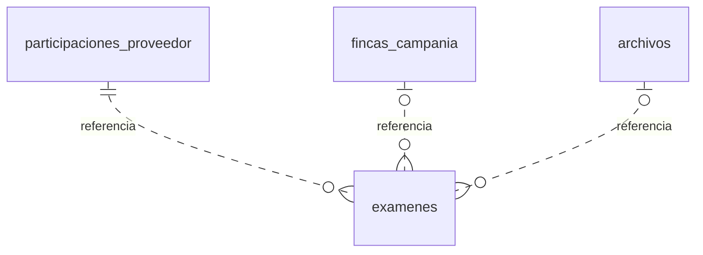


**Diccionario de `examenes`.** Exámenes sanitarios de la participación, con muestra y fechas de laboratorio.

| Atributo propuesto | Tipo / definición | Obligatoriedad y vínculo |
|---|---|---|
| `id` | `bigint GENERATED ALWAYS AS IDENTITY PRIMARY KEY` | PK interna automática |
| `participacion_id` | `bigint NOT NULL` | Obligatorio; FK a `participaciones_proveedor`, FK a `fincas_campania` |
| `finca_campania_id` | `bigint` | Opcional; FK a `fincas_campania` |
| `tipo` | `varchar(100) NOT NULL` | Obligatorio |
| `codigo_muestra` | `varchar(80)` | Opcional |
| `origen` | `varchar(180)` | Opcional |
| `fecha_muestra` | `date NOT NULL` | Obligatorio |
| `fecha_envio` | `date` | Opcional |
| `estado` | `varchar(30) NOT NULL DEFAULT 'PENDIENTE'` | Obligatorio |
| `resultado` | `varchar(180)` | Opcional |
| `archivo_id` | `bigint` | Opcional; FK a `archivos` |
| `observaciones` | `text` | Opcional |

**Validaciones locales:** `fecha_envio IS NULL OR fecha_envio >= fecha_muestra`.

## Certificaciones (Administrador > Gestión de Campaña > Planificado > Campaña > Certificaciones)

**Cobertura:** Inspeccionada en la aplicación. **Referencia de inventario:** V14.

**Observado:** Certificado Palta 2027: nombre, documento, vigencia, tipo, organismo, productores cubiertos, kilos iniciales, ampliaciones, total y pago. La pantalla declara un certificado por campaña.

**Diseño y reglas:** Se separa el certificado propio del proveedor. Un certificado de campaña cubre varias participaciones de la misma campaña; se capturan los kg iniciales por productor. El total inicial se obtiene de esas filas, y las ampliaciones se suman aparte. El SQL aplica unicidad de campaña según esta pantalla; revisar esa regla si una futura campaña admite varios certificados.

**Tablas usadas:** `normas`, `certificaciones`, `certificacion_proveedor`.

**Relaciones:**

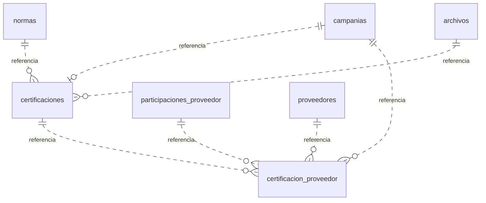


**Diccionario de `normas`.** Catálogo de normas de certificación y traslado.

| Atributo propuesto | Tipo / definición | Obligatoriedad y vínculo |
|---|---|---|
| `id` | `bigint GENERATED ALWAYS AS IDENTITY PRIMARY KEY` | PK interna automática |
| `codigo` | `varchar(40) NOT NULL` | Obligatorio |
| `nombre` | `varchar(180) NOT NULL` | Obligatorio |

**Unicidades:** `(codigo)`.

**`certificaciones`:** reutiliza el diccionario definido en su primera aparición; no crea otra tabla.

**Diccionario de `certificacion_proveedor`.** Productores cubiertos y kilos iniciales capturados al certificar.

| Atributo propuesto | Tipo / definición | Obligatoriedad y vínculo |
|---|---|---|
| `id` | `bigint GENERATED ALWAYS AS IDENTITY PRIMARY KEY` | PK interna automática |
| `certificacion_id` | `bigint NOT NULL` | Obligatorio; FK a `certificaciones` |
| `campania_id` | `bigint NOT NULL` | Obligatorio; FK a `campanias`, FK a `certificaciones`, FK a `participaciones_proveedor` |
| `participacion_id` | `bigint NOT NULL` | Obligatorio; FK a `participaciones_proveedor` |
| `proveedor_id` | `bigint NOT NULL` | Obligatorio; FK a `proveedores`, FK a `participaciones_proveedor` |
| `kilos_autorizados` | `numeric(14,3) NOT NULL` | Obligatorio |

**Unicidades:** `(certificacion_id, participacion_id)`.

**Validaciones locales:** `kilos_autorizados > 0`.

## Ampliación de certificación (Administrador > Gestión de Campaña > Certificaciones > Ampliación)

**Cobertura:** Inspeccionada en la aplicación. **Referencia de inventario:** V15.

**Observado:** Formulario con kilos adicionales, fecha, referencia/evidencia y total de kilos iniciales y ampliaciones actuales.

**Diseño y reglas:** Cada ampliación es un evento con kilos positivos; no sustituye ni modifica los kilos iniciales. En el formulario observado la evidencia es texto de referencia, no un archivo obligatorio. Se preserva el evento sin edición destructiva.

**Tablas usadas:** `ampliaciones_certificacion`.

**Relaciones:**

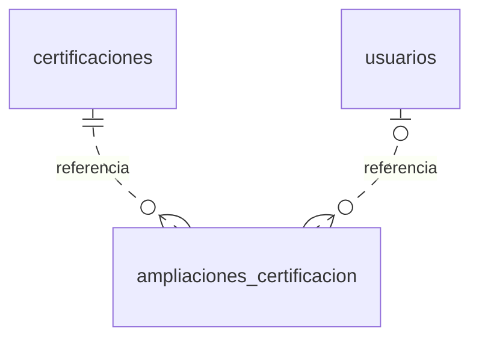


**Diccionario de `ampliaciones_certificacion`.** Incrementos de cobertura, sin sobrescribir los kilos iniciales.

| Atributo propuesto | Tipo / definición | Obligatoriedad y vínculo |
|---|---|---|
| `id` | `bigint GENERATED ALWAYS AS IDENTITY PRIMARY KEY` | PK interna automática |
| `certificacion_id` | `bigint NOT NULL` | Obligatorio; FK a `certificaciones` |
| `fecha` | `date NOT NULL` | Obligatorio |
| `kilos_adicionales` | `numeric(14,3) NOT NULL` | Obligatorio |
| `referencia` | `varchar(180) NOT NULL` | Obligatorio |
| `registrado_por` | `bigint` | Opcional; FK a `usuarios` |

**Validaciones locales:** `kilos_adicionales > 0`.

## Pago de certificación (Administrador > Gestión de Campaña > Certificaciones > Pagos)

**Cobertura:** Inspeccionada en la aplicación. **Referencia de inventario:** V16.

**Observado:** Formulario con costo USD 2,400, pagado, monto, fecha, referencia y archivo de evidencia.

**Diseño y reglas:** Una certificación admite pagos parciales. El monto se interpreta en su moneda; no crear un segundo costo por pago. El SQL bloquea el sobrepago y conserva los movimientos. Después de pagos o ampliaciones, la cabecera queda protegida.

**Tablas usadas:** `pagos_certificacion`.

**Relaciones:**

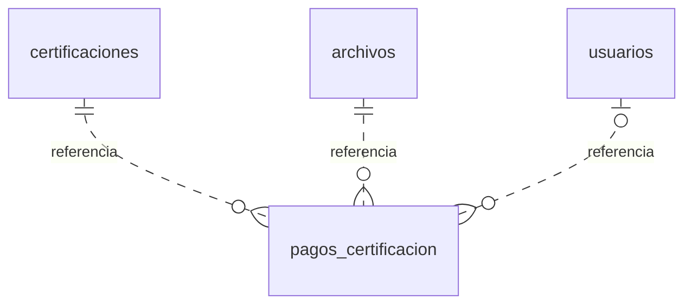


**Diccionario de `pagos_certificacion`.** Desembolsos de la certificación en su misma moneda.

| Atributo propuesto | Tipo / definición | Obligatoriedad y vínculo |
|---|---|---|
| `id` | `bigint GENERATED ALWAYS AS IDENTITY PRIMARY KEY` | PK interna automática |
| `certificacion_id` | `bigint NOT NULL` | Obligatorio; FK a `certificaciones` |
| `fecha` | `date NOT NULL` | Obligatorio |
| `monto` | `numeric(14,2) NOT NULL` | Obligatorio |
| `referencia` | `varchar(100) NOT NULL` | Obligatorio |
| `comprobante_id` | `bigint NOT NULL` | Obligatorio; FK a `archivos` |
| `registrado_por` | `bigint` | Opcional; FK a `usuarios` |

**Unicidades:** `(certificacion_id, referencia)`.

**Validaciones locales:** `monto > 0`.

## Transportistas por campaña (Administrador > Gestión de Campaña > En Proceso > Campaña > Transportistas)

**Cobertura:** Inspeccionada en la aplicación. **Referencia de inventario:** V17.

**Observado:** Listado de transportistas vinculados con documento, ubicación, teléfono, correo, fecha de vinculación y acuerdo de pago. Incluye empresa e independiente.

**Diseño y reglas:** Una vinculación de transporte por empresa/campaña; el acuerdo guarda modalidad y flete autorizado. Los adelantos son desembolsos separados. En el SQL, el acuerdo se registra completo al vincular: si se necesita guardar una vinculación sin acuerdo, separar una cabecera de vinculación o permitir un borrador antes de exigir montos.

**Tablas usadas:** `acuerdos_transporte`.

**Relaciones:**

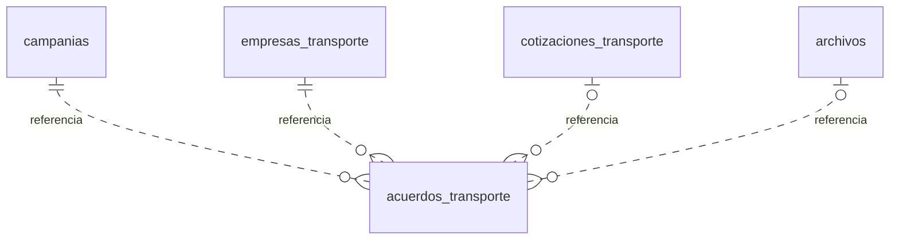


**Diccionario de `acuerdos_transporte`.** Transportista vinculado a campaña y acuerdo de flete autorizado.

| Atributo propuesto | Tipo / definición | Obligatoriedad y vínculo |
|---|---|---|
| `id` | `bigint GENERATED ALWAYS AS IDENTITY PRIMARY KEY` | PK interna automática |
| `campania_id` | `bigint NOT NULL` | Obligatorio; FK a `campanias` |
| `empresa_id` | `bigint NOT NULL` | Obligatorio; FK a `empresas_transporte` |
| `cotizacion_id` | `bigint` | Opcional; FK a `cotizaciones_transporte` |
| `tipo_pago` | `varchar(20) NOT NULL` | Obligatorio |
| `monto_acordado` | `numeric(14,2) NOT NULL` | Obligatorio |
| `fecha_acuerdo` | `date NOT NULL` | Obligatorio |
| `fecha_pago_final` | `date` | Opcional |
| `archivo_id` | `bigint` | Opcional; FK a `archivos` |

**Unicidades:** `(campania_id, empresa_id)`; `(id, empresa_id)`.

**Validaciones locales:** `monto_acordado > 0`; `tipo_pago IN ('INMEDIATO','CON_ADELANTO','AL_FINAL')`.

## Entregas de la campaña (Administrador > Gestión de Campaña > En Proceso > Campaña > Entregas)

**Cobertura:** Inspeccionada en la aplicación. **Referencia de inventario:** V18.

**Observado:** Listado de entregas comerciales con estados Por completar, Lista para carga y Con carga registrada; acciones completar o consultar.

**Diseño y reglas:** Una entrega programada puede existir sin coordinación, y una coordinación sin carga real. Estas tres etapas no deben forzar kilos ficticios ni una cosecha para permitir la asignación del chofer.

**Tablas usadas:** `entregas_programadas`, `coordinaciones_entrega`.

**Relaciones:**

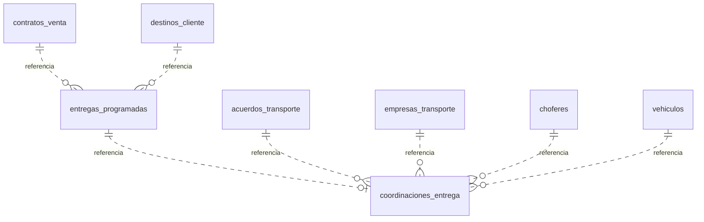


**`entregas_programadas`:** reutiliza el diccionario definido en su primera aparición; no crea otra tabla.

**Diccionario de `coordinaciones_entrega`.** Asignación previa a la carga real; un registro por entrega.

| Atributo propuesto | Tipo / definición | Obligatoriedad y vínculo |
|---|---|---|
| `id` | `bigint GENERATED ALWAYS AS IDENTITY PRIMARY KEY` | PK interna automática |
| `entrega_id` | `bigint NOT NULL` | Obligatorio; FK a `entregas_programadas` |
| `acuerdo_transporte_id` | `bigint NOT NULL` | Obligatorio; FK a `acuerdos_transporte` |
| `empresa_id` | `bigint NOT NULL` | Obligatorio; FK a `empresas_transporte`, FK a `acuerdos_transporte`, FK a `vehiculos`, FK a `choferes` |
| `vehiculo_id` | `bigint NOT NULL` | Obligatorio; FK a `vehiculos` |
| `chofer_id` | `bigint NOT NULL` | Obligatorio; FK a `choferes` |
| `inicio_programado` | `timestamptz NOT NULL` | Obligatorio |
| `fin_programado` | `timestamptz NOT NULL` | Obligatorio |
| `origen_descripcion` | `text NOT NULL` | Obligatorio |
| `condiciones_carga` | `text` | Opcional |
| `observaciones` | `text` | Opcional |

**Unicidades:** `(entrega_id)`; `(id, entrega_id)`.

**Validaciones locales:** `fin_programado >= inicio_programado`.

## Completar coordinación de entrega (Administrador > Gestión de Campaña > En Proceso > Entregas > Coordinación)

**Cobertura:** Inspeccionada en la aplicación. **Referencia de inventario:** V19.

**Observado:** Formulario inspeccionado: contrato, transportista vinculado, varios proveedores y varias fincas de cada uno, camión, chofer, inicio/fin del viaje, origen, condiciones y observaciones.

**Diseño y reglas:** El camión y el chofer deben pertenecer al transportista del acuerdo y este a la campaña. Los orígenes son fincas de participaciones de esa campaña. Exportación admite origen orgánico según el prototipo. Una fila por finca evita guardar una cadena de nombres como relación. La descripción de origen sí puede mantenerse como texto informativo.

**Tablas usadas:** `coordinaciones_entrega`, `origenes_entrega`.

**Relaciones:**

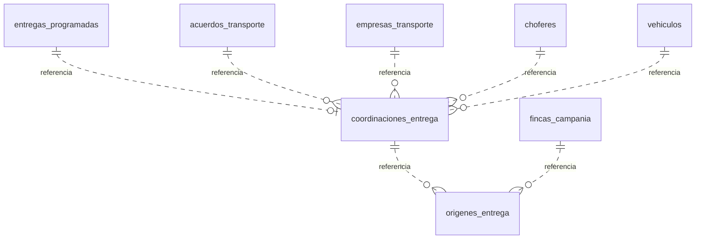


**`coordinaciones_entrega`:** reutiliza el diccionario definido en su primera aparición; no crea otra tabla.

**Diccionario de `origenes_entrega`.** Selección de varias fincas de varios proveedores antes de cargar.

| Atributo propuesto | Tipo / definición | Obligatoriedad y vínculo |
|---|---|---|
| `id` | `bigint GENERATED ALWAYS AS IDENTITY PRIMARY KEY` | PK interna automática |
| `coordinacion_id` | `bigint NOT NULL` | Obligatorio; FK a `coordinaciones_entrega` |
| `finca_campania_id` | `bigint NOT NULL` | Obligatorio; FK a `fincas_campania` |

**Unicidades:** `(coordinacion_id, finca_campania_id)`.

## Programa semanal de entregas (Administrador > Gestión de Campaña > Campaña > Programa semanal de entregas)

**Cobertura:** Inspeccionada en la aplicación. **Referencia de inventario:** V20.

**Observado:** Selector de semana ISO, variedad, días lunes–domingo, cliente/contrato, placa, kilos y total. La pantalla dice que los kg se cuentan una sola vez y la placa se completa después.

**Diseño y reglas:** Es una proyección de la programación, no una tabla calendario ni un registro de carga. La vista SQL v_programa_semanal usa año ISO y semana ISO para no mezclar semanas de distintos años; admite vehículo todavía sin asignar.

**Tablas usadas:** `entregas_programadas`, `entrega_variedades`, `coordinaciones_entrega`.

**Relaciones:**

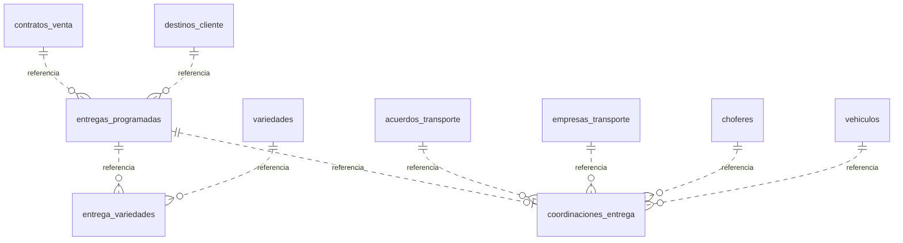


**`entregas_programadas`:** reutiliza el diccionario definido en su primera aparición; no crea otra tabla.

**`entrega_variedades`:** reutiliza el diccionario definido en su primera aparición; no crea otra tabla.

**`coordinaciones_entrega`:** reutiliza el diccionario definido en su primera aparición; no crea otra tabla.

## Gestión de proveedores (Administrador > Gestión de Proveedores > Listado)

**Cobertura:** Inspeccionada en la aplicación. **Referencia de inventario:** V21.

**Observado:** Nombre completo, documento, zona, frutas asociadas, variedades y estado de sanidad.

**Diseño y reglas:** Separar persona, proveedor y participación. Las personas vinculadas se reutilizan para liquidaciones y control anual; no crean un proveedor nuevo ni transfieren compras antiguas. Las asociaciones generales de fruta y variedad no implican automáticamente que se ofrece esa fruta en todas las campañas.

**Tablas usadas:** `proveedores`, `personas_proveedor`, `proveedor_frutas`, `proveedor_variedades`.

**Relaciones:**

```mermaid
erDiagram
    personas ||..o| proveedores : referencia
    proveedores ||..o{ personas_proveedor : referencia
    personas ||..o{ personas_proveedor : referencia
    proveedores ||..o{ proveedor_frutas : referencia
    frutas ||..o{ proveedor_frutas : referencia
    proveedores ||..o{ proveedor_variedades : referencia
    variedades ||..o{ proveedor_variedades : referencia
```


**Diccionario de `proveedores`.** Identidad comercial del proveedor principal.

| Atributo propuesto | Tipo / definición | Obligatoriedad y vínculo |
|---|---|---|
| `id` | `bigint GENERATED ALWAYS AS IDENTITY PRIMARY KEY` | PK interna automática |
| `persona_principal_id` | `bigint NOT NULL` | Obligatorio; FK a `personas` |
| `codigo` | `varchar(40) NOT NULL` | Obligatorio |
| `zona` | `varchar(120)` | Opcional |
| `codigo_produccion` | `varchar(60)` | Opcional |
| `estado_sanidad` | `varchar(30)` | Opcional |
| `activo` | `boolean NOT NULL DEFAULT true` | Obligatorio |

**Unicidades:** `(persona_principal_id)`; `(codigo)`.

**Diccionario de `personas_proveedor`.** Personas vinculadas; la relación no transfiere compras históricas.

| Atributo propuesto | Tipo / definición | Obligatoriedad y vínculo |
|---|---|---|
| `id` | `bigint GENERATED ALWAYS AS IDENTITY PRIMARY KEY` | PK interna automática |
| `proveedor_id` | `bigint NOT NULL` | Obligatorio; FK a `proveedores` |
| `persona_id` | `bigint NOT NULL` | Obligatorio; FK a `personas` |
| `vinculo` | `varchar(60) NOT NULL` | Obligatorio |
| `activo` | `boolean NOT NULL DEFAULT true` | Obligatorio |

**Unicidades:** `(proveedor_id, persona_id)`.

**Diccionario de `proveedor_frutas`.** Frutas asociadas al padrón general.

| Atributo propuesto | Tipo / definición | Obligatoriedad y vínculo |
|---|---|---|
| `id` | `bigint GENERATED ALWAYS AS IDENTITY PRIMARY KEY` | PK interna automática |
| `proveedor_id` | `bigint NOT NULL` | Obligatorio; FK a `proveedores` |
| `fruta_id` | `bigint NOT NULL` | Obligatorio; FK a `frutas` |

**Unicidades:** `(proveedor_id, fruta_id)`.

**Diccionario de `proveedor_variedades`.** Variedades asociadas al padrón general.

| Atributo propuesto | Tipo / definición | Obligatoriedad y vínculo |
|---|---|---|
| `id` | `bigint GENERATED ALWAYS AS IDENTITY PRIMARY KEY` | PK interna automática |
| `proveedor_id` | `bigint NOT NULL` | Obligatorio; FK a `proveedores` |
| `variedad_id` | `bigint NOT NULL` | Obligatorio; FK a `variedades` |

**Unicidades:** `(proveedor_id, variedad_id)`.

## Detalle de proveedor (Administrador > Gestión de Proveedores > Proveedor > Detalle)

**Cobertura:** Inspeccionada en la aplicación. **Referencia de inventario:** V22.

**Observado:** Documento, contacto, código de lugar de producción, sanidad, documento de identidad y frutas/variedades asociadas.

**Diseño y reglas:** El documento personal se guarda en personas y su archivo de identidad se referencia en archivos. Los datos de sanidad del padrón son un resumen general, no sustituyen el historial de exámenes por campaña.

**Tablas usadas:** `proveedores`, `personas`, `proveedor_frutas`, `proveedor_variedades`.

**Relaciones:**

```mermaid
erDiagram
    archivos o|..o{ personas : referencia
    personas ||..o| proveedores : referencia
    proveedores ||..o{ proveedor_frutas : referencia
    frutas ||..o{ proveedor_frutas : referencia
    proveedores ||..o{ proveedor_variedades : referencia
    variedades ||..o{ proveedor_variedades : referencia
```


**`proveedores`:** reutiliza el diccionario definido en su primera aparición; no crea otra tabla.

**`personas`:** reutiliza el diccionario definido en su primera aparición; no crea otra tabla.

**`proveedor_frutas`:** reutiliza el diccionario definido en su primera aparición; no crea otra tabla.

**`proveedor_variedades`:** reutiliza el diccionario definido en su primera aparición; no crea otra tabla.

## Fincas (Administrador > Gestión de Proveedores > Proveedor > Fincas)

**Cobertura:** Inspeccionada en la aplicación. **Referencia de inventario:** V23.

**Observado:** Lista y modal con finca, código SENASA, código catastral, departamento/provincia/distrito, coordenadas, hectáreas, cultivo, variedad y edad. La pantalla distingue los datos agronómicos por campaña.

**Diseño y reglas:** Una finca pertenece a un proveedor. Validar hectáreas cultivadas ≤ totales y coordenadas emparejadas. Ubigeo, dirección y código de establecimiento quedan opcionales en el padrón porque el prototipo no siempre los muestra; pasan a ser obligatorios al preparar una guía mediante su captura histórica. No inventarlos durante importación.

**Tablas usadas:** `fincas`.

**Relaciones:**

```mermaid
erDiagram
    proveedores ||..o{ fincas : referencia
    variedades o|..o{ fincas : referencia
```


**Diccionario de `fincas`.** Datos físicos de cada finca, independientes de la campaña.

| Atributo propuesto | Tipo / definición | Obligatoriedad y vínculo |
|---|---|---|
| `id` | `bigint GENERATED ALWAYS AS IDENTITY PRIMARY KEY` | PK interna automática |
| `proveedor_id` | `bigint NOT NULL` | Obligatorio; FK a `proveedores` |
| `nombre` | `varchar(150) NOT NULL` | Obligatorio |
| `codigo_produccion` | `varchar(60)` | Opcional |
| `codigo_catastral` | `varchar(60)` | Opcional |
| `departamento` | `varchar(80) NOT NULL` | Obligatorio |
| `provincia` | `varchar(80) NOT NULL` | Obligatorio |
| `distrito` | `varchar(80) NOT NULL` | Obligatorio |
| `ubigeo` | `varchar(6)` | Opcional |
| `direccion` | `text` | Opcional |
| `codigo_establecimiento` | `varchar(4)` | Opcional |
| `latitud` | `numeric(10,7)` | Opcional |
| `longitud` | `numeric(10,7)` | Opcional |
| `hectareas` | `numeric(12,4) NOT NULL` | Obligatorio |
| `hectareas_cultivo` | `numeric(12,4) NOT NULL` | Obligatorio |
| `variedad_id` | `bigint` | Opcional; FK a `variedades` |
| `edad_cultivo_anios` | `numeric(6,2)` | Opcional |

**Unicidades:** `(id, proveedor_id)`.

**Validaciones locales:** `hectareas > 0`; `hectareas_cultivo >= 0 AND hectareas_cultivo <= hectareas`; `ubigeo IS NULL OR ubigeo ~ '^[0-9]{6}$'`; `latitud BETWEEN -90 AND 90`; `longitud BETWEEN -180 AND 180`; `(latitud IS NULL) = (longitud IS NULL)`.

## Certificados del proveedor (Administrador > Gestión de Proveedores > Proveedor > Certificados)

**Cobertura:** Inspeccionada en la aplicación. **Referencia de inventario:** V24.

**Observado:** Certificado SENASA con fecha de revisión y documento. La pantalla aclara que son propios y separados de los certificados de campaña.

**Diseño y reglas:** No exigir campaña, costo, moneda o norma a un certificado propio que solo registra nombre, revisión y archivo. Separarlo evita columnas obligatorias artificiales del certificado de campaña.

**Tablas usadas:** `certificados_propios`.

**Relaciones:**

```mermaid
erDiagram
    proveedores ||..o{ certificados_propios : referencia
    archivos ||..o{ certificados_propios : referencia
```


**Diccionario de `certificados_propios`.** Certificados generales del proveedor; distintos del certificado de campaña.

| Atributo propuesto | Tipo / definición | Obligatoriedad y vínculo |
|---|---|---|
| `id` | `bigint GENERATED ALWAYS AS IDENTITY PRIMARY KEY` | PK interna automática |
| `proveedor_id` | `bigint NOT NULL` | Obligatorio; FK a `proveedores` |
| `nombre` | `varchar(180) NOT NULL` | Obligatorio |
| `fecha_revision` | `date` | Opcional |
| `archivo_id` | `bigint NOT NULL` | Obligatorio; FK a `archivos` |

## Gestión de transporte (Administrador > Gestión de Transporte > Transportistas)

**Cobertura:** Inspeccionada en la aplicación. **Referencia de inventario:** V25.

**Observado:** Padrón de empresas públicas e independientes privados; filtros geográficos, selección múltiple y acceso a solicitudes.

**Diseño y reglas:** Se conserva el nombre empresas_transporte del DBML por continuidad, pero con tipo de transportista y documento genérico. El independiente se vincula a personas; no exigirle RUC de once dígitos. El mismo nombre comercial de cliente y transportista no prueba que sean una sola entidad.

**Tablas usadas:** `empresas_transporte`.

**Relaciones:**

```mermaid
erDiagram
    personas o|..o{ empresas_transporte : referencia
```


**Diccionario de `empresas_transporte`.** Nombre heredado del DBML; admite empresas e independientes.

| Atributo propuesto | Tipo / definición | Obligatoriedad y vínculo |
|---|---|---|
| `id` | `bigint GENERATED ALWAYS AS IDENTITY PRIMARY KEY` | PK interna automática |
| `tipo` | `varchar(20) NOT NULL` | Obligatorio |
| `razon_social` | `varchar(180) NOT NULL` | Obligatorio |
| `tipo_documento` | `varchar(20) NOT NULL` | Obligatorio |
| `numero_documento` | `varchar(30) NOT NULL` | Obligatorio |
| `persona_id` | `bigint` | Opcional; FK a `personas` |
| `registro_mtc` | `varchar(80)` | Opcional |
| `telefono` | `varchar(30)` | Opcional |
| `correo` | `varchar(180)` | Opcional |
| `departamento` | `varchar(80)` | Opcional |
| `provincia` | `varchar(80)` | Opcional |
| `ciudad` | `varchar(80)` | Opcional |
| `activo` | `boolean NOT NULL DEFAULT true` | Obligatorio |

**Unicidades:** `(tipo_documento, numero_documento)`.

**Validaciones locales:** `tipo IN ('EMPRESA','INDEPENDIENTE')`; `tipo <> 'INDEPENDIENTE' OR persona_id IS NOT NULL`.

## Ficha del transportista (Administrador > Gestión de Transporte > Transportista > Detalle)

**Cobertura:** Inspeccionada en la aplicación. **Referencia de inventario:** V26.

**Observado:** Documento, tipo, contacto, ubicación, MTC y accesos explícitos a vehículos/choferes.

**Diseño y reglas:** La ficha agrega información de los hijos. No mantener contadores editables de vehículos o choferes. Los códigos de empresa se referencian desde el acuerdo y no se repiten como textos en cada carga.

**Tablas usadas:** `empresas_transporte`, `vehiculos`, `choferes`.

**Relaciones:**

```mermaid
erDiagram
    personas o|..o{ empresas_transporte : referencia
    empresas_transporte ||..o{ vehiculos : referencia
    empresas_transporte ||..o{ choferes : referencia
    personas ||..o| choferes : referencia
    usuarios o|..o| choferes : referencia
```


**`empresas_transporte`:** reutiliza el diccionario definido en su primera aparición; no crea otra tabla.

**Diccionario de `vehiculos`.** Unidad de transporte con capacidad y pesos explícitos.

| Atributo propuesto | Tipo / definición | Obligatoriedad y vínculo |
|---|---|---|
| `id` | `bigint GENERATED ALWAYS AS IDENTITY PRIMARY KEY` | PK interna automática |
| `empresa_id` | `bigint NOT NULL` | Obligatorio; FK a `empresas_transporte` |
| `placa` | `varchar(15) NOT NULL` | Obligatorio |
| `volumen_m3` | `numeric(12,3)` | Opcional |
| `capacidad_kg` | `numeric(14,3) NOT NULL` | Obligatorio |
| `peso_bruto_kg` | `numeric(14,3)` | Opcional |
| `activo` | `boolean NOT NULL DEFAULT true` | Obligatorio |

**Unicidades:** `(placa)`; `(id, empresa_id)`.

**Validaciones locales:** `capacidad_kg > 0`; `volumen_m3 > 0`; `peso_bruto_kg >= capacidad_kg`.

**Diccionario de `choferes`.** Identidad del conductor y vínculo opcional a cuenta de acceso.

| Atributo propuesto | Tipo / definición | Obligatoriedad y vínculo |
|---|---|---|
| `id` | `bigint GENERATED ALWAYS AS IDENTITY PRIMARY KEY` | PK interna automática |
| `empresa_id` | `bigint NOT NULL` | Obligatorio; FK a `empresas_transporte` |
| `persona_id` | `bigint NOT NULL` | Obligatorio; FK a `personas` |
| `usuario_id` | `bigint` | Opcional; FK a `usuarios` |
| `licencia` | `varchar(40) NOT NULL` | Obligatorio |
| `activo` | `boolean NOT NULL DEFAULT true` | Obligatorio |

**Unicidades:** `(persona_id)`; `(usuario_id)`; `(id, empresa_id)`.

## Vehículos (Administrador > Gestión de Transporte > Transportista > Vehículos)

**Cobertura:** Inspeccionada en la aplicación. **Referencia de inventario:** V27.

**Observado:** Identificador, placa, volumen, peso neto expresado en toneladas y peso bruto.

**Diseño y reglas:** Placa única y normalizada en el servicio. El SQL almacena kg y m³: convertir las toneladas visibles al importar. La interpretación de peso neto como capacidad de carga debe confirmarse con el negocio; no usar indistintamente tara, capacidad y peso bruto. Este es un supuesto señalado del modelo.

**Tablas usadas:** `vehiculos`.

**Relaciones:**

```mermaid
erDiagram
    empresas_transporte ||..o{ vehiculos : referencia
```


**`vehiculos`:** reutiliza el diccionario definido en su primera aparición; no crea otra tabla.

## Choferes (Administrador > Gestión de Transporte > Transportista > Choferes)

**Cobertura:** Inspeccionada en la aplicación. **Referencia de inventario:** V28.

**Observado:** Listado y modal de Miguel Torres: nombre, empresa, documento, licencia, teléfono y correo. Documento y licencia aparecen Sin registrar en el demo.

**Diseño y reglas:** Conductor y cuenta deben referir a la misma persona. El modelo objetivo exige documento en personas y licencia en choferes; por ello el demo no se importa sin completar esos datos. No usar valores ficticios como DNI 00000000 para hacer pasar restricciones.

**Tablas usadas:** `choferes`, `personas`, `usuarios`.

**Relaciones:**

```mermaid
erDiagram
    archivos o|..o{ personas : referencia
    personas ||..o| usuarios : referencia
    roles ||..o{ usuarios : referencia
    empresas_transporte ||..o{ choferes : referencia
    personas ||..o| choferes : referencia
    usuarios o|..o| choferes : referencia
```


**`choferes`:** reutiliza el diccionario definido en su primera aparición; no crea otra tabla.

**`personas`:** reutiliza el diccionario definido en su primera aparición; no crea otra tabla.

**`usuarios`:** reutiliza el diccionario definido en su primera aparición; no crea otra tabla.

## Requerimientos y cotizaciones (Administrador > Gestión de Transporte > Requerimientos y cotizaciones)

**Cobertura:** Inspeccionada en la aplicación. **Referencia de inventario:** V29.

**Observado:** Lista con referencia, campaña, fecha, invitados, respuestas y estado; actualmente sin solicitudes guardadas.

**Diseño y reglas:** Solicitud 1:N invitados; cada invitación puede recibir N versiones de cotización. La tabla cotizaciones_transporte y sus atributos de respuesta son propuestos porque no había respuestas para inspeccionar. No afirmar que existe envío real: la interfaz lo declara simulado.

**Tablas usadas:** `solicitudes_transporte`, `invitaciones_transporte`, `cotizaciones_transporte`.

**Relaciones:**

```mermaid
erDiagram
    campanias ||..o{ solicitudes_transporte : referencia
    archivos o|..o{ solicitudes_transporte : referencia
    solicitudes_transporte ||..o{ invitaciones_transporte : referencia
    empresas_transporte ||..o{ invitaciones_transporte : referencia
    invitaciones_transporte ||..o{ cotizaciones_transporte : referencia
    archivos o|..o{ cotizaciones_transporte : referencia
```


**Diccionario de `solicitudes_transporte`.** Solicitud persistida; enviar correos está simulado en el prototipo.

| Atributo propuesto | Tipo / definición | Obligatoriedad y vínculo |
|---|---|---|
| `id` | `bigint GENERATED ALWAYS AS IDENTITY PRIMARY KEY` | PK interna automática |
| `campania_id` | `bigint NOT NULL` | Obligatorio; FK a `campanias` |
| `referencia` | `varchar(100) NOT NULL` | Obligatorio |
| `fecha` | `timestamptz NOT NULL DEFAULT now()` | Obligatorio |
| `origen` | `text NOT NULL` | Obligatorio |
| `destino` | `text NOT NULL` | Obligatorio |
| `ventana_servicio` | `varchar(180)` | Opcional |
| `cantidad_estimada` | `varchar(100)` | Opcional |
| `caracteristicas_vehiculo` | `text` | Opcional |
| `condiciones` | `text` | Opcional |
| `limite_respuesta` | `timestamptz` | Opcional |
| `mensaje` | `text` | Opcional |
| `archivo_id` | `bigint` | Opcional; FK a `archivos` |
| `estado` | `varchar(25) NOT NULL DEFAULT 'BORRADOR'` | Obligatorio |

**Unicidades:** `(referencia)`.

**Diccionario de `invitaciones_transporte`.** Destinatarios por solicitud, con contacto capturado al invitar.

| Atributo propuesto | Tipo / definición | Obligatoriedad y vínculo |
|---|---|---|
| `id` | `bigint GENERATED ALWAYS AS IDENTITY PRIMARY KEY` | PK interna automática |
| `solicitud_id` | `bigint NOT NULL` | Obligatorio; FK a `solicitudes_transporte` |
| `empresa_id` | `bigint NOT NULL` | Obligatorio; FK a `empresas_transporte` |
| `correo_snapshot` | `varchar(180)` | Opcional |
| `estado` | `varchar(25) NOT NULL DEFAULT 'INVITADA'` | Obligatorio |

**Unicidades:** `(solicitud_id, empresa_id)`.

**Diccionario de `cotizaciones_transporte`.** Propuesta de respuesta; atributos no observables por lista vacía se proponen.

| Atributo propuesto | Tipo / definición | Obligatoriedad y vínculo |
|---|---|---|
| `id` | `bigint GENERATED ALWAYS AS IDENTITY PRIMARY KEY` | PK interna automática |
| `invitacion_id` | `bigint NOT NULL` | Obligatorio; FK a `invitaciones_transporte` |
| `fecha` | `date NOT NULL` | Obligatorio |
| `monto` | `numeric(14,2) NOT NULL` | Obligatorio |
| `moneda` | `varchar(3) NOT NULL` | Obligatorio |
| `condiciones` | `text` | Opcional |
| `archivo_id` | `bigint` | Opcional; FK a `archivos` |
| `estado` | `varchar(25) NOT NULL DEFAULT 'RECIBIDA'` | Obligatorio |

**Validaciones locales:** `monto > 0`; `moneda IN ('PEN','USD','EUR')`.

## Solicitar cotización (Administrador > Gestión de Transporte > Requerimientos y cotizaciones > Solicitud)

**Cobertura:** Inspeccionada en la aplicación. **Referencia de inventario:** V30.

**Observado:** Formulario abierto tras seleccionar un transportista: campaña, referencia, origen/destino, ventana del servicio, kilos/volumen estimado, vehículo, condiciones, límite, mensaje y adjunto; acción Revisar solicitud.

**Diseño y reglas:** La referencia es única y los invitados son una tabla puente; no serializar la lista de empresas en una columna. La cantidad estimada observada es un campo textual que puede expresar kg o volumen; se conserva como tal hasta acordar un formato estructurado. No se envió la solicitud.

**Tablas usadas:** `solicitudes_transporte`, `invitaciones_transporte`.

**Relaciones:**

```mermaid
erDiagram
    campanias ||..o{ solicitudes_transporte : referencia
    archivos o|..o{ solicitudes_transporte : referencia
    solicitudes_transporte ||..o{ invitaciones_transporte : referencia
    empresas_transporte ||..o{ invitaciones_transporte : referencia
```


**`solicitudes_transporte`:** reutiliza el diccionario definido en su primera aparición; no crea otra tabla.

**`invitaciones_transporte`:** reutiliza el diccionario definido en su primera aparición; no crea otra tabla.

## Cosecha y control de calidad (Administrador > Cosecha y Control de Calidad > Campañas)

**Cobertura:** Inspeccionada en la aplicación. **Referencia de inventario:** V31.

**Observado:** Pestañas Exportador e Industria, campaña y estado; en Exportador opciones Análisis y revisión, Carga y Guías; en Industria Carga y Guías.

**Diseño y reglas:** Exportador/Industria son canales de la operación/contrato, no dos bases independientes. El listado usa campañas existentes; Agregar campaña no justifica duplicar la entidad campanias.

**Tablas usadas:** `campanias`, `cosechas`, `contratos_venta`.

**Relaciones:**

```mermaid
erDiagram
    frutas ||..o{ campanias : referencia
    usuarios o|..o{ campanias : referencia
    archivos o|..o{ campanias : referencia
    requerimientos_comerciales ||..o{ contratos_venta : referencia
    archivos o|..o{ contratos_venta : referencia
    entregas_programadas ||..o{ cosechas : referencia
    archivos o|..o{ cosechas : referencia
```


**`campanias`:** reutiliza el diccionario definido en su primera aparición; no crea otra tabla.

**`cosechas`:** reutiliza el diccionario definido en su primera aparición; no crea otra tabla.

**`contratos_venta`:** reutiliza el diccionario definido en su primera aparición; no crea otra tabla.

## Resumen de cosecha y calidad (Administrador > Cosecha y Control de Calidad > Campaña > Resumen)

**Cobertura:** Inspeccionada en la aplicación. **Referencia de inventario:** V32.

**Observado:** Campaña con fecha de inicio/fin y estado. El texto aclara que la calidad corresponde a cada carga.

**Diseño y reglas:** El estado de campaña, el de cosecha, el de calidad y el del chofer tienen responsabilidades distintas. No usar una única columna estado para cuatro procesos.

**Tablas usadas:** `campanias`, `cosechas`, `cargas`.

**Relaciones:**

```mermaid
erDiagram
    frutas ||..o{ campanias : referencia
    usuarios o|..o{ campanias : referencia
    archivos o|..o{ campanias : referencia
    entregas_programadas ||..o{ cosechas : referencia
    archivos o|..o{ cosechas : referencia
    coordinaciones_entrega ||..o| cargas : referencia
    archivos o|..o{ cargas : referencia
```


**`campanias`:** reutiliza el diccionario definido en su primera aparición; no crea otra tabla.

**`cosechas`:** reutiliza el diccionario definido en su primera aparición; no crea otra tabla.

**`cargas`:** reutiliza el diccionario definido en su primera aparición; no crea otra tabla.

## Análisis y revisión (Administrador > Cosecha y Control de Calidad > Exportador > Campaña > Análisis y revisión)

**Cobertura:** Inspeccionada en la aplicación. **Referencia de inventario:** V33.

**Observado:** Muestreos por proveedor y finca, fecha, tipo, resultado, archivo y Completar/editar; residuos de plaguicidas y materia seca, con resultados pendientes y numéricos. El detalle operativo muestra MTD por finca, límite y captura/historial.

**Diseño y reglas:** El análisis pertenece a una operación y finca; el MTD es historial por finca/campaña. Conservar resultado textual y numérico con unidad. No reemplazar el historial por el último valor del JSON de la finca. No se infiere un umbral reglamentario: limite_aplicado es configurable y se conserva por medición.

**Tablas usadas:** `cosechas`, `analisis_calidad`, `mediciones_mtd`.

**Relaciones:**

```mermaid
erDiagram
    entregas_programadas ||..o{ cosechas : referencia
    archivos o|..o{ cosechas : referencia
    cosechas ||..o{ analisis_calidad : referencia
    fincas_campania ||..o{ analisis_calidad : referencia
    archivos o|..o{ analisis_calidad : referencia
    fincas_campania ||..o{ mediciones_mtd : referencia
    archivos ||..o{ mediciones_mtd : referencia
    usuarios o|..o{ mediciones_mtd : referencia
```


**`cosechas`:** reutiliza el diccionario definido en su primera aparición; no crea otra tabla.

**Diccionario de `analisis_calidad`.** Muestreo por operación y finca; no mezclar con exámenes de admisión.

| Atributo propuesto | Tipo / definición | Obligatoriedad y vínculo |
|---|---|---|
| `id` | `bigint GENERATED ALWAYS AS IDENTITY PRIMARY KEY` | PK interna automática |
| `cosecha_id` | `bigint NOT NULL` | Obligatorio; FK a `cosechas` |
| `finca_campania_id` | `bigint NOT NULL` | Obligatorio; FK a `fincas_campania` |
| `tipo` | `varchar(100) NOT NULL` | Obligatorio |
| `fecha_muestreo` | `date NOT NULL` | Obligatorio |
| `estado` | `varchar(30) NOT NULL DEFAULT 'PENDIENTE'` | Obligatorio |
| `resultado_texto` | `varchar(180)` | Opcional |
| `resultado_numerico` | `numeric(14,4)` | Opcional |
| `unidad` | `varchar(30)` | Opcional |
| `archivo_id` | `bigint` | Opcional; FK a `archivos` |
| `observaciones` | `text` | Opcional |

**Diccionario de `mediciones_mtd`.** Historial de MTD por finca y campaña, con captura de respaldo.

| Atributo propuesto | Tipo / definición | Obligatoriedad y vínculo |
|---|---|---|
| `id` | `bigint GENERATED ALWAYS AS IDENTITY PRIMARY KEY` | PK interna automática |
| `finca_campania_id` | `bigint NOT NULL` | Obligatorio; FK a `fincas_campania` |
| `medido_at` | `timestamptz NOT NULL` | Obligatorio |
| `valor` | `numeric(12,4) NOT NULL` | Obligatorio |
| `limite_aplicado` | `numeric(12,4) NOT NULL` | Obligatorio |
| `archivo_id` | `bigint NOT NULL` | Obligatorio; FK a `archivos` |
| `registrado_por` | `bigint` | Opcional; FK a `usuarios` |

**Validaciones locales:** `valor >= 0`; `limite_aplicado >= 0`.

## Cargas por entrega (Administrador > Cosecha y Control de Calidad > Campaña > Cargas por entrega)

**Cobertura:** Inspeccionada en la aplicación. **Referencia de inventario:** V34.

**Observado:** Transportista, placa/chofer, entrega/cliente, kg registrados, inversión, calidad, ver/editar. La pantalla declara que la entrega se registra una sola vez, aunque los datos demo repiten en1.

**Diseño y reglas:** Se adopta la regla explícita de una carga por coordinación/entrega. La repetición observada se trata como anomalía del demo; no se usa para permitir duplicación silenciosa. Si se requieren viajes parciales, separar viajes y repartir kg por viaje antes de quitar esta unicidad. La carga real se detalla por proveedor/variedad; el reparto por finca no está medido en el formulario, por lo que kilos_origen puede ser nulo.

**Tablas usadas:** `cargas`, `proveedores_carga`, `origenes_carga`, `gastos_carga`.

**Relaciones:**

```mermaid
erDiagram
    coordinaciones_entrega ||..o| cargas : referencia
    archivos o|..o{ cargas : referencia
    cargas ||..o{ proveedores_carga : referencia
    participaciones_proveedor ||..o{ proveedores_carga : referencia
    variedades ||..o{ proveedores_carga : referencia
    proveedores_carga ||..o{ origenes_carga : referencia
    fincas_campania ||..o{ origenes_carga : referencia
    cargas ||..o{ gastos_carga : referencia
```


**`cargas`:** reutiliza el diccionario definido en su primera aparición; no crea otra tabla.

**Diccionario de `proveedores_carga`.** Kilos reales por proveedor y variedad; la UI no reparte automáticamente por finca.

| Atributo propuesto | Tipo / definición | Obligatoriedad y vínculo |
|---|---|---|
| `id` | `bigint GENERATED ALWAYS AS IDENTITY PRIMARY KEY` | PK interna automática |
| `carga_id` | `bigint NOT NULL` | Obligatorio; FK a `cargas` |
| `participacion_id` | `bigint NOT NULL` | Obligatorio; FK a `participaciones_proveedor` |
| `variedad_id` | `bigint NOT NULL` | Obligatorio; FK a `variedades` |
| `kilos_cargados` | `numeric(14,3) NOT NULL` | Obligatorio |
| `precio_compra_kg_aplicado` | `numeric(14,4)` | Opcional |
| `jabas_cargadas` | `integer NOT NULL DEFAULT 0` | Obligatorio |
| `jabas_vacias` | `integer NOT NULL DEFAULT 0` | Obligatorio |
| `bines_cargados` | `integer NOT NULL DEFAULT 0` | Obligatorio |
| `bines_vacios` | `integer NOT NULL DEFAULT 0` | Obligatorio |
| `mallas_cargadas` | `integer NOT NULL DEFAULT 0` | Obligatorio |
| `mallas_vacias` | `integer NOT NULL DEFAULT 0` | Obligatorio |

**Unicidades:** `(carga_id, participacion_id, variedad_id)`; `(id, carga_id)`.

**Validaciones locales:** `kilos_cargados > 0`; `precio_compra_kg_aplicado > 0`; `jabas_cargadas >= 0`; `jabas_vacias >= 0`; `bines_cargados >= 0`; `bines_vacios >= 0`; `mallas_cargadas >= 0`; `mallas_vacias >= 0`.

**Diccionario de `origenes_carga`.** Trazabilidad a fincas seleccionadas; asignación de kg opcional hasta medirla.

| Atributo propuesto | Tipo / definición | Obligatoriedad y vínculo |
|---|---|---|
| `id` | `bigint GENERATED ALWAYS AS IDENTITY PRIMARY KEY` | PK interna automática |
| `proveedor_carga_id` | `bigint NOT NULL` | Obligatorio; FK a `proveedores_carga` |
| `finca_campania_id` | `bigint NOT NULL` | Obligatorio; FK a `fincas_campania` |
| `kilos_origen` | `numeric(14,3)` | Opcional |

**Unicidades:** `(proveedor_carga_id, finca_campania_id)`.

**Validaciones locales:** `kilos_origen > 0`.

**Diccionario de `gastos_carga`.** Cuadrilla, anotadores y otros costos de carga; no son automáticamente gasto de transporte.

| Atributo propuesto | Tipo / definición | Obligatoriedad y vínculo |
|---|---|---|
| `id` | `bigint GENERATED ALWAYS AS IDENTITY PRIMARY KEY` | PK interna automática |
| `carga_id` | `bigint NOT NULL` | Obligatorio; FK a `cargas` |
| `concepto` | `varchar(150) NOT NULL` | Obligatorio |
| `monto` | `numeric(14,2) NOT NULL` | Obligatorio |

**Unicidades:** `(carga_id, concepto)`.

**Validaciones locales:** `monto >= 0`.

## Detalle de operación y carga (Administrador > Cosecha y Control de Calidad > Cargas por entrega > Detalle)

**Cobertura:** Inspeccionada en la aplicación. **Referencia de inventario:** V35.

**Observado:** Código de operación, fecha prevista, estimados, cosechado/aceptado/cargado/recibido, fincas, contrato, viaje y calidad; tabla e historial MTD con evidencia.

**Diseño y reglas:** La cantidad prevista no se sobrescribe con la real. Una operación puede abarcar varias fincas a través de la entrega; el modelo no obliga a dividir artificialmente los kilos reales por finca. Una eventual relación operación–lote físico adicional debe definirse si el negocio maneja varios lotes identificables dentro de la misma operación.

**Tablas usadas:** `cosechas`, `cargas`, `analisis_calidad`, `mediciones_mtd`, `coordinaciones_entrega`.

**Relaciones:**

```mermaid
erDiagram
    entregas_programadas ||..o| coordinaciones_entrega : referencia
    acuerdos_transporte ||..o{ coordinaciones_entrega : referencia
    empresas_transporte ||..o{ coordinaciones_entrega : referencia
    choferes ||..o{ coordinaciones_entrega : referencia
    entregas_programadas ||..o{ cosechas : referencia
    archivos o|..o{ cosechas : referencia
    cosechas ||..o{ analisis_calidad : referencia
    fincas_campania ||..o{ analisis_calidad : referencia
    archivos o|..o{ analisis_calidad : referencia
    fincas_campania ||..o{ mediciones_mtd : referencia
    archivos ||..o{ mediciones_mtd : referencia
    usuarios o|..o{ mediciones_mtd : referencia
    coordinaciones_entrega ||..o| cargas : referencia
    archivos o|..o{ cargas : referencia
    vehiculos ||..o{ coordinaciones_entrega : referencia
```


**`cosechas`:** reutiliza el diccionario definido en su primera aparición; no crea otra tabla.

**`cargas`:** reutiliza el diccionario definido en su primera aparición; no crea otra tabla.

**`analisis_calidad`:** reutiliza el diccionario definido en su primera aparición; no crea otra tabla.

**`mediciones_mtd`:** reutiliza el diccionario definido en su primera aparición; no crea otra tabla.

**`coordinaciones_entrega`:** reutiliza el diccionario definido en su primera aparición; no crea otra tabla.

## Guías de remisión (Administrador > Cosecha y Control de Calidad > Campaña > Guías de remisión)

**Cobertura:** Inspeccionada en la aplicación. **Referencia de inventario:** V36.

**Observado:** Cargas con transportista, cliente, placa/chofer, peso real y guías generadas o por preparar.

**Diseño y reglas:** Una carga admite varias guías. Cada guía distribuye cantidades de los detalles de proveedor de esa misma carga. El SQL impide consumir más kilos que los cargados y exige trazabilidad al punto de partida seleccionado. Número único generado por servicio/secuencia documental; identity es solo la clave interna.

**Tablas usadas:** `guias_remision`, `proveedores_guia`, `normas_guia`.

**Relaciones:**

```mermaid
erDiagram
    cargas ||..o{ guias_remision : referencia
    fincas ||..o{ guias_remision : referencia
    destinos_cliente ||..o{ guias_remision : referencia
    archivos o|..o{ guias_remision : referencia
    guias_remision ||..o{ proveedores_guia : referencia
    cargas ||..o{ proveedores_guia : referencia
    proveedores_carga ||..o{ proveedores_guia : referencia
    guias_remision ||..o{ normas_guia : referencia
    normas ||..o{ normas_guia : referencia
```


**Diccionario de `guias_remision`.** Documento de traslado y captura histórica de origen, destino y transportista.

| Atributo propuesto | Tipo / definición | Obligatoriedad y vínculo |
|---|---|---|
| `id` | `bigint GENERATED ALWAYS AS IDENTITY PRIMARY KEY` | PK interna automática |
| `carga_id` | `bigint NOT NULL` | Obligatorio; FK a `cargas` |
| `numero` | `varchar(30) NOT NULL` | Obligatorio |
| `fecha_inicio_traslado` | `date NOT NULL` | Obligatorio |
| `fecha_entrega_transportista` | `date` | Opcional |
| `peso_bruto_kg` | `numeric(14,3) NOT NULL` | Obligatorio |
| `unidad_peso` | `varchar(3) NOT NULL DEFAULT 'KGM'` | Obligatorio |
| `numero_bultos` | `integer NOT NULL` | Obligatorio |
| `finca_partida_id` | `bigint NOT NULL` | Obligatorio; FK a `fincas` |
| `destino_id` | `bigint NOT NULL` | Obligatorio; FK a `destinos_cliente` |
| `ubigeo_partida_snapshot` | `varchar(6) NOT NULL` | Obligatorio |
| `direccion_partida_snapshot` | `text NOT NULL` | Obligatorio |
| `establecimiento_partida_snapshot` | `varchar(4) NOT NULL` | Obligatorio |
| `ubigeo_llegada_snapshot` | `varchar(6) NOT NULL` | Obligatorio |
| `direccion_llegada_snapshot` | `text NOT NULL` | Obligatorio |
| `establecimiento_llegada_snapshot` | `varchar(4) NOT NULL` | Obligatorio |
| `transportista_documento_snapshot` | `varchar(30) NOT NULL` | Obligatorio |
| `mtc_snapshot` | `varchar(80)` | Opcional |
| `placa_snapshot` | `varchar(15) NOT NULL` | Obligatorio |
| `conductor_documento_snapshot` | `varchar(30) NOT NULL` | Obligatorio |
| `conductor_nombre_snapshot` | `varchar(180) NOT NULL` | Obligatorio |
| `conductor_licencia_snapshot` | `varchar(40) NOT NULL` | Obligatorio |
| `archivo_id` | `bigint` | Opcional; FK a `archivos` |
| `observaciones` | `text` | Opcional |

**Unicidades:** `(numero)`; `(id, carga_id)`.

**Validaciones locales:** `peso_bruto_kg > 0`; `numero_bultos > 0`; `unidad_peso = 'KGM'`.

**Diccionario de `proveedores_guia`.** Distribución de kilos de una carga entre sus guías, sin duplicarlos.

| Atributo propuesto | Tipo / definición | Obligatoriedad y vínculo |
|---|---|---|
| `id` | `bigint GENERATED ALWAYS AS IDENTITY PRIMARY KEY` | PK interna automática |
| `guia_id` | `bigint NOT NULL` | Obligatorio; FK a `guias_remision` |
| `carga_id` | `bigint NOT NULL` | Obligatorio; FK a `cargas`, FK a `guias_remision`, FK a `proveedores_carga` |
| `proveedor_carga_id` | `bigint NOT NULL` | Obligatorio; FK a `proveedores_carga` |
| `kilos_asignados` | `numeric(14,3) NOT NULL` | Obligatorio |

**Unicidades:** `(guia_id, proveedor_carga_id)`.

**Validaciones locales:** `kilos_asignados > 0`.

**Diccionario de `normas_guia`.** Selección múltiple de normas en la guía.

| Atributo propuesto | Tipo / definición | Obligatoriedad y vínculo |
|---|---|---|
| `id` | `bigint GENERATED ALWAYS AS IDENTITY PRIMARY KEY` | PK interna automática |
| `guia_id` | `bigint NOT NULL` | Obligatorio; FK a `guias_remision` |
| `norma_id` | `bigint NOT NULL` | Obligatorio; FK a `normas` |

**Unicidades:** `(guia_id, norma_id)`.

## Preparar guía de remisión (Administrador > Cosecha y Control de Calidad > Guías de remisión > Carga > Preparar guía)

**Cobertura:** Inspeccionada en la aplicación. **Referencia de inventario:** V37.

**Observado:** Formulario inspeccionado con proveedores seleccionados, fecha de traslado y entrega al transportista, peso KGM, bultos, secciones de transportista, conductor, partida, llegada, normas y observaciones.

**Diseño y reglas:** Los datos de traslado son capturas históricas: cambiar la placa o dirección del padrón no debe reescribir una guía emitida. Una guía tiene un punto de partida; una cadena con varias fincas no es una dirección válida. Para distintos puntos físicos se deben preparar guías separadas y asignar kilos medidos; el backend debe comprobar totales de cabecera, bultos y distribución completa antes de emitir.

**Tablas usadas:** `guias_remision`, `proveedores_guia`, `normas_guia`, `archivos`.

**Relaciones:**

```mermaid
erDiagram
    usuarios o|..o{ archivos : referencia
    cargas ||..o{ guias_remision : referencia
    fincas ||..o{ guias_remision : referencia
    destinos_cliente ||..o{ guias_remision : referencia
    archivos o|..o{ guias_remision : referencia
    guias_remision ||..o{ proveedores_guia : referencia
    cargas ||..o{ proveedores_guia : referencia
    proveedores_carga ||..o{ proveedores_guia : referencia
    guias_remision ||..o{ normas_guia : referencia
    normas ||..o{ normas_guia : referencia
```


**`guias_remision`:** reutiliza el diccionario definido en su primera aparición; no crea otra tabla.

**`proveedores_guia`:** reutiliza el diccionario definido en su primera aparición; no crea otra tabla.

**`normas_guia`:** reutiliza el diccionario definido en su primera aparición; no crea otra tabla.

**`archivos`:** reutiliza el diccionario definido en su primera aparición; no crea otra tabla.

## Logística y despacho (Administrador > Logística y Despacho > Campañas)

**Cobertura:** Inspeccionada en la aplicación. **Referencia de inventario:** V38.

**Observado:** Totales por campaña y estado En carga, Salida de finca, En camino, Llegada, Cierre-Completado.

**Diseño y reglas:** El tablero se deriva de los eventos del chofer y las cargas existentes. No persistir otra copia de los contadores. Una asignación puede ser visible antes de tener carga real, por eso historial_chofer se vincula a coordinación y admite carga aún nula.

**Tablas usadas:** `campanias`, `coordinaciones_entrega`, `cargas`, `historial_chofer`.

**Relaciones:**

```mermaid
erDiagram
    frutas ||..o{ campanias : referencia
    usuarios o|..o{ campanias : referencia
    archivos o|..o{ campanias : referencia
    entregas_programadas ||..o| coordinaciones_entrega : referencia
    acuerdos_transporte ||..o{ coordinaciones_entrega : referencia
    empresas_transporte ||..o{ coordinaciones_entrega : referencia
    choferes ||..o{ coordinaciones_entrega : referencia
    coordinaciones_entrega ||..o| cargas : referencia
    archivos o|..o{ cargas : referencia
    coordinaciones_entrega ||..o{ historial_chofer : referencia
    cargas o|..o{ historial_chofer : referencia
    choferes ||..o{ historial_chofer : referencia
    vehiculos ||..o{ coordinaciones_entrega : referencia
```


**`campanias`:** reutiliza el diccionario definido en su primera aparición; no crea otra tabla.

**`coordinaciones_entrega`:** reutiliza el diccionario definido en su primera aparición; no crea otra tabla.

**`cargas`:** reutiliza el diccionario definido en su primera aparición; no crea otra tabla.

**Diccionario de `historial_chofer`.** Eventos ordenados del despacho; el estado vigente se deriva del último evento.

| Atributo propuesto | Tipo / definición | Obligatoriedad y vínculo |
|---|---|---|
| `id` | `bigint GENERATED ALWAYS AS IDENTITY PRIMARY KEY` | PK interna automática |
| `coordinacion_id` | `bigint NOT NULL` | Obligatorio; FK a `coordinaciones_entrega`, FK a `cargas` |
| `carga_id` | `bigint` | Opcional; FK a `cargas` |
| `chofer_id` | `bigint NOT NULL` | Obligatorio; FK a `choferes` |
| `estado` | `varchar(25) NOT NULL` | Obligatorio |
| `fecha_hora` | `timestamptz NOT NULL DEFAULT now()` | Obligatorio |
| `observacion` | `text` | Opcional |

**Unicidades:** `(coordinacion_id, estado)`.

**Validaciones locales:** `estado IN ('EN_CARGA','SALIDA','EN_CAMINO','LLEGADA','CIERRE')`.

## Cargas de campaña (Administrador > Logística y Despacho > Campaña > Cargas)

**Cobertura:** Inspeccionada en la aplicación. **Referencia de inventario:** V39.

**Observado:** Códigos de carga, cliente/destino, camión/chofer, kilos, estado y último reporte.

**Diseño y reglas:** El último reporte se obtiene por fecha/hora e id. Las diferencias de etiquetas entre tablero y ficha observadas son inconsistencias del demo; el SQL propone una sola fuente del estado: v_estado_despacho.

**Tablas usadas:** `cargas`, `coordinaciones_entrega`, `historial_chofer`.

**Relaciones:**

```mermaid
erDiagram
    entregas_programadas ||..o| coordinaciones_entrega : referencia
    acuerdos_transporte ||..o{ coordinaciones_entrega : referencia
    empresas_transporte ||..o{ coordinaciones_entrega : referencia
    choferes ||..o{ coordinaciones_entrega : referencia
    coordinaciones_entrega ||..o| cargas : referencia
    archivos o|..o{ cargas : referencia
    coordinaciones_entrega ||..o{ historial_chofer : referencia
    cargas o|..o{ historial_chofer : referencia
    choferes ||..o{ historial_chofer : referencia
    vehiculos ||..o{ coordinaciones_entrega : referencia
```


**`cargas`:** reutiliza el diccionario definido en su primera aparición; no crea otra tabla.

**`coordinaciones_entrega`:** reutiliza el diccionario definido en su primera aparición; no crea otra tabla.

**`historial_chofer`:** reutiliza el diccionario definido en su primera aparición; no crea otra tabla.

## Consulta de entrega (Administrador > Logística y Despacho > Campaña > Cargas > Entrega)

**Cobertura:** Inspeccionada en la aplicación. **Referencia de inventario:** V40.

**Observado:** Historial del chofer, viaje, datos reales de carga, proveedor/variedad, bultos, gastos, checklist, peso origen/planta, descarte y documentos. Algunas recepciones están sin peso ni respaldo pese a existir documentos financieros.

**Diseño y reglas:** Una recepción física por carga. Diferencia de peso origen/planta no equivale a descarte. Porcentaje de descarte=descarte/origen×100; no guardarlo además como dato editable. El reporte de recepción y el resultado son necesarios para preparar una factura. Para importar históricos incompletos se necesita una migración excepcional controlada: el SQL nuevo no inventa los pesos ausentes.

**Tablas usadas:** `historial_chofer`, `recepciones_planta`, `gastos_carga`.

**Relaciones:**

```mermaid
erDiagram
    cargas ||..o{ gastos_carga : referencia
    coordinaciones_entrega ||..o{ historial_chofer : referencia
    cargas o|..o{ historial_chofer : referencia
    choferes ||..o{ historial_chofer : referencia
    cargas ||..o| recepciones_planta : referencia
    choferes ||..o{ recepciones_planta : referencia
    archivos o|..o{ recepciones_planta : referencia
```


**`historial_chofer`:** reutiliza el diccionario definido en su primera aparición; no crea otra tabla.

**Diccionario de `recepciones_planta`.** Recepción única con checklist, peso, descarte y cierre físico/administrativo.

| Atributo propuesto | Tipo / definición | Obligatoriedad y vínculo |
|---|---|---|
| `id` | `bigint GENERATED ALWAYS AS IDENTITY PRIMARY KEY` | PK interna automática |
| `carga_id` | `bigint NOT NULL` | Obligatorio; FK a `cargas` |
| `chofer_id` | `bigint NOT NULL` | Obligatorio; FK a `choferes` |
| `fecha_recepcion` | `timestamptz` | Opcional |
| `peso_planta_kg` | `numeric(14,3)` | Opcional |
| `hubo_descarte` | `boolean` | Opcional |
| `descarte_kg` | `numeric(14,3)` | Opcional |
| `evidencia_descarte_id` | `bigint` | Opcional; FK a `archivos` |
| `reporte_recepcion_id` | `bigint` | Opcional; FK a `archivos` |
| `resultado` | `varchar(80)` | Opcional |
| `recepcion_confirmada_at` | `timestamptz` | Opcional |
| `descarte_confirmado_at` | `timestamptz` | Opcional |
| `jabas_devueltas` | `integer` | Opcional |
| `jabas_devolucion_at` | `timestamptz` | Opcional |
| `descarga_at` | `timestamptz` | Opcional |
| `cierre_fisico_at` | `timestamptz` | Opcional |
| `cierre_administrativo_at` | `timestamptz` | Opcional |
| `observaciones` | `text` | Opcional |

**Unicidades:** `(carga_id)`.

**Validaciones locales:** `peso_planta_kg > 0`; `descarte_kg >= 0`; `jabas_devueltas >= 0`; `hubo_descarte IS DISTINCT FROM false OR descarte_kg = 0`; `hubo_descarte IS DISTINCT FROM true OR (descarte_kg > 0 AND evidencia_descarte_id IS NOT NULL)`.

**`gastos_carga`:** reutiliza el diccionario definido en su primera aparición; no crea otra tabla.

## Facturación y cobros — Campañas (Administrador > Facturación y cobros > Campañas)

**Cobertura:** Inspeccionada en la aplicación. **Referencia de inventario:** V41.

**Observado:** Campañas con cargas, incluidas finalizadas; ingreso a clientes.

**Diseño y reglas:** Es una consulta, sin nueva tabla financiera por campaña. Acceso a campaña cerrada debe ser de consulta.

**Tablas usadas:** `campanias`, `cargas`.

**Relaciones:**

```mermaid
erDiagram
    frutas ||..o{ campanias : referencia
    usuarios o|..o{ campanias : referencia
    archivos o|..o{ campanias : referencia
    coordinaciones_entrega ||..o| cargas : referencia
    archivos o|..o{ cargas : referencia
```


**`campanias`:** reutiliza el diccionario definido en su primera aparición; no crea otra tabla.

**`cargas`:** reutiliza el diccionario definido en su primera aparición; no crea otra tabla.

## Clientes de campaña (Administrador > Facturación y cobros > Campaña > Clientes)

**Cobertura:** Inspeccionada en la aplicación. **Referencia de inventario:** V42.

**Observado:** Cliente, RUC, cargas, kilos contratados, número de contratos, total contratado y resumen facturado/cobrado/saldo.

**Diseño y reglas:** Separar contratado, preparado y facturado. Sumar por moneda del documento; la UI muestra totales USD, pero hay contratos PEN en la misma campaña. Un resumen único mezclado sería incorrecto.

**Tablas usadas:** `clientes`, `contratos_venta`, `facturas_venta`, `cobros_venta`.

**Relaciones:**

```mermaid
erDiagram
    facturas_venta ||..o{ cobros_venta : referencia
    requerimientos_comerciales ||..o{ contratos_venta : referencia
    archivos o|..o{ contratos_venta : referencia
    cargas ||..o| facturas_venta : referencia
    archivos o|..o{ facturas_venta : referencia
    archivos ||..o{ cobros_venta : referencia
    usuarios o|..o{ cobros_venta : referencia
    clientes
```


**`clientes`:** reutiliza el diccionario definido en su primera aparición; no crea otra tabla.

**`contratos_venta`:** reutiliza el diccionario definido en su primera aparición; no crea otra tabla.

**Diccionario de `facturas_venta`.** Preparación y factura externa en una fila; preserva peso, precio y moneda facturados.

| Atributo propuesto | Tipo / definición | Obligatoriedad y vínculo |
|---|---|---|
| `id` | `bigint GENERATED ALWAYS AS IDENTITY PRIMARY KEY` | PK interna automática |
| `carga_id` | `bigint NOT NULL` | Obligatorio; FK a `cargas` |
| `referencia_preparacion` | `varchar(40) NOT NULL` | Obligatorio |
| `fecha_preparacion` | `date NOT NULL` | Obligatorio |
| `estado` | `varchar(25) NOT NULL DEFAULT 'PREPARADA'` | Obligatorio |
| `numero_factura` | `varchar(80)` | Opcional |
| `fecha_emision` | `date` | Opcional |
| `fecha_vencimiento` | `date` | Opcional |
| `kilos_facturados` | `numeric(14,3) NOT NULL` | Obligatorio |
| `precio_kg_aplicado` | `numeric(14,4) NOT NULL` | Obligatorio |
| `moneda` | `varchar(3) NOT NULL` | Obligatorio |
| `importe_venta` | `numeric(14,2) NOT NULL` | Obligatorio |
| `archivo_id` | `bigint` | Opcional; FK a `archivos` |

**Unicidades:** `(carga_id)`; `(referencia_preparacion)`; `(numero_factura)`.

**Validaciones locales:** `kilos_facturados > 0`; `precio_kg_aplicado > 0`; `importe_venta = round(kilos_facturados * precio_kg_aplicado, 2)`; `estado IN ('PREPARADA','EMITIDA')`; `moneda IN ('PEN','USD','EUR')`; `estado <> 'EMITIDA' OR (numero_factura IS NOT NULL AND fecha_emision IS NOT NULL AND archivo_id IS NOT NULL)`; `fecha_vencimiento >= fecha_emision`.

**Diccionario de `cobros_venta`.** Cobros parciales en la moneda de la factura.

| Atributo propuesto | Tipo / definición | Obligatoriedad y vínculo |
|---|---|---|
| `id` | `bigint GENERATED ALWAYS AS IDENTITY PRIMARY KEY` | PK interna automática |
| `factura_id` | `bigint NOT NULL` | Obligatorio; FK a `facturas_venta` |
| `fecha` | `date NOT NULL` | Obligatorio |
| `monto` | `numeric(14,2) NOT NULL` | Obligatorio |
| `medio` | `varchar(30) NOT NULL` | Obligatorio |
| `referencia` | `varchar(100) NOT NULL` | Obligatorio |
| `comprobante_id` | `bigint NOT NULL` | Obligatorio; FK a `archivos` |
| `registrado_por` | `bigint` | Opcional; FK a `usuarios` |

**Unicidades:** `(factura_id, referencia)`.

**Validaciones locales:** `monto > 0`.

## Cargas registradas del cliente (Administrador > Facturación y cobros > Campaña > Cliente > Cargas)

**Cobertura:** Inspeccionada en la aplicación. **Referencia de inventario:** V43.

**Observado:** Acordeones por carga, kg cargados/recibidos/facturados, precio, reporte de recepción y estado de factura; acciones preparar/consultar factura, registrar cobro e historial. En DEMO-FACTURAR-001 se observaron 580 kg cargados y 570 facturados.

**Diseño y reglas:** Conservar kg facturados, precio aplicado, moneda e importe histórico. El SQL toma como base el peso recibido, según lo mostrado. No volver a calcular documentos emitidos desde el peso o precio actual. Una preparación es estado PREPARADA; solo pasa a EMITIDA al registrar número, fecha y archivo de la factura externa. No implica emisión fiscal electrónica desde esta app.

**Tablas usadas:** `facturas_venta`.

**Relaciones:**

```mermaid
erDiagram
    cargas ||..o| facturas_venta : referencia
    archivos o|..o{ facturas_venta : referencia
```


**`facturas_venta`:** reutiliza el diccionario definido en su primera aparición; no crea otra tabla.

## Historial de cobros (Administrador > Facturación y cobros > Cliente > Factura > Cobros)

**Cobertura:** Inspeccionada en la aplicación. **Referencia de inventario:** V44.

**Observado:** Fecha, monto, medio, referencia y evidencia; total, cobrado y saldo. Se observó un cobro parcial de USD 500 frente a USD 1,368.

**Diseño y reglas:** Factura 1:N cobros. La moneda proviene de la factura. Las referencias son únicas por documento; el SQL evita sobrecobro y prohíbe editar o borrar movimientos. Falta diseñar un flujo explícito de reversos si se requieren correcciones.

**Tablas usadas:** `cobros_venta`.

**Relaciones:**

```mermaid
erDiagram
    facturas_venta ||..o{ cobros_venta : referencia
    archivos ||..o{ cobros_venta : referencia
    usuarios o|..o{ cobros_venta : referencia
```


**`cobros_venta`:** reutiliza el diccionario definido en su primera aparición; no crea otra tabla.

## Liquidación de compra — Campañas (Administrador > Liquidación de Compra > Campañas)

**Cobertura:** Inspeccionada en la aplicación. **Referencia de inventario:** V45.

**Observado:** Campañas con cargas y accesos a cargas y proveedores/transportistas pagados.

**Diseño y reglas:** El módulo reúne compras y transporte; no debe transformarse en una tabla liquidacion_campania que duplique todos los documentos.

**Tablas usadas:** `campanias`, `cargas`, `liquidaciones_proveedor`, `liquidaciones_transporte`.

**Relaciones:**

```mermaid
erDiagram
    frutas ||..o{ campanias : referencia
    usuarios o|..o{ campanias : referencia
    archivos o|..o{ campanias : referencia
    coordinaciones_entrega ||..o| cargas : referencia
    archivos o|..o{ cargas : referencia
    cargas ||..o{ liquidaciones_proveedor : referencia
    proveedores ||..o{ liquidaciones_proveedor : referencia
    usuarios ||..o{ liquidaciones_proveedor : referencia
    archivos o|..o{ liquidaciones_proveedor : referencia
    cargas ||..o| liquidaciones_transporte : referencia
    usuarios ||..o{ liquidaciones_transporte : referencia
    archivos o|..o{ liquidaciones_transporte : referencia
    personas_proveedor ||..o{ liquidaciones_proveedor : referencia
```


**`campanias`:** reutiliza el diccionario definido en su primera aparición; no crea otra tabla.

**`cargas`:** reutiliza el diccionario definido en su primera aparición; no crea otra tabla.

**Diccionario de `liquidaciones_proveedor`.** Documento por carga y proveedor, con persona receptora e importe histórico.

| Atributo propuesto | Tipo / definición | Obligatoriedad y vínculo |
|---|---|---|
| `id` | `bigint GENERATED ALWAYS AS IDENTITY PRIMARY KEY` | PK interna automática |
| `carga_id` | `bigint NOT NULL` | Obligatorio; FK a `cargas` |
| `proveedor_id` | `bigint NOT NULL` | Obligatorio; FK a `proveedores`, FK a `personas_proveedor` |
| `persona_liquidacion_id` | `bigint NOT NULL` | Obligatorio; FK a `personas_proveedor` |
| `numero` | `varchar(40) NOT NULL` | Obligatorio |
| `fecha` | `date NOT NULL` | Obligatorio |
| `importe_compra` | `numeric(14,2) NOT NULL` | Obligatorio |
| `valor_uit_aplicado` | `numeric(14,2) NOT NULL` | Obligatorio |
| `registrado_por` | `bigint NOT NULL` | Obligatorio; FK a `usuarios` |
| `archivo_id` | `bigint` | Opcional; FK a `archivos` |
| `observaciones` | `text` | Opcional |

**Unicidades:** `(carga_id, proveedor_id)`; `(numero)`.

**Validaciones locales:** `importe_compra > 0`; `valor_uit_aplicado > 0`.

**Diccionario de `liquidaciones_transporte`.** Documento por carga; flete ingresado al liquidar y gastos separados.

| Atributo propuesto | Tipo / definición | Obligatoriedad y vínculo |
|---|---|---|
| `id` | `bigint GENERATED ALWAYS AS IDENTITY PRIMARY KEY` | PK interna automática |
| `carga_id` | `bigint NOT NULL` | Obligatorio; FK a `cargas` |
| `numero` | `varchar(40) NOT NULL` | Obligatorio |
| `fecha` | `date NOT NULL` | Obligatorio |
| `flete` | `numeric(14,2) NOT NULL` | Obligatorio |
| `registrado_por` | `bigint NOT NULL` | Obligatorio; FK a `usuarios` |
| `archivo_id` | `bigint` | Opcional; FK a `archivos` |

**Unicidades:** `(carga_id)`; `(numero)`.

**Validaciones locales:** `flete >= 0`.

## Liquidaciones por carga (Administrador > Liquidación de Compra > Campaña > Cargas)

**Cobertura:** Inspeccionada en la aplicación. **Referencia de inventario:** V46.

**Observado:** Filas por carga con cliente, transportista, camión/chofer, kg, proveedores liquidados y transporte; acceso a Control UIT.

**Diseño y reglas:** Una liquidación por carga/proveedor; una de transporte por carga. Un proveedor con varias variedades se liquida sumando sus líneas de esa carga.

**Tablas usadas:** `cargas`, `proveedores_carga`, `liquidaciones_proveedor`, `liquidaciones_transporte`.

**Relaciones:**

```mermaid
erDiagram
    coordinaciones_entrega ||..o| cargas : referencia
    archivos o|..o{ cargas : referencia
    cargas ||..o{ proveedores_carga : referencia
    participaciones_proveedor ||..o{ proveedores_carga : referencia
    variedades ||..o{ proveedores_carga : referencia
    cargas ||..o{ liquidaciones_proveedor : referencia
    proveedores ||..o{ liquidaciones_proveedor : referencia
    usuarios ||..o{ liquidaciones_proveedor : referencia
    archivos o|..o{ liquidaciones_proveedor : referencia
    cargas ||..o| liquidaciones_transporte : referencia
    usuarios ||..o{ liquidaciones_transporte : referencia
    archivos o|..o{ liquidaciones_transporte : referencia
    personas_proveedor ||..o{ liquidaciones_proveedor : referencia
```


**`cargas`:** reutiliza el diccionario definido en su primera aparición; no crea otra tabla.

**`proveedores_carga`:** reutiliza el diccionario definido en su primera aparición; no crea otra tabla.

**`liquidaciones_proveedor`:** reutiliza el diccionario definido en su primera aparición; no crea otra tabla.

**`liquidaciones_transporte`:** reutiliza el diccionario definido en su primera aparición; no crea otra tabla.

## Proveedor — Por liquidar, Por pagar y Pagados (Administrador > Liquidación de Compra > Campaña > Carga > Proveedor)

**Cobertura:** Inspeccionada en la aplicación. **Referencia de inventario:** V47.

**Observado:** Pestañas por estado financiero y tarjetas con kilos, precio, total, saldo, número LC y pagos/comprobantes; se consultó una liquidación pagada.

**Diseño y reglas:** El estado se deriva de existencia de documento y saldo. El importe se calcula de kilos×precio aplicado de cada detalle del proveedor. La persona receptora debe pertenecer a personas_proveedor; no cambiar al principal ni el historial para repartir el acumulado anual entre personas. La validación de autorización de esa elección corresponde al proceso de negocio.

**Tablas usadas:** `liquidaciones_proveedor`, `pagos_proveedor`.

**Relaciones:**

```mermaid
erDiagram
    liquidaciones_proveedor ||..o{ pagos_proveedor : referencia
    cargas ||..o{ liquidaciones_proveedor : referencia
    proveedores ||..o{ liquidaciones_proveedor : referencia
    usuarios ||..o{ liquidaciones_proveedor : referencia
    archivos o|..o{ liquidaciones_proveedor : referencia
    archivos ||..o{ pagos_proveedor : referencia
    usuarios o|..o{ pagos_proveedor : referencia
    personas_proveedor ||..o{ liquidaciones_proveedor : referencia
```


**`liquidaciones_proveedor`:** reutiliza el diccionario definido en su primera aparición; no crea otra tabla.

**Diccionario de `pagos_proveedor`.** Pagos parciales de compras en PEN.

| Atributo propuesto | Tipo / definición | Obligatoriedad y vínculo |
|---|---|---|
| `id` | `bigint GENERATED ALWAYS AS IDENTITY PRIMARY KEY` | PK interna automática |
| `liquidacion_id` | `bigint NOT NULL` | Obligatorio; FK a `liquidaciones_proveedor` |
| `fecha` | `date NOT NULL` | Obligatorio |
| `monto` | `numeric(14,2) NOT NULL` | Obligatorio |
| `medio` | `varchar(30) NOT NULL` | Obligatorio |
| `referencia` | `varchar(100) NOT NULL` | Obligatorio |
| `comprobante_id` | `bigint NOT NULL` | Obligatorio; FK a `archivos` |
| `registrado_por` | `bigint` | Opcional; FK a `usuarios` |

**Unicidades:** `(liquidacion_id, referencia)`.

**Validaciones locales:** `monto > 0`.

## Liquidación de compra — Documento (Administrador > Liquidación de Compra > Campaña > Carga > Proveedor > Liquidación)

**Cobertura:** Inspeccionada en la aplicación. **Referencia de inventario:** V48.

**Observado:** Modal LC con proveedor, campaña, estado, operación/origen, fecha, kilos, precio, importe, pagado, saldo y archivo.

**Diseño y reglas:** El documento captura la operación y la persona destinataria. El SQL protege la liquidación desde su registro; es más estricto que permitir edición antes del primer pago. Para rectificar se requiere un futuro documento de reverso/sustitución, sin borrar compras ya registradas.

**Tablas usadas:** `liquidaciones_proveedor`, `pagos_proveedor`.

**Relaciones:**

```mermaid
erDiagram
    liquidaciones_proveedor ||..o{ pagos_proveedor : referencia
    cargas ||..o{ liquidaciones_proveedor : referencia
    proveedores ||..o{ liquidaciones_proveedor : referencia
    usuarios ||..o{ liquidaciones_proveedor : referencia
    archivos o|..o{ liquidaciones_proveedor : referencia
    archivos ||..o{ pagos_proveedor : referencia
    usuarios o|..o{ pagos_proveedor : referencia
    personas_proveedor ||..o{ liquidaciones_proveedor : referencia
```


**`liquidaciones_proveedor`:** reutiliza el diccionario definido en su primera aparición; no crea otra tabla.

**`pagos_proveedor`:** reutiliza el diccionario definido en su primera aparición; no crea otra tabla.

## Control UIT por proveedor (Administrador > Liquidación de Compra > Campaña > Control UIT por proveedor)

**Cobertura:** Inspeccionada en la aplicación. **Referencia de inventario:** V49.

**Observado:** Modal anual por persona, compras de todas las campañas, acumulado, uso, disponible y alerta desde 90%; incluye principal y familiar. La interfaz muestra parámetros de 2026.

**Diseño y reglas:** El acumulado se basa en documentos de compra, no en pagos, y agrupa por persona y año calendario. Los parámetros vistos se tratan como configuración del demo, no como validación tributaria. No se precargan valores UIT. La vista SQL deja disponible en nulo si falta parámetro anual; no interpretar la ausencia como cero.

**Tablas usadas:** `parametros_uit`, `personas_proveedor`, `liquidaciones_proveedor`.

**Relaciones:**

```mermaid
erDiagram
    proveedores ||..o{ personas_proveedor : referencia
    personas ||..o{ personas_proveedor : referencia
    cargas ||..o{ liquidaciones_proveedor : referencia
    proveedores ||..o{ liquidaciones_proveedor : referencia
    usuarios ||..o{ liquidaciones_proveedor : referencia
    archivos o|..o{ liquidaciones_proveedor : referencia
    personas_proveedor ||..o{ liquidaciones_proveedor : referencia
    parametros_uit
```


**Diccionario de `parametros_uit`.** Parámetros anuales configurables del prototipo, sin afirmar vigencia tributaria.

| Atributo propuesto | Tipo / definición | Obligatoriedad y vínculo |
|---|---|---|
| `id` | `bigint GENERATED ALWAYS AS IDENTITY PRIMARY KEY` | PK interna automática |
| `anio` | `integer NOT NULL` | Obligatorio |
| `valor` | `numeric(14,2) NOT NULL` | Obligatorio |
| `limite_uit` | `numeric(10,2) NOT NULL` | Obligatorio |
| `umbral_alerta` | `numeric(5,4) NOT NULL DEFAULT 0.90` | Obligatorio |

**Unicidades:** `(anio)`.

**Validaciones locales:** `valor > 0`; `limite_uit > 0`; `umbral_alerta > 0 AND umbral_alerta <= 1`.

**`personas_proveedor`:** reutiliza el diccionario definido en su primera aparición; no crea otra tabla.

**`liquidaciones_proveedor`:** reutiliza el diccionario definido en su primera aparición; no crea otra tabla.

## Transportista — Liquidación y pagos (Administrador > Liquidación de Compra > Campaña > Carga > Transportista)

**Cobertura:** Inspeccionada en la aplicación. **Referencia de inventario:** V50.

**Observado:** Chofer/camión, flete, viáticos, gastos reales, total, número LT e historial de pagos.

**Diseño y reglas:** Flete más gastos incluidos, menos pagos y aplicaciones de adelanto. Los viáticos presupuestados de carga y sus gastos reales no se suman dos veces: crear solo la fila aplicable por concepto. Los gastos de cuadrilla/anotador pertenecen a gastos_carga y no se trasladan automáticamente a transporte. Liquidar no registra desembolso.

**Tablas usadas:** `liquidaciones_transporte`, `gastos_transporte`, `pagos_transporte`.

**Relaciones:**

```mermaid
erDiagram
    liquidaciones_transporte ||..o{ pagos_transporte : referencia
    cargas ||..o| liquidaciones_transporte : referencia
    usuarios ||..o{ liquidaciones_transporte : referencia
    archivos o|..o{ liquidaciones_transporte : referencia
    cargas ||..o{ gastos_transporte : referencia
    archivos ||..o{ pagos_transporte : referencia
    usuarios o|..o{ pagos_transporte : referencia
```


**`liquidaciones_transporte`:** reutiliza el diccionario definido en su primera aparición; no crea otra tabla.

**Diccionario de `gastos_transporte`.** Gastos reales o viáticos aplicados una sola vez a la liquidación.

| Atributo propuesto | Tipo / definición | Obligatoriedad y vínculo |
|---|---|---|
| `id` | `bigint GENERATED ALWAYS AS IDENTITY PRIMARY KEY` | PK interna automática |
| `carga_id` | `bigint NOT NULL` | Obligatorio; FK a `cargas` |
| `concepto` | `varchar(150) NOT NULL` | Obligatorio |
| `monto` | `numeric(14,2) NOT NULL` | Obligatorio |
| `origen` | `varchar(20) NOT NULL` | Obligatorio |
| `incluido_en_liquidacion` | `boolean NOT NULL DEFAULT false` | Obligatorio |

**Unicidades:** `(carga_id, concepto)`.

**Validaciones locales:** `monto >= 0`; `origen IN ('VIATICO','REAL')`.

**Diccionario de `pagos_transporte`.** Desembolsos de transporte, distintos de aplicar adelantos.

| Atributo propuesto | Tipo / definición | Obligatoriedad y vínculo |
|---|---|---|
| `id` | `bigint GENERATED ALWAYS AS IDENTITY PRIMARY KEY` | PK interna automática |
| `liquidacion_id` | `bigint NOT NULL` | Obligatorio; FK a `liquidaciones_transporte` |
| `fecha` | `date NOT NULL` | Obligatorio |
| `monto` | `numeric(14,2) NOT NULL` | Obligatorio |
| `medio` | `varchar(30) NOT NULL` | Obligatorio |
| `referencia` | `varchar(100) NOT NULL` | Obligatorio |
| `comprobante_id` | `bigint NOT NULL` | Obligatorio; FK a `archivos` |
| `registrado_por` | `bigint` | Opcional; FK a `usuarios` |

**Unicidades:** `(liquidacion_id, referencia)`.

**Validaciones locales:** `monto > 0`.

## Acuerdo de la empresa y saldo de campaña (Administrador > Liquidación de Compra > Transportista > Acuerdo y adelantos)

**Cobertura:** Inspeccionada en la aplicación. **Referencia de inventario:** V51.

**Observado:** Panel desplegable con tipo de pago, monto acordado, adelanto, fecha y boleta; saldo de campaña y otras cargas/pagos.

**Diseño y reglas:** El adelanto pertenece al acuerdo y se aplica a liquidaciones de ese mismo acuerdo. Dinero entregado y aplicación son hechos distintos. No descontar el mismo adelanto del flete autorizado y de la liquidación como si fueran dos pagos. El saldo del acuerdo requiere distinguir adelanto libre, flete ya liquidado y gastos aparte.

**Tablas usadas:** `acuerdos_transporte`, `adelantos_transporte`, `aplicaciones_adelanto`.

**Relaciones:**

```mermaid
erDiagram
    campanias ||..o{ acuerdos_transporte : referencia
    empresas_transporte ||..o{ acuerdos_transporte : referencia
    cotizaciones_transporte o|..o{ acuerdos_transporte : referencia
    archivos o|..o{ acuerdos_transporte : referencia
    acuerdos_transporte ||..o{ adelantos_transporte : referencia
    archivos ||..o{ adelantos_transporte : referencia
    adelantos_transporte ||..o{ aplicaciones_adelanto : referencia
    liquidaciones_transporte ||..o{ aplicaciones_adelanto : referencia
```


**`acuerdos_transporte`:** reutiliza el diccionario definido en su primera aparición; no crea otra tabla.

**Diccionario de `adelantos_transporte`.** Dinero entregado a la empresa antes de aplicarse a una carga.

| Atributo propuesto | Tipo / definición | Obligatoriedad y vínculo |
|---|---|---|
| `id` | `bigint GENERATED ALWAYS AS IDENTITY PRIMARY KEY` | PK interna automática |
| `acuerdo_id` | `bigint NOT NULL` | Obligatorio; FK a `acuerdos_transporte` |
| `fecha` | `date NOT NULL` | Obligatorio |
| `monto` | `numeric(14,2) NOT NULL` | Obligatorio |
| `referencia` | `varchar(100) NOT NULL` | Obligatorio |
| `comprobante_id` | `bigint NOT NULL` | Obligatorio; FK a `archivos` |

**Unicidades:** `(acuerdo_id, referencia)`.

**Validaciones locales:** `monto > 0`.

**Diccionario de `aplicaciones_adelanto`.** Aplicación de un adelanto existente; no representa otro desembolso.

| Atributo propuesto | Tipo / definición | Obligatoriedad y vínculo |
|---|---|---|
| `id` | `bigint GENERATED ALWAYS AS IDENTITY PRIMARY KEY` | PK interna automática |
| `adelanto_id` | `bigint NOT NULL` | Obligatorio; FK a `adelantos_transporte` |
| `liquidacion_id` | `bigint NOT NULL` | Obligatorio; FK a `liquidaciones_transporte` |
| `fecha` | `date NOT NULL` | Obligatorio |
| `monto` | `numeric(14,2) NOT NULL` | Obligatorio |

**Unicidades:** `(adelanto_id, liquidacion_id)`.

**Validaciones locales:** `monto > 0`.

## Revisar cierre de campaña (Administrador > Gestión de Campaña > Campaña > Cierre)

**Cobertura:** Inspeccionada en la aplicación. **Referencia de inventario:** V52.

**Observado:** Panel con ocho grupos de pendientes: contratos/viajes, cierre del chofer, recepción/documentación, cosechas, facturas, liquidaciones, cobros y pagos/certificaciones; motivo y confirmación bloqueada.

**Diseño y reglas:** El cierre debe ejecutarse en transacción y volver a validar en servidor. El SQL verifica programación completa, cierres de entregas/chofer, recepción, facturas, documentos y saldos, certificaciones y adelantos. La congelación completa de descendientes y el bloqueo concurrente de toda la campaña deben aplicarse también desde el servicio; el SQL protege documentos y la propia campaña, pero no constituye por sí solo una política de autorización o cierre de toda escritura futura.

**Tablas usadas:** `campanias`, `cosechas`, `recepciones_planta`, `facturas_venta`, `liquidaciones_proveedor`, `liquidaciones_transporte`.

**Relaciones:**

```mermaid
erDiagram
    frutas ||..o{ campanias : referencia
    usuarios o|..o{ campanias : referencia
    archivos o|..o{ campanias : referencia
    entregas_programadas ||..o{ cosechas : referencia
    archivos o|..o{ cosechas : referencia
    cargas ||..o| recepciones_planta : referencia
    choferes ||..o{ recepciones_planta : referencia
    archivos o|..o{ recepciones_planta : referencia
    cargas ||..o{ liquidaciones_proveedor : referencia
    proveedores ||..o{ liquidaciones_proveedor : referencia
    usuarios ||..o{ liquidaciones_proveedor : referencia
    archivos o|..o{ liquidaciones_proveedor : referencia
    cargas ||..o| liquidaciones_transporte : referencia
    usuarios ||..o{ liquidaciones_transporte : referencia
    archivos o|..o{ liquidaciones_transporte : referencia
    cargas ||..o| facturas_venta : referencia
    archivos o|..o{ facturas_venta : referencia
    personas_proveedor ||..o{ liquidaciones_proveedor : referencia
```


**`campanias`:** reutiliza el diccionario definido en su primera aparición; no crea otra tabla.

**`cosechas`:** reutiliza el diccionario definido en su primera aparición; no crea otra tabla.

**`recepciones_planta`:** reutiliza el diccionario definido en su primera aparición; no crea otra tabla.

**`facturas_venta`:** reutiliza el diccionario definido en su primera aparición; no crea otra tabla.

**`liquidaciones_proveedor`:** reutiliza el diccionario definido en su primera aparición; no crea otra tabla.

**`liquidaciones_transporte`:** reutiliza el diccionario definido en su primera aparición; no crea otra tabla.

## Mis campañas (Chofer > Mis campañas)

**Cobertura:** Inspeccionada en la aplicación. **Referencia de inventario:** V53.

**Observado:** Se ingresó como Miguel Torres y Elena Ruiz; solo aparecen sus campañas asignadas, incluso una campaña histórica finalizada.

**Diseño y reglas:** La consulta filtra por el chofer vinculado a la identidad autenticada. No recibir libremente un chofer_id del navegador como autorización. La sesión persistente requiere la implementación de autenticación mencionada al inicio; los usuarios del selector son solo demostración.

**Tablas usadas:** `usuarios`, `choferes`, `coordinaciones_entrega`, `campanias`.

**Relaciones:**

```mermaid
erDiagram
    personas ||..o| usuarios : referencia
    roles ||..o{ usuarios : referencia
    frutas ||..o{ campanias : referencia
    usuarios o|..o{ campanias : referencia
    archivos o|..o{ campanias : referencia
    empresas_transporte ||..o{ choferes : referencia
    personas ||..o| choferes : referencia
    usuarios o|..o| choferes : referencia
    entregas_programadas ||..o| coordinaciones_entrega : referencia
    acuerdos_transporte ||..o{ coordinaciones_entrega : referencia
    empresas_transporte ||..o{ coordinaciones_entrega : referencia
    choferes ||..o{ coordinaciones_entrega : referencia
    vehiculos ||..o{ coordinaciones_entrega : referencia
```


**`usuarios`:** reutiliza el diccionario definido en su primera aparición; no crea otra tabla.

**`choferes`:** reutiliza el diccionario definido en su primera aparición; no crea otra tabla.

**`coordinaciones_entrega`:** reutiliza el diccionario definido en su primera aparición; no crea otra tabla.

**`campanias`:** reutiliza el diccionario definido en su primera aparición; no crea otra tabla.

## Mis cargas (Chofer > Mis campañas > Campaña > Mis cargas)

**Cobertura:** Inspeccionada en la aplicación. **Referencia de inventario:** V54.

**Observado:** Tarjetas con canal, estado, cliente, fincas de recojo, destino, placa, fecha y cantidad programada; varias asignaciones todavía Por completar.

**Diseño y reglas:** Debe mostrar coordinación antes de carga real. El dato de la tarjeta puede ser programado y diferir del detalle real; etiquetar ambos claramente. No crear chofer_campanias ni chofer_cargas duplicadas: esas asociaciones se obtienen del viaje asignado.

**Tablas usadas:** `coordinaciones_entrega`, `origenes_entrega`, `cargas`.

**Relaciones:**

```mermaid
erDiagram
    entregas_programadas ||..o| coordinaciones_entrega : referencia
    acuerdos_transporte ||..o{ coordinaciones_entrega : referencia
    empresas_transporte ||..o{ coordinaciones_entrega : referencia
    choferes ||..o{ coordinaciones_entrega : referencia
    coordinaciones_entrega ||..o{ origenes_entrega : referencia
    fincas_campania ||..o{ origenes_entrega : referencia
    coordinaciones_entrega ||..o| cargas : referencia
    archivos o|..o{ cargas : referencia
    vehiculos ||..o{ coordinaciones_entrega : referencia
```


**`coordinaciones_entrega`:** reutiliza el diccionario definido en su primera aparición; no crea otra tabla.

**`origenes_entrega`:** reutiliza el diccionario definido en su primera aparición; no crea otra tabla.

**`cargas`:** reutiliza el diccionario definido en su primera aparición; no crea otra tabla.

## Ubicación y ruta de recojo (Chofer > Mis cargas > Carga > Ubicación y ruta de recojo)

**Cobertura:** Inspeccionada en la aplicación. **Referencia de inventario:** V55.

**Observado:** Mapa con selector de finca, coordenadas, punto de salida, usar ubicación y ruta. Se abrió el mapa sin solicitar geolocalización.

**Diseño y reglas:** Las coordenadas pertenecen a la finca; cada punto es una finca distinta. No se observó persistencia del trazado ni de la posición actual del chofer: no crear tabla de tracking ni guardar ubicaciones personales a partir de esta pantalla. Una futura trazabilidad GPS necesitaría alcance explícito.

**Tablas usadas:** `fincas`, `origenes_entrega`.

**Relaciones:**

```mermaid
erDiagram
    proveedores ||..o{ fincas : referencia
    variedades o|..o{ fincas : referencia
    coordinaciones_entrega ||..o{ origenes_entrega : referencia
    fincas_campania ||..o{ origenes_entrega : referencia
```


**`fincas`:** reutiliza el diccionario definido en su primera aparición; no crea otra tabla.

**`origenes_entrega`:** reutiliza el diccionario definido en su primera aparición; no crea otra tabla.

## Completar carga (Chofer > Mis cargas > Carga > Completar carga)

**Cobertura:** Inspeccionada en la aplicación. **Referencia de inventario:** V56.

**Observado:** Para exportación sin carga real aparece estado En carga y botón Llenar datos de carga.

**Diseño y reglas:** La asignación ya existe; completar crea la carga física de esa coordinación. No crear una nueva entrega ni replicar contrato y cliente.

**Tablas usadas:** `coordinaciones_entrega`, `cargas`.

**Relaciones:**

```mermaid
erDiagram
    entregas_programadas ||..o| coordinaciones_entrega : referencia
    acuerdos_transporte ||..o{ coordinaciones_entrega : referencia
    empresas_transporte ||..o{ coordinaciones_entrega : referencia
    choferes ||..o{ coordinaciones_entrega : referencia
    coordinaciones_entrega ||..o| cargas : referencia
    archivos o|..o{ cargas : referencia
    vehiculos ||..o{ coordinaciones_entrega : referencia
```


**`coordinaciones_entrega`:** reutiliza el diccionario definido en su primera aparición; no crea otra tabla.

**`cargas`:** reutiliza el diccionario definido en su primera aparición; no crea otra tabla.

## Registrar datos de carga (Chofer > Mis cargas > Carga > Datos de carga)

**Cobertura:** Inspeccionada en la aplicación. **Referencia de inventario:** V57.

**Observado:** Formulario abierto: fecha, anotador/jefe de cuadrilla, por proveedor variedad/kg y jabas/bines/mallas cargadas/vacías, movilidad, insumos, cuadrilla, anotadores y observaciones.

**Diseño y reglas:** Los kg se registran por proveedor/variedad, no por cada finca. No distribuirlos a partes iguales para satisfacer una FK. origenes_carga conserva las fincas seleccionadas y permite kilos aún desconocidos; una guía que requiera reparto por punto físico debe medirlo antes. La suma de líneas es el peso de origen de la carga.

**Tablas usadas:** `cargas`, `proveedores_carga`, `origenes_carga`, `gastos_carga`.

**Relaciones:**

```mermaid
erDiagram
    coordinaciones_entrega ||..o| cargas : referencia
    archivos o|..o{ cargas : referencia
    cargas ||..o{ proveedores_carga : referencia
    participaciones_proveedor ||..o{ proveedores_carga : referencia
    variedades ||..o{ proveedores_carga : referencia
    proveedores_carga ||..o{ origenes_carga : referencia
    fincas_campania ||..o{ origenes_carga : referencia
    cargas ||..o{ gastos_carga : referencia
```


**`cargas`:** reutiliza el diccionario definido en su primera aparición; no crea otra tabla.

**`proveedores_carga`:** reutiliza el diccionario definido en su primera aparición; no crea otra tabla.

**`origenes_carga`:** reutiliza el diccionario definido en su primera aparición; no crea otra tabla.

**`gastos_carga`:** reutiliza el diccionario definido en su primera aparición; no crea otra tabla.

## Mi despacho (Chofer > Mis cargas > Carga > Mi despacho)

**Cobertura:** Inspeccionada en la aplicación. **Referencia de inventario:** V58.

**Observado:** Estados En carga, Salida, En camino y Llegada, botón siguiente e historial. Se consultaron viajes en camino y llegada sin confirmar cambios de estado.

**Diseño y reglas:** Secuencia EN_CARGA→SALIDA→EN_CAMINO→LLEGADA→CIERRE. Los eventos son inmutables y el SQL comprueba orden y conductor asignado. El estado visible se deriva del último evento, sin una copia editable independiente en cargas.

**Tablas usadas:** `historial_chofer`, `cargas`, `coordinaciones_entrega`.

**Relaciones:**

```mermaid
erDiagram
    entregas_programadas ||..o| coordinaciones_entrega : referencia
    acuerdos_transporte ||..o{ coordinaciones_entrega : referencia
    empresas_transporte ||..o{ coordinaciones_entrega : referencia
    choferes ||..o{ coordinaciones_entrega : referencia
    coordinaciones_entrega ||..o| cargas : referencia
    archivos o|..o{ cargas : referencia
    coordinaciones_entrega ||..o{ historial_chofer : referencia
    cargas o|..o{ historial_chofer : referencia
    choferes ||..o{ historial_chofer : referencia
    vehiculos ||..o{ coordinaciones_entrega : referencia
```


**`historial_chofer`:** reutiliza el diccionario definido en su primera aparición; no crea otra tabla.

**`cargas`:** reutiliza el diccionario definido en su primera aparición; no crea otra tabla.

**`coordinaciones_entrega`:** reutiliza el diccionario definido en su primera aparición; no crea otra tabla.

## Registrar recepción (Chofer > Mi despacho > Checklist de entrega > Recepción en planta)

**Cobertura:** Inspeccionada en la aplicación. **Referencia de inventario:** V59.

**Observado:** Formulario con peso de origen y peso recibido; indica que la diferencia de peso no es descarte.

**Diseño y reglas:** El registro de recepción puede estar parcialmente completo. Confirmar exige peso y fecha. Antes de preparar una factura, completar resultado y reporte de recepción desde el proceso administrativo; esos campos no estaban en este pequeño formulario del chofer y se proponen a partir de los requisitos de Logística y cierre.

**Tablas usadas:** `recepciones_planta`.

**Relaciones:**

```mermaid
erDiagram
    cargas ||..o| recepciones_planta : referencia
    choferes ||..o{ recepciones_planta : referencia
    archivos o|..o{ recepciones_planta : referencia
```


**`recepciones_planta`:** reutiliza el diccionario definido en su primera aparición; no crea otra tabla.

## Registrar descarte (Chofer > Mi despacho > Checklist de entrega > Descarte informado)

**Cobertura:** Inspeccionada en la aplicación. **Referencia de inventario:** V60.

**Observado:** Selector Sí/No; al seleccionar Sí aparecen kilos descartados, porcentaje calculado sobre peso original y evidencia. Se canceló sin guardar.

**Diseño y reglas:** Nulo significa aún no informado; false significa informado sin descarte y kg=0. Si hubo descarte, exigir kg positivos y evidencia. El SQL impide superar el peso origen. No restar automáticamente la diferencia de balanza como descarte.

**Tablas usadas:** `recepciones_planta`, `archivos`.

**Relaciones:**

```mermaid
erDiagram
    usuarios o|..o{ archivos : referencia
    cargas ||..o| recepciones_planta : referencia
    choferes ||..o{ recepciones_planta : referencia
    archivos o|..o{ recepciones_planta : referencia
```


**`recepciones_planta`:** reutiliza el diccionario definido en su primera aparición; no crea otra tabla.

**`archivos`:** reutiliza el diccionario definido en su primera aparición; no crea otra tabla.

## Guía de salida del vehículo (Chofer > Mi despacho > Guía de salida del vehículo)

**Cobertura:** Inspeccionada en la aplicación. **Referencia de inventario:** V61.

**Observado:** Al llegar permite adjuntar documento y guardar; en un histórico aparecía una guía firmada ya adjuntada.

**Diseño y reglas:** Es un adjunto de salida/entrega distinto de las guías de remisión estructuradas. Registrar archivo y hora conjuntamente. Una nueva referencia no debe borrar el historial del almacenamiento ni cambiar los kilos facturados.

**Tablas usadas:** `cargas`, `archivos`.

**Relaciones:**

```mermaid
erDiagram
    usuarios o|..o{ archivos : referencia
    coordinaciones_entrega ||..o| cargas : referencia
    archivos o|..o{ cargas : referencia
```


**`cargas`:** reutiliza el diccionario definido en su primera aparición; no crea otra tabla.

**`archivos`:** reutiliza el diccionario definido en su primera aparición; no crea otra tabla.

## Cerrar despacho (Chofer > Mi despacho > Cierre)

**Cobertura:** Inspeccionada en la aplicación. **Referencia de inventario:** V62.

**Observado:** Botón de cierre deshabilitado con recepción pendiente; checklist de recepción y descarte. El histórico finalizado tiene datos incompletos y controles bloqueados.

**Diseño y reglas:** El cierre exige llegada previa, checklist confirmado y guía de salida; el SQL implementa esas condiciones. jabas_devueltas y hora se conservan del DBML como extensión compatible, pero no se observó un tercer paso de devolución en el checklist inspeccionado: debe confirmarse antes de hacerlo obligatorio. No se ejecutó ningún cierre real.

**Tablas usadas:** `historial_chofer`, `recepciones_planta`, `cargas`.

**Relaciones:**

```mermaid
erDiagram
    coordinaciones_entrega ||..o| cargas : referencia
    archivos o|..o{ cargas : referencia
    coordinaciones_entrega ||..o{ historial_chofer : referencia
    cargas o|..o{ historial_chofer : referencia
    choferes ||..o{ historial_chofer : referencia
    cargas ||..o| recepciones_planta : referencia
    choferes ||..o{ recepciones_planta : referencia
    archivos o|..o{ recepciones_planta : referencia
```


**`historial_chofer`:** reutiliza el diccionario definido en su primera aparición; no crea otra tabla.

**`recepciones_planta`:** reutiliza el diccionario definido en su primera aparición; no crea otra tabla.

**`cargas`:** reutiliza el diccionario definido en su primera aparición; no crea otra tabla.

**Verificación local del esquema entregado.** Se instaló completo en PGlite (motor PostgreSQL compilado a WASM), en memoria y sin conectar a la base publicada. Se ejecutaron 29 pruebas. No se probaron rendimiento, múltiples conexiones concurrentes, integración Nest/ORM ni permisos de un despliegue PostgreSQL externo.

| Prueba | Resultado |
|---|---|
| Instalación y flujo inicial con relaciones completas | Aceptado, correcto |
| Variedad de otra fruta | Rechazado como se esperaba |
| Programación excede contrato | Rechazado como se esperaba |
| Kilos de reparto exceden entrega | Rechazado como se esperaba |
| Pago negativo | Rechazado como se esperaba |
| Sobrepago proveedor | Rechazado como se esperaba |
| Cobro de preparación sin emitir | Rechazado como se esperaba |
| Modificar contrato utilizado | Rechazado como se esperaba |
| Modificar carga liquidada | Rechazado como se esperaba |
| Modificar detalle liquidado | Rechazado como se esperaba |
| Cambiar peso recibido facturado | Rechazado como se esperaba |
| Saltar estados de chofer | Rechazado como se esperaba |
| Cierre campaña con pendientes | Rechazado como se esperaba |
| Sobrepago transporte tras aplicar adelanto | Rechazado como se esperaba |
| Sobrecobro factura | Rechazado como se esperaba |
| Reutilizar adelanto agotado | Rechazado como se esperaba |
| Editar pago histórico | Rechazado como se esperaba |
| Borrar cobro histórico | Rechazado como se esperaba |
| Eliminar proveedor utilizado | Rechazado como se esperaba |
| Añadir gasto después de liquidar transporte | Rechazado como se esperaba |
| Vincular otra persona a la cuenta de chofer | Rechazado como se esperaba |
| Descarte mayor que origen | Rechazado como se esperaba |
| Cuenta duplicada para la misma persona | Rechazado como se esperaba |
| Documento personal duplicado | Rechazado como se esperaba |
| Duplicar kg entre guías | Rechazado como se esperaba |
| Cambiar guía registrada | Rechazado como se esperaba |
| Sobrepago de certificación | Rechazado como se esperaba |
| Modificar certificación pagada | Rechazado como se esperaba |
| Pagos parciales, aplicación de adelanto, emisión, cobro, guías repartidas, certificación, secuencia y cierre válidos | Aceptado, correcto |

**Orden para acoplar los módulos:** identidad/archivos → catálogos/campañas → proveedores/fincas/participaciones → requerimientos/contratos/programación → transportistas/acuerdos/coordinación → cosecha/calidad/carga → guías/recepción → liquidaciones/facturas → pagos/cobros/adelantos → cierre. En cada paso reutilizar las claves anteriores y ejecutar los procesos de varias tablas dentro de una transacción.

**Reglas financieras ejecutadas en SQL:** movimientos positivos; referencias únicas por documento; sobrepago/sobrecobro bloqueados; aplicación de adelanto limitada a su saldo y acuerdo; preparación no cobrable; captura de importe de compra y de factura; documentos/orígenes utilizados protegidos. La versión usa inmovilidad más estricta para liquidaciones ya registradas. No hay reversos contables implementados.
