# Agro Exportaciones — tablas y relaciones por vista

[Reporte detallado](baseline-01_reporte_especifico.md) · [SQL](baseline-03_schema_total.sql). Modelo propuesto a partir de la aplicación inspeccionada el 25/10/2026. Los nombres son tablas propuestas, no nombres confirmados del backend actual. No se incluyen atributos.


**Cómo leer los diagramas Mermaid:** cada caja es una tabla, sin atributos. En el extremo de una línea, `||` significa exactamente uno; `o|`, cero o uno; `o{`, cero o muchos. Por ejemplo, `clientes ||..o{ destinos_cliente` indica que un cliente puede tener varios destinos y cada destino pertenece a un cliente. La línea discontinua representa una relación no identificadora: cada tabla tiene su propia PK. Las relaciones N:M se representan mediante tablas intermedias. Una tabla sin línea en una vista participa mediante consultas o reglas del servicio, sin FK directa. Los diagramas por vista incluyen sus tablas padre externas para conservar el contexto; las tablas compartidas se reutilizan entre módulos y roles. Las FK compuestas de coherencia entre el mismo par se agrupan en una sola línea; el SQL conserva todas las restricciones.


**Mapa general de integración.** Resume las entidades centrales; los diagramas por vista amplían las relaciones de identidad, catálogos, calidad, certificados, documentos y adelantos.

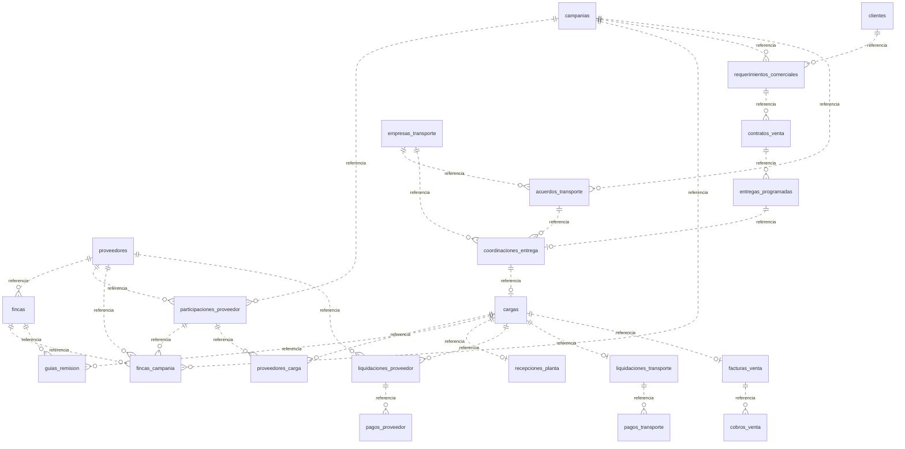

## Bienvenido (Acceso > Selección de perfil)

**Tablas:** `personas`, `roles`, `usuarios`, `archivos`, `sesiones_usuario`.

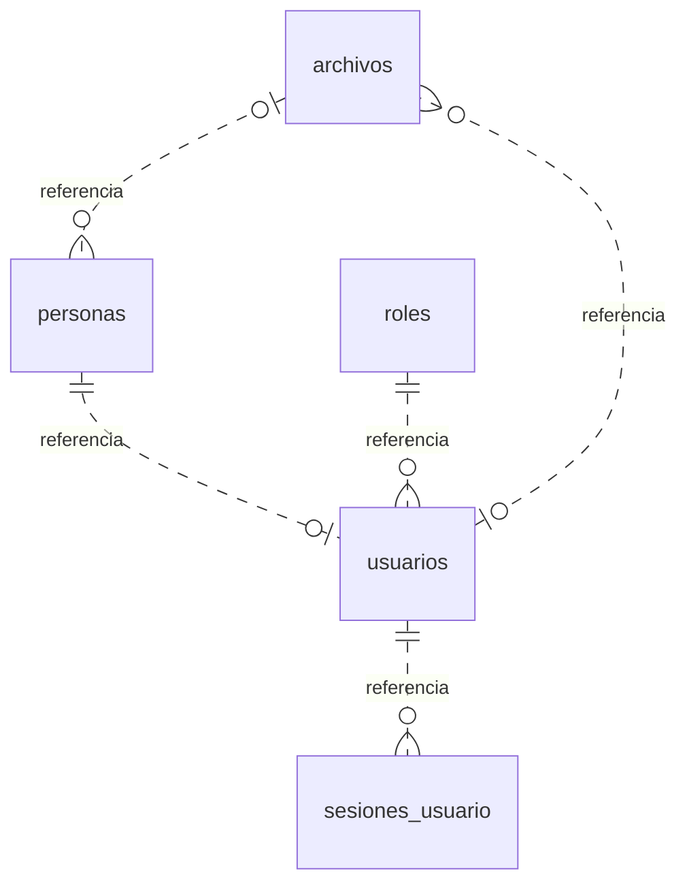


## Módulos del sistema (Administrador > Inicio)

Sin tabla propia: navegación de módulos.

## Gestión Comercial — Clientes (Administrador > Gestión Comercial > Clientes)

**Tablas:** `clientes`, `destinos_cliente`.

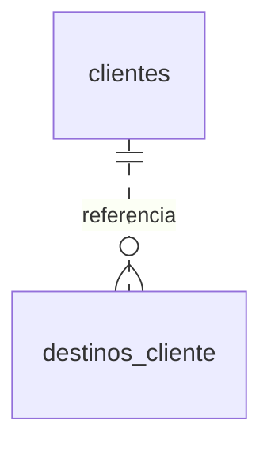


## Detalle de cliente (Administrador > Gestión Comercial > Clientes > Detalle)

**Tablas:** `clientes`, `requerimientos_comerciales`, `contratos_venta`.

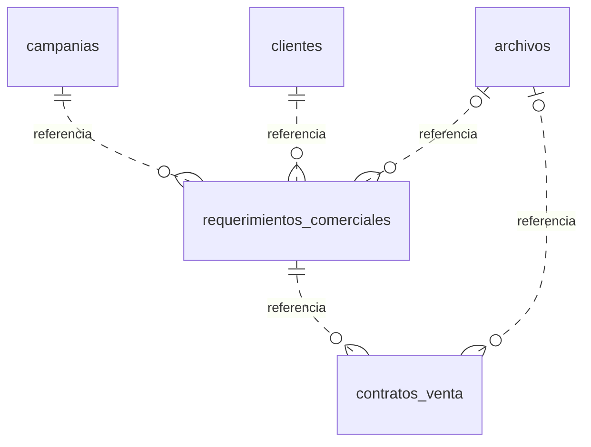


## Contratos — Participaciones comerciales (Administrador > Gestión Comercial > Contratos)

**Tablas:** `requerimientos_comerciales`, `requerimiento_variedades`.

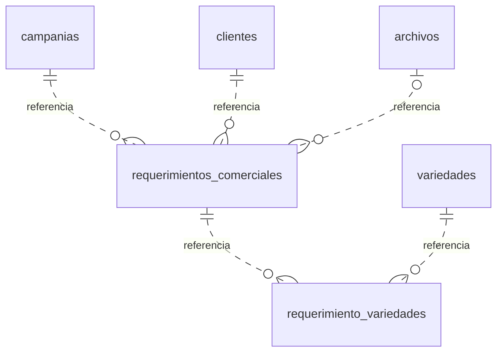


## Consulta cliente–campaña (Administrador > Gestión Comercial > Contratos > Participación)

**Tablas:** `requerimientos_comerciales`, `requerimiento_variedades`, `contratos_venta`, `entregas_programadas`.

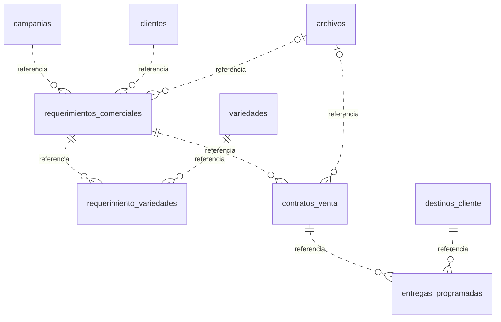


## Contratos del cliente en campaña (Administrador > Gestión Comercial > Contratos > Participación > Contratos)

**Tablas:** `contratos_venta`.

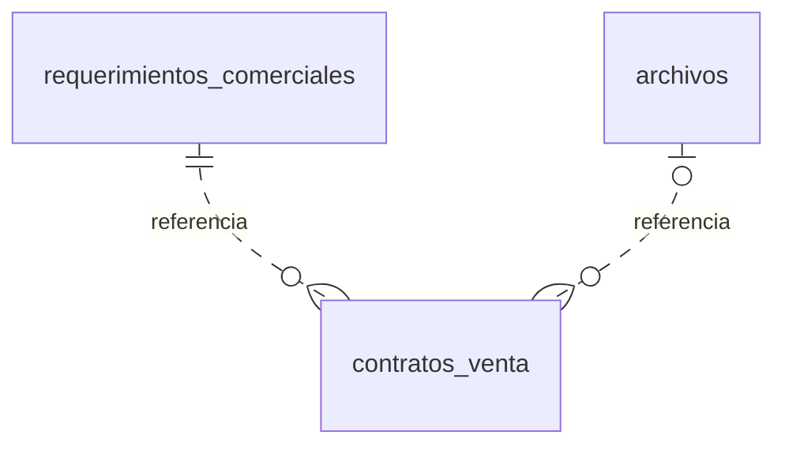


## Entregas programadas (Administrador > Gestión Comercial > Contratos > Contrato > Entregas)

**Tablas:** `entregas_programadas`, `entrega_variedades`.

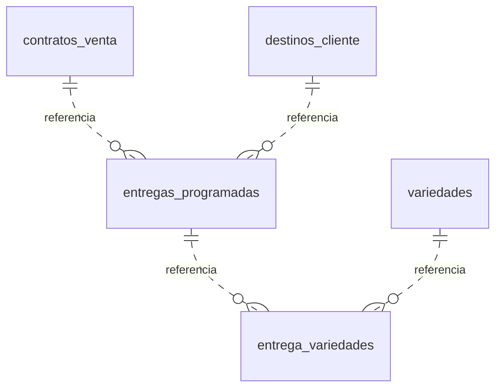


## Gestión de Campaña (Administrador > Gestión de Campaña > Listado)

**Tablas:** `frutas`, `variedades`, `campanias`, `campania_variedades`.

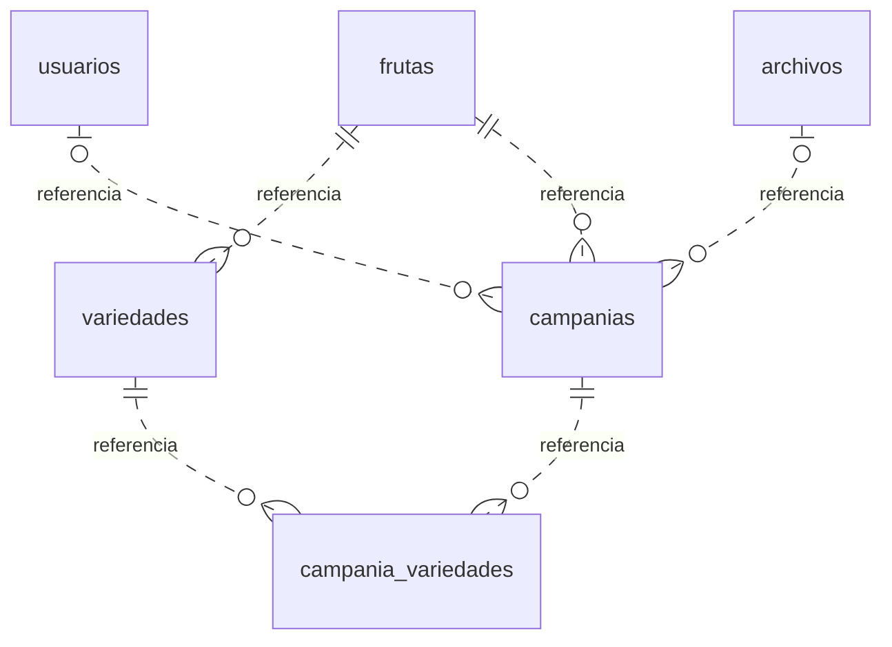


## Datos generales y resumen de campaña (Administrador > Gestión de Campaña > Campaña > Detalle)

**Tablas:** `campanias`, `participaciones_proveedor`, `certificaciones`, `contratos_venta`, `cosechas`, `cargas`.

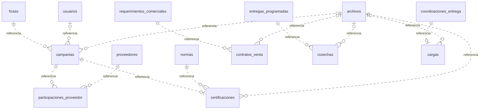


## Proveedores de campaña (Administrador > Gestión de Campaña > Planificado > Campaña > Proveedores)

**Tablas:** `participaciones_proveedor`, `participacion_variedades`, `fincas_campania`.

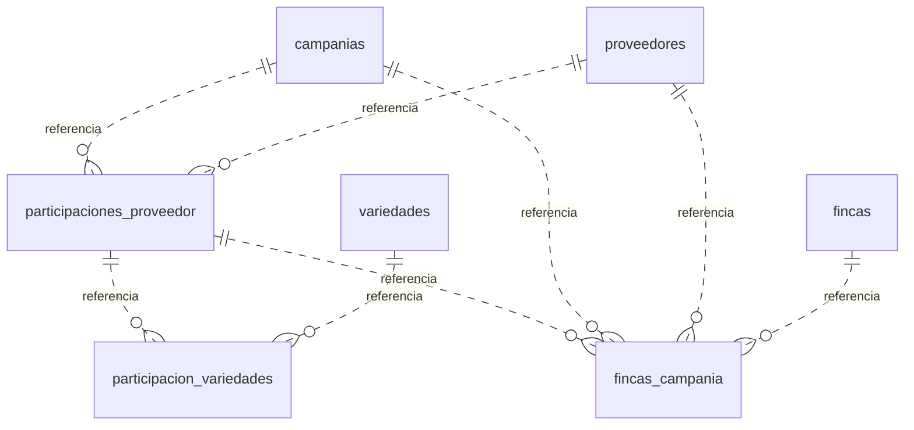


## Entrevista (Administrador > Gestión de Campaña > Planificado > Proveedores > Participación > Entrevista)

**Tablas:** `entrevistas`, `fincas_campania`, `acuerdos_compra`.

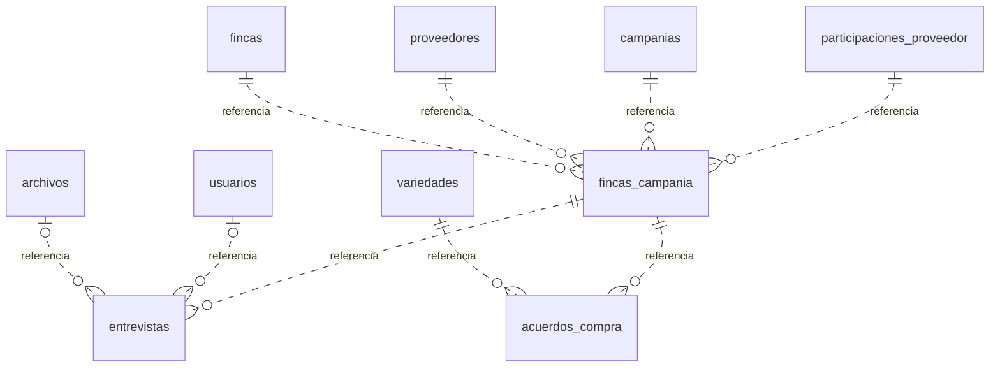


## Exámenes (Administrador > Gestión de Campaña > Planificado > Proveedores > Participación > Exámenes)

**Tablas:** `examenes`.

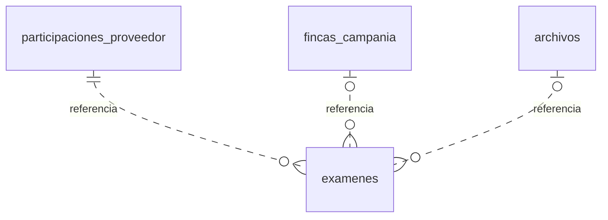


## Certificaciones (Administrador > Gestión de Campaña > Planificado > Campaña > Certificaciones)

**Tablas:** `normas`, `certificaciones`, `certificacion_proveedor`.

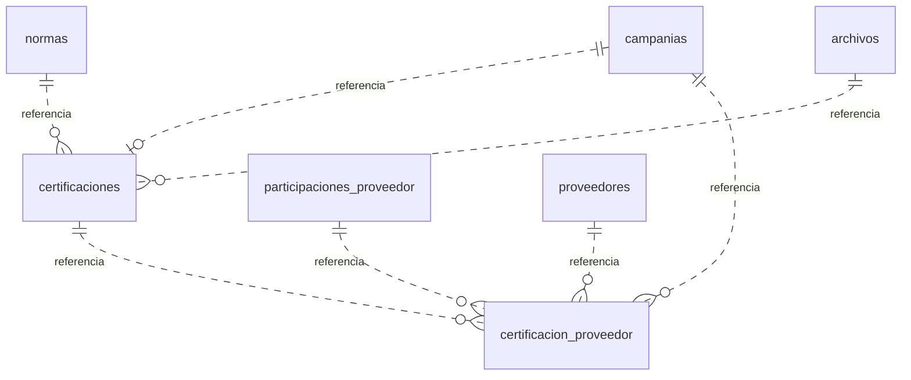


## Ampliación de certificación (Administrador > Gestión de Campaña > Certificaciones > Ampliación)

**Tablas:** `ampliaciones_certificacion`.

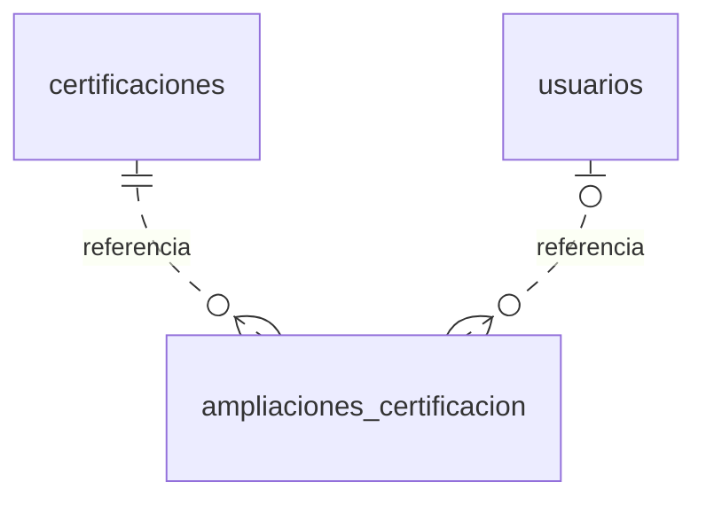


## Pago de certificación (Administrador > Gestión de Campaña > Certificaciones > Pagos)

**Tablas:** `pagos_certificacion`.

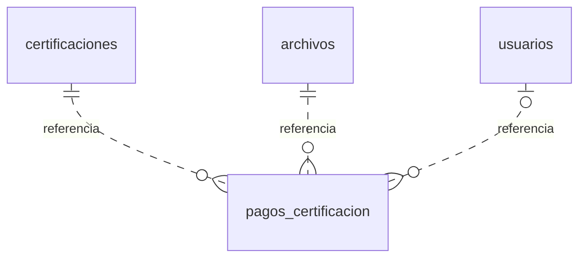


## Transportistas por campaña (Administrador > Gestión de Campaña > En Proceso > Campaña > Transportistas)

**Tablas:** `acuerdos_transporte`.

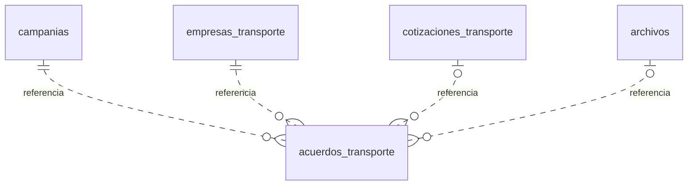


## Entregas de la campaña (Administrador > Gestión de Campaña > En Proceso > Campaña > Entregas)

**Tablas:** `entregas_programadas`, `coordinaciones_entrega`.

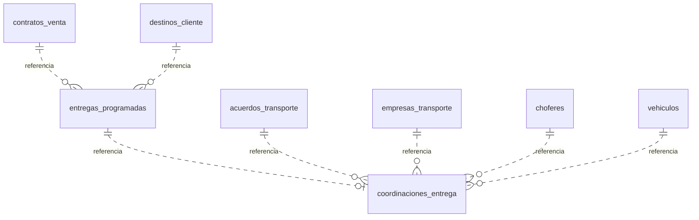


## Completar coordinación de entrega (Administrador > Gestión de Campaña > En Proceso > Entregas > Coordinación)

**Tablas:** `coordinaciones_entrega`, `origenes_entrega`.

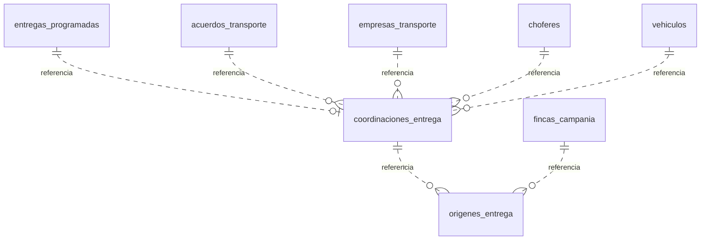


## Programa semanal de entregas (Administrador > Gestión de Campaña > Campaña > Programa semanal de entregas)

**Tablas:** `entregas_programadas`, `entrega_variedades`, `coordinaciones_entrega`.

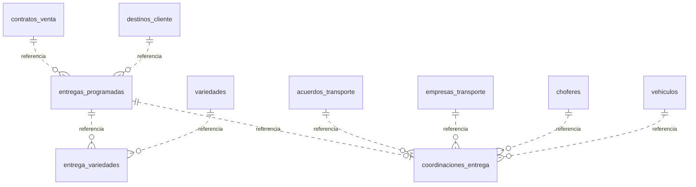


## Gestión de proveedores (Administrador > Gestión de Proveedores > Listado)

**Tablas:** `proveedores`, `personas_proveedor`, `proveedor_frutas`, `proveedor_variedades`.

```mermaid
erDiagram
    personas ||..o| proveedores : referencia
    proveedores ||..o{ personas_proveedor : referencia
    personas ||..o{ personas_proveedor : referencia
    proveedores ||..o{ proveedor_frutas : referencia
    frutas ||..o{ proveedor_frutas : referencia
    proveedores ||..o{ proveedor_variedades : referencia
    variedades ||..o{ proveedor_variedades : referencia
```


## Detalle de proveedor (Administrador > Gestión de Proveedores > Proveedor > Detalle)

**Tablas:** `proveedores`, `personas`, `proveedor_frutas`, `proveedor_variedades`.

```mermaid
erDiagram
    archivos o|..o{ personas : referencia
    personas ||..o| proveedores : referencia
    proveedores ||..o{ proveedor_frutas : referencia
    frutas ||..o{ proveedor_frutas : referencia
    proveedores ||..o{ proveedor_variedades : referencia
    variedades ||..o{ proveedor_variedades : referencia
```


## Fincas (Administrador > Gestión de Proveedores > Proveedor > Fincas)

**Tablas:** `fincas`.

```mermaid
erDiagram
    proveedores ||..o{ fincas : referencia
    variedades o|..o{ fincas : referencia
```


## Certificados del proveedor (Administrador > Gestión de Proveedores > Proveedor > Certificados)

**Tablas:** `certificados_propios`.

```mermaid
erDiagram
    proveedores ||..o{ certificados_propios : referencia
    archivos ||..o{ certificados_propios : referencia
```


## Gestión de transporte (Administrador > Gestión de Transporte > Transportistas)

**Tablas:** `empresas_transporte`.

```mermaid
erDiagram
    personas o|..o{ empresas_transporte : referencia
```


## Ficha del transportista (Administrador > Gestión de Transporte > Transportista > Detalle)

**Tablas:** `empresas_transporte`, `vehiculos`, `choferes`.

```mermaid
erDiagram
    personas o|..o{ empresas_transporte : referencia
    empresas_transporte ||..o{ vehiculos : referencia
    empresas_transporte ||..o{ choferes : referencia
    personas ||..o| choferes : referencia
    usuarios o|..o| choferes : referencia
```


## Vehículos (Administrador > Gestión de Transporte > Transportista > Vehículos)

**Tablas:** `vehiculos`.

```mermaid
erDiagram
    empresas_transporte ||..o{ vehiculos : referencia
```


## Choferes (Administrador > Gestión de Transporte > Transportista > Choferes)

**Tablas:** `choferes`, `personas`, `usuarios`.

```mermaid
erDiagram
    archivos o|..o{ personas : referencia
    personas ||..o| usuarios : referencia
    roles ||..o{ usuarios : referencia
    empresas_transporte ||..o{ choferes : referencia
    personas ||..o| choferes : referencia
    usuarios o|..o| choferes : referencia
```


## Requerimientos y cotizaciones (Administrador > Gestión de Transporte > Requerimientos y cotizaciones)

**Tablas:** `solicitudes_transporte`, `invitaciones_transporte`, `cotizaciones_transporte`.

```mermaid
erDiagram
    campanias ||..o{ solicitudes_transporte : referencia
    archivos o|..o{ solicitudes_transporte : referencia
    solicitudes_transporte ||..o{ invitaciones_transporte : referencia
    empresas_transporte ||..o{ invitaciones_transporte : referencia
    invitaciones_transporte ||..o{ cotizaciones_transporte : referencia
    archivos o|..o{ cotizaciones_transporte : referencia
```


## Solicitar cotización (Administrador > Gestión de Transporte > Requerimientos y cotizaciones > Solicitud)

**Tablas:** `solicitudes_transporte`, `invitaciones_transporte`.

```mermaid
erDiagram
    campanias ||..o{ solicitudes_transporte : referencia
    archivos o|..o{ solicitudes_transporte : referencia
    solicitudes_transporte ||..o{ invitaciones_transporte : referencia
    empresas_transporte ||..o{ invitaciones_transporte : referencia
```


## Cosecha y control de calidad (Administrador > Cosecha y Control de Calidad > Campañas)

**Tablas:** `campanias`, `cosechas`, `contratos_venta`.

```mermaid
erDiagram
    frutas ||..o{ campanias : referencia
    usuarios o|..o{ campanias : referencia
    archivos o|..o{ campanias : referencia
    requerimientos_comerciales ||..o{ contratos_venta : referencia
    archivos o|..o{ contratos_venta : referencia
    entregas_programadas ||..o{ cosechas : referencia
    archivos o|..o{ cosechas : referencia
```


## Resumen de cosecha y calidad (Administrador > Cosecha y Control de Calidad > Campaña > Resumen)

**Tablas:** `campanias`, `cosechas`, `cargas`.

```mermaid
erDiagram
    frutas ||..o{ campanias : referencia
    usuarios o|..o{ campanias : referencia
    archivos o|..o{ campanias : referencia
    entregas_programadas ||..o{ cosechas : referencia
    archivos o|..o{ cosechas : referencia
    coordinaciones_entrega ||..o| cargas : referencia
    archivos o|..o{ cargas : referencia
```


## Análisis y revisión (Administrador > Cosecha y Control de Calidad > Exportador > Campaña > Análisis y revisión)

**Tablas:** `cosechas`, `analisis_calidad`, `mediciones_mtd`.

```mermaid
erDiagram
    entregas_programadas ||..o{ cosechas : referencia
    archivos o|..o{ cosechas : referencia
    cosechas ||..o{ analisis_calidad : referencia
    fincas_campania ||..o{ analisis_calidad : referencia
    archivos o|..o{ analisis_calidad : referencia
    fincas_campania ||..o{ mediciones_mtd : referencia
    archivos ||..o{ mediciones_mtd : referencia
    usuarios o|..o{ mediciones_mtd : referencia
```


## Cargas por entrega (Administrador > Cosecha y Control de Calidad > Campaña > Cargas por entrega)

**Tablas:** `cargas`, `proveedores_carga`, `origenes_carga`, `gastos_carga`.

```mermaid
erDiagram
    coordinaciones_entrega ||..o| cargas : referencia
    archivos o|..o{ cargas : referencia
    cargas ||..o{ proveedores_carga : referencia
    participaciones_proveedor ||..o{ proveedores_carga : referencia
    variedades ||..o{ proveedores_carga : referencia
    proveedores_carga ||..o{ origenes_carga : referencia
    fincas_campania ||..o{ origenes_carga : referencia
    cargas ||..o{ gastos_carga : referencia
```


## Detalle de operación y carga (Administrador > Cosecha y Control de Calidad > Cargas por entrega > Detalle)

**Tablas:** `cosechas`, `cargas`, `analisis_calidad`, `mediciones_mtd`, `coordinaciones_entrega`.

```mermaid
erDiagram
    entregas_programadas ||..o| coordinaciones_entrega : referencia
    acuerdos_transporte ||..o{ coordinaciones_entrega : referencia
    empresas_transporte ||..o{ coordinaciones_entrega : referencia
    choferes ||..o{ coordinaciones_entrega : referencia
    entregas_programadas ||..o{ cosechas : referencia
    archivos o|..o{ cosechas : referencia
    cosechas ||..o{ analisis_calidad : referencia
    fincas_campania ||..o{ analisis_calidad : referencia
    archivos o|..o{ analisis_calidad : referencia
    fincas_campania ||..o{ mediciones_mtd : referencia
    archivos ||..o{ mediciones_mtd : referencia
    usuarios o|..o{ mediciones_mtd : referencia
    coordinaciones_entrega ||..o| cargas : referencia
    archivos o|..o{ cargas : referencia
    vehiculos ||..o{ coordinaciones_entrega : referencia
```


## Guías de remisión (Administrador > Cosecha y Control de Calidad > Campaña > Guías de remisión)

**Tablas:** `guias_remision`, `proveedores_guia`, `normas_guia`.

```mermaid
erDiagram
    cargas ||..o{ guias_remision : referencia
    fincas ||..o{ guias_remision : referencia
    destinos_cliente ||..o{ guias_remision : referencia
    archivos o|..o{ guias_remision : referencia
    guias_remision ||..o{ proveedores_guia : referencia
    cargas ||..o{ proveedores_guia : referencia
    proveedores_carga ||..o{ proveedores_guia : referencia
    guias_remision ||..o{ normas_guia : referencia
    normas ||..o{ normas_guia : referencia
```


## Preparar guía de remisión (Administrador > Cosecha y Control de Calidad > Guías de remisión > Carga > Preparar guía)

**Tablas:** `guias_remision`, `proveedores_guia`, `normas_guia`, `archivos`.

```mermaid
erDiagram
    usuarios o|..o{ archivos : referencia
    cargas ||..o{ guias_remision : referencia
    fincas ||..o{ guias_remision : referencia
    destinos_cliente ||..o{ guias_remision : referencia
    archivos o|..o{ guias_remision : referencia
    guias_remision ||..o{ proveedores_guia : referencia
    cargas ||..o{ proveedores_guia : referencia
    proveedores_carga ||..o{ proveedores_guia : referencia
    guias_remision ||..o{ normas_guia : referencia
    normas ||..o{ normas_guia : referencia
```


## Logística y despacho (Administrador > Logística y Despacho > Campañas)

**Tablas:** `campanias`, `coordinaciones_entrega`, `cargas`, `historial_chofer`.

```mermaid
erDiagram
    frutas ||..o{ campanias : referencia
    usuarios o|..o{ campanias : referencia
    archivos o|..o{ campanias : referencia
    entregas_programadas ||..o| coordinaciones_entrega : referencia
    acuerdos_transporte ||..o{ coordinaciones_entrega : referencia
    empresas_transporte ||..o{ coordinaciones_entrega : referencia
    choferes ||..o{ coordinaciones_entrega : referencia
    coordinaciones_entrega ||..o| cargas : referencia
    archivos o|..o{ cargas : referencia
    coordinaciones_entrega ||..o{ historial_chofer : referencia
    cargas o|..o{ historial_chofer : referencia
    choferes ||..o{ historial_chofer : referencia
    vehiculos ||..o{ coordinaciones_entrega : referencia
```


## Cargas de campaña (Administrador > Logística y Despacho > Campaña > Cargas)

**Tablas:** `cargas`, `coordinaciones_entrega`, `historial_chofer`.

```mermaid
erDiagram
    entregas_programadas ||..o| coordinaciones_entrega : referencia
    acuerdos_transporte ||..o{ coordinaciones_entrega : referencia
    empresas_transporte ||..o{ coordinaciones_entrega : referencia
    choferes ||..o{ coordinaciones_entrega : referencia
    coordinaciones_entrega ||..o| cargas : referencia
    archivos o|..o{ cargas : referencia
    coordinaciones_entrega ||..o{ historial_chofer : referencia
    cargas o|..o{ historial_chofer : referencia
    choferes ||..o{ historial_chofer : referencia
    vehiculos ||..o{ coordinaciones_entrega : referencia
```


## Consulta de entrega (Administrador > Logística y Despacho > Campaña > Cargas > Entrega)

**Tablas:** `historial_chofer`, `recepciones_planta`, `gastos_carga`.

```mermaid
erDiagram
    cargas ||..o{ gastos_carga : referencia
    coordinaciones_entrega ||..o{ historial_chofer : referencia
    cargas o|..o{ historial_chofer : referencia
    choferes ||..o{ historial_chofer : referencia
    cargas ||..o| recepciones_planta : referencia
    choferes ||..o{ recepciones_planta : referencia
    archivos o|..o{ recepciones_planta : referencia
```


## Facturación y cobros — Campañas (Administrador > Facturación y cobros > Campañas)

**Tablas:** `campanias`, `cargas`.

```mermaid
erDiagram
    frutas ||..o{ campanias : referencia
    usuarios o|..o{ campanias : referencia
    archivos o|..o{ campanias : referencia
    coordinaciones_entrega ||..o| cargas : referencia
    archivos o|..o{ cargas : referencia
```


## Clientes de campaña (Administrador > Facturación y cobros > Campaña > Clientes)

**Tablas:** `clientes`, `contratos_venta`, `facturas_venta`, `cobros_venta`.

```mermaid
erDiagram
    facturas_venta ||..o{ cobros_venta : referencia
    requerimientos_comerciales ||..o{ contratos_venta : referencia
    archivos o|..o{ contratos_venta : referencia
    cargas ||..o| facturas_venta : referencia
    archivos o|..o{ facturas_venta : referencia
    archivos ||..o{ cobros_venta : referencia
    usuarios o|..o{ cobros_venta : referencia
    clientes
```


## Cargas registradas del cliente (Administrador > Facturación y cobros > Campaña > Cliente > Cargas)

**Tablas:** `facturas_venta`.

```mermaid
erDiagram
    cargas ||..o| facturas_venta : referencia
    archivos o|..o{ facturas_venta : referencia
```


## Historial de cobros (Administrador > Facturación y cobros > Cliente > Factura > Cobros)

**Tablas:** `cobros_venta`.

```mermaid
erDiagram
    facturas_venta ||..o{ cobros_venta : referencia
    archivos ||..o{ cobros_venta : referencia
    usuarios o|..o{ cobros_venta : referencia
```


## Liquidación de compra — Campañas (Administrador > Liquidación de Compra > Campañas)

**Tablas:** `campanias`, `cargas`, `liquidaciones_proveedor`, `liquidaciones_transporte`.

```mermaid
erDiagram
    frutas ||..o{ campanias : referencia
    usuarios o|..o{ campanias : referencia
    archivos o|..o{ campanias : referencia
    coordinaciones_entrega ||..o| cargas : referencia
    archivos o|..o{ cargas : referencia
    cargas ||..o{ liquidaciones_proveedor : referencia
    proveedores ||..o{ liquidaciones_proveedor : referencia
    usuarios ||..o{ liquidaciones_proveedor : referencia
    archivos o|..o{ liquidaciones_proveedor : referencia
    cargas ||..o| liquidaciones_transporte : referencia
    usuarios ||..o{ liquidaciones_transporte : referencia
    archivos o|..o{ liquidaciones_transporte : referencia
    personas_proveedor ||..o{ liquidaciones_proveedor : referencia
```


## Liquidaciones por carga (Administrador > Liquidación de Compra > Campaña > Cargas)

**Tablas:** `cargas`, `proveedores_carga`, `liquidaciones_proveedor`, `liquidaciones_transporte`.

```mermaid
erDiagram
    coordinaciones_entrega ||..o| cargas : referencia
    archivos o|..o{ cargas : referencia
    cargas ||..o{ proveedores_carga : referencia
    participaciones_proveedor ||..o{ proveedores_carga : referencia
    variedades ||..o{ proveedores_carga : referencia
    cargas ||..o{ liquidaciones_proveedor : referencia
    proveedores ||..o{ liquidaciones_proveedor : referencia
    usuarios ||..o{ liquidaciones_proveedor : referencia
    archivos o|..o{ liquidaciones_proveedor : referencia
    cargas ||..o| liquidaciones_transporte : referencia
    usuarios ||..o{ liquidaciones_transporte : referencia
    archivos o|..o{ liquidaciones_transporte : referencia
    personas_proveedor ||..o{ liquidaciones_proveedor : referencia
```


## Proveedor — Por liquidar, Por pagar y Pagados (Administrador > Liquidación de Compra > Campaña > Carga > Proveedor)

**Tablas:** `liquidaciones_proveedor`, `pagos_proveedor`.

```mermaid
erDiagram
    liquidaciones_proveedor ||..o{ pagos_proveedor : referencia
    cargas ||..o{ liquidaciones_proveedor : referencia
    proveedores ||..o{ liquidaciones_proveedor : referencia
    usuarios ||..o{ liquidaciones_proveedor : referencia
    archivos o|..o{ liquidaciones_proveedor : referencia
    archivos ||..o{ pagos_proveedor : referencia
    usuarios o|..o{ pagos_proveedor : referencia
    personas_proveedor ||..o{ liquidaciones_proveedor : referencia
```


## Liquidación de compra — Documento (Administrador > Liquidación de Compra > Campaña > Carga > Proveedor > Liquidación)

**Tablas:** `liquidaciones_proveedor`, `pagos_proveedor`.

```mermaid
erDiagram
    liquidaciones_proveedor ||..o{ pagos_proveedor : referencia
    cargas ||..o{ liquidaciones_proveedor : referencia
    proveedores ||..o{ liquidaciones_proveedor : referencia
    usuarios ||..o{ liquidaciones_proveedor : referencia
    archivos o|..o{ liquidaciones_proveedor : referencia
    archivos ||..o{ pagos_proveedor : referencia
    usuarios o|..o{ pagos_proveedor : referencia
    personas_proveedor ||..o{ liquidaciones_proveedor : referencia
```


## Control UIT por proveedor (Administrador > Liquidación de Compra > Campaña > Control UIT por proveedor)

**Tablas:** `parametros_uit`, `personas_proveedor`, `liquidaciones_proveedor`.

```mermaid
erDiagram
    proveedores ||..o{ personas_proveedor : referencia
    personas ||..o{ personas_proveedor : referencia
    cargas ||..o{ liquidaciones_proveedor : referencia
    proveedores ||..o{ liquidaciones_proveedor : referencia
    usuarios ||..o{ liquidaciones_proveedor : referencia
    archivos o|..o{ liquidaciones_proveedor : referencia
    personas_proveedor ||..o{ liquidaciones_proveedor : referencia
    parametros_uit
```


## Transportista — Liquidación y pagos (Administrador > Liquidación de Compra > Campaña > Carga > Transportista)

**Tablas:** `liquidaciones_transporte`, `gastos_transporte`, `pagos_transporte`.

```mermaid
erDiagram
    liquidaciones_transporte ||..o{ pagos_transporte : referencia
    cargas ||..o| liquidaciones_transporte : referencia
    usuarios ||..o{ liquidaciones_transporte : referencia
    archivos o|..o{ liquidaciones_transporte : referencia
    cargas ||..o{ gastos_transporte : referencia
    archivos ||..o{ pagos_transporte : referencia
    usuarios o|..o{ pagos_transporte : referencia
```


## Acuerdo de la empresa y saldo de campaña (Administrador > Liquidación de Compra > Transportista > Acuerdo y adelantos)

**Tablas:** `acuerdos_transporte`, `adelantos_transporte`, `aplicaciones_adelanto`.

```mermaid
erDiagram
    campanias ||..o{ acuerdos_transporte : referencia
    empresas_transporte ||..o{ acuerdos_transporte : referencia
    cotizaciones_transporte o|..o{ acuerdos_transporte : referencia
    archivos o|..o{ acuerdos_transporte : referencia
    acuerdos_transporte ||..o{ adelantos_transporte : referencia
    archivos ||..o{ adelantos_transporte : referencia
    adelantos_transporte ||..o{ aplicaciones_adelanto : referencia
    liquidaciones_transporte ||..o{ aplicaciones_adelanto : referencia
```


## Revisar cierre de campaña (Administrador > Gestión de Campaña > Campaña > Cierre)

**Tablas:** `campanias`, `cosechas`, `recepciones_planta`, `facturas_venta`, `liquidaciones_proveedor`, `liquidaciones_transporte`.

```mermaid
erDiagram
    frutas ||..o{ campanias : referencia
    usuarios o|..o{ campanias : referencia
    archivos o|..o{ campanias : referencia
    entregas_programadas ||..o{ cosechas : referencia
    archivos o|..o{ cosechas : referencia
    cargas ||..o| recepciones_planta : referencia
    choferes ||..o{ recepciones_planta : referencia
    archivos o|..o{ recepciones_planta : referencia
    cargas ||..o{ liquidaciones_proveedor : referencia
    proveedores ||..o{ liquidaciones_proveedor : referencia
    usuarios ||..o{ liquidaciones_proveedor : referencia
    archivos o|..o{ liquidaciones_proveedor : referencia
    cargas ||..o| liquidaciones_transporte : referencia
    usuarios ||..o{ liquidaciones_transporte : referencia
    archivos o|..o{ liquidaciones_transporte : referencia
    cargas ||..o| facturas_venta : referencia
    archivos o|..o{ facturas_venta : referencia
    personas_proveedor ||..o{ liquidaciones_proveedor : referencia
```


## Mis campañas (Chofer > Mis campañas)

**Tablas:** `usuarios`, `choferes`, `coordinaciones_entrega`, `campanias`.

```mermaid
erDiagram
    personas ||..o| usuarios : referencia
    roles ||..o{ usuarios : referencia
    frutas ||..o{ campanias : referencia
    usuarios o|..o{ campanias : referencia
    archivos o|..o{ campanias : referencia
    empresas_transporte ||..o{ choferes : referencia
    personas ||..o| choferes : referencia
    usuarios o|..o| choferes : referencia
    entregas_programadas ||..o| coordinaciones_entrega : referencia
    acuerdos_transporte ||..o{ coordinaciones_entrega : referencia
    empresas_transporte ||..o{ coordinaciones_entrega : referencia
    choferes ||..o{ coordinaciones_entrega : referencia
    vehiculos ||..o{ coordinaciones_entrega : referencia
```


## Mis cargas (Chofer > Mis campañas > Campaña > Mis cargas)

**Tablas:** `coordinaciones_entrega`, `origenes_entrega`, `cargas`.

```mermaid
erDiagram
    entregas_programadas ||..o| coordinaciones_entrega : referencia
    acuerdos_transporte ||..o{ coordinaciones_entrega : referencia
    empresas_transporte ||..o{ coordinaciones_entrega : referencia
    choferes ||..o{ coordinaciones_entrega : referencia
    coordinaciones_entrega ||..o{ origenes_entrega : referencia
    fincas_campania ||..o{ origenes_entrega : referencia
    coordinaciones_entrega ||..o| cargas : referencia
    archivos o|..o{ cargas : referencia
    vehiculos ||..o{ coordinaciones_entrega : referencia
```


## Ubicación y ruta de recojo (Chofer > Mis cargas > Carga > Ubicación y ruta de recojo)

**Tablas:** `fincas`, `origenes_entrega`.

```mermaid
erDiagram
    proveedores ||..o{ fincas : referencia
    variedades o|..o{ fincas : referencia
    coordinaciones_entrega ||..o{ origenes_entrega : referencia
    fincas_campania ||..o{ origenes_entrega : referencia
```


## Completar carga (Chofer > Mis cargas > Carga > Completar carga)

**Tablas:** `coordinaciones_entrega`, `cargas`.

```mermaid
erDiagram
    entregas_programadas ||..o| coordinaciones_entrega : referencia
    acuerdos_transporte ||..o{ coordinaciones_entrega : referencia
    empresas_transporte ||..o{ coordinaciones_entrega : referencia
    choferes ||..o{ coordinaciones_entrega : referencia
    coordinaciones_entrega ||..o| cargas : referencia
    archivos o|..o{ cargas : referencia
    vehiculos ||..o{ coordinaciones_entrega : referencia
```


## Registrar datos de carga (Chofer > Mis cargas > Carga > Datos de carga)

**Tablas:** `cargas`, `proveedores_carga`, `origenes_carga`, `gastos_carga`.

```mermaid
erDiagram
    coordinaciones_entrega ||..o| cargas : referencia
    archivos o|..o{ cargas : referencia
    cargas ||..o{ proveedores_carga : referencia
    participaciones_proveedor ||..o{ proveedores_carga : referencia
    variedades ||..o{ proveedores_carga : referencia
    proveedores_carga ||..o{ origenes_carga : referencia
    fincas_campania ||..o{ origenes_carga : referencia
    cargas ||..o{ gastos_carga : referencia
```


## Mi despacho (Chofer > Mis cargas > Carga > Mi despacho)

**Tablas:** `historial_chofer`, `cargas`, `coordinaciones_entrega`.

```mermaid
erDiagram
    entregas_programadas ||..o| coordinaciones_entrega : referencia
    acuerdos_transporte ||..o{ coordinaciones_entrega : referencia
    empresas_transporte ||..o{ coordinaciones_entrega : referencia
    choferes ||..o{ coordinaciones_entrega : referencia
    coordinaciones_entrega ||..o| cargas : referencia
    archivos o|..o{ cargas : referencia
    coordinaciones_entrega ||..o{ historial_chofer : referencia
    cargas o|..o{ historial_chofer : referencia
    choferes ||..o{ historial_chofer : referencia
    vehiculos ||..o{ coordinaciones_entrega : referencia
```


## Registrar recepción (Chofer > Mi despacho > Checklist de entrega > Recepción en planta)

**Tablas:** `recepciones_planta`.

```mermaid
erDiagram
    cargas ||..o| recepciones_planta : referencia
    choferes ||..o{ recepciones_planta : referencia
    archivos o|..o{ recepciones_planta : referencia
```


## Registrar descarte (Chofer > Mi despacho > Checklist de entrega > Descarte informado)

**Tablas:** `recepciones_planta`, `archivos`.

```mermaid
erDiagram
    usuarios o|..o{ archivos : referencia
    cargas ||..o| recepciones_planta : referencia
    choferes ||..o{ recepciones_planta : referencia
    archivos o|..o{ recepciones_planta : referencia
```


## Guía de salida del vehículo (Chofer > Mi despacho > Guía de salida del vehículo)

**Tablas:** `cargas`, `archivos`.

```mermaid
erDiagram
    usuarios o|..o{ archivos : referencia
    coordinaciones_entrega ||..o| cargas : referencia
    archivos o|..o{ cargas : referencia
```


## Cerrar despacho (Chofer > Mi despacho > Cierre)

**Tablas:** `historial_chofer`, `recepciones_planta`, `cargas`.

```mermaid
erDiagram
    coordinaciones_entrega ||..o| cargas : referencia
    archivos o|..o{ cargas : referencia
    coordinaciones_entrega ||..o{ historial_chofer : referencia
    cargas o|..o{ historial_chofer : referencia
    choferes ||..o{ historial_chofer : referencia
    cargas ||..o| recepciones_planta : referencia
    choferes ||..o{ recepciones_planta : referencia
    archivos o|..o{ recepciones_planta : referencia
```
